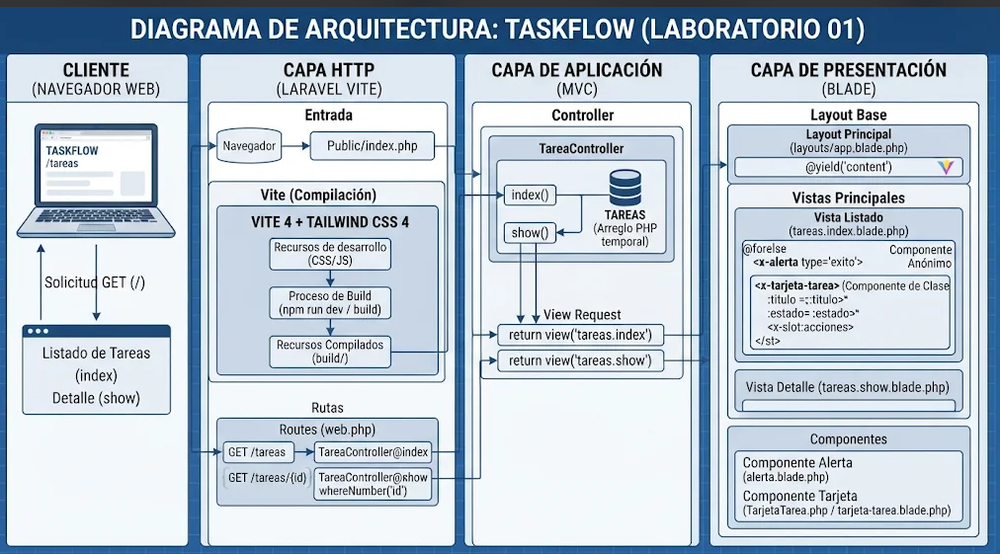

# Laboratorio 01 — Fundamentos de Laravel y desarrollo full-stack

**Curso:** Desarrollo de aplicaciones para ambientes Web Avanzado  
**Capítulo:** 1. Introducción a Laravel (PHP, Python) + Fundamentos Full-Stack  
**Práctica oficial:** 1.7  
**Duración:** 180 minutos (3 horas)  
**Proyecto conductor:** **TaskFlow**, gestor de tareas  
**Entorno de referencia:** terminal Bash en Ubuntu o distribución Linux similar; Visual Studio Code; navegador actualizado  
**Stack:** Laravel 13, PHP 8.3 o superior, Composer 2, Node.js 24 LTS, Vite y Tailwind CSS 4

> **Importante:** Este documento es el laboratorio completo. El alumno **creará los archivos y ejecutará los comandos** siguiendo las instrucciones. No se necesita descargar un proyecto base ni copiar un ZIP. En este primer laboratorio **no se implementan MySQL, Eloquent, autenticación, CRUD persistente ni servicios de IA**. Estos elementos corresponden a capítulos posteriores.

---

## 1. Objetivo y resultado final

Construir una primera versión funcional de **TaskFlow** que muestre dos tareas de ejemplo almacenadas temporalmente en un arreglo PHP, permita navegar desde el listado al detalle de cada tarea, utilice vistas y componentes Blade reutilizables y aplique estilos de Tailwind CSS mediante Vite.

## Diagrama



Al finalizar, el alumno podrá:

- [ ] Identificar las responsabilidades de rutas, controlador y vistas en Laravel.
- [ ] Crear un proyecto Laravel 13 y comprobar sus requisitos.
- [ ] Registrar rutas web con nombres y parámetros.
- [ ] Crear `TareaController` con los métodos `index()` y `show()`.
- [ ] Crear un layout Blade y vistas para listado y detalle.
- [ ] Reutilizar componentes Blade de clase y anónimos, con atributos y slots.
- [ ] Compilar Tailwind CSS 4 utilizando Vite.
- [ ] Ejecutar pruebas automatizadas sin depender de MySQL ni del servidor de Vite.
- [ ] Guardar el avance en una rama Git reutilizable en el laboratorio 2.

### Distribución sugerida de los 180 minutos

| Etapa | Actividad | Minutos |
|---|---|---:|
| 1 | Revisar requisitos e instalar el proyecto | 20 |
| 2 | Configurar `.env`, Git y reconocer estructura | 15 |
| 3 | Configurar y verificar Vite + Tailwind CSS 4 | 25 |
| 4 | Explorar rutas web y crear el controlador | 30 |
| 5 | Crear layout y vistas Blade | 30 |
| 6 | Construir componentes Blade reutilizables | 30 |
| 7 | Probar, validar y resolver errores | 25 |
| 8 | Guardar evidencias y commit final | 5 |
| **Total** | | **180** |

---

## 2. Preparación del entorno

### Paso 0.1 — Verificar herramientas

Abra una terminal de Ubuntu y ejecute, **uno por uno**:

```bash
php -v
composer --version
node -v
npm -v
git --version
```

**Requisitos:**

- PHP **8.3 o posterior**. Para este curso también puede utilizar PHP 8.5 si está instalado y es compatible con las dependencias.
- Composer **2.x**.
- Node.js **24 LTS** recomendado para trabajar con la versión de Vite incluida en Laravel 13.
- npm y Git disponibles.
- Editor recomendado: Visual Studio Code.

Revise las extensiones PHP principales:

```bash
php -m
```

Compruebe que aparecen, entre otras, `openssl`, `pdo`, `mbstring`, `xml`, `ctype`, `fileinfo` y `tokenizer`. Las dependencias exactas también serán validadas por Composer.

**Resultado esperado:** todos los comandos muestran una versión válida. Si alguno indica `command not found`, instale esa herramienta **antes** de continuar.

**No instale Python ni MySQL para esta práctica.** Python puede integrarse como un servicio externo, pero la implementación de IA se reserva para el capítulo 7.

### Paso 0.2 — Preparar la carpeta de trabajo

```bash
mkdir -p ~/labs
cd ~/labs
pwd
```

**Resultado esperado:** la terminal muestra una ruta similar a `/home/usuario/labs`.

---

## 3. Crear y configurar TaskFlow

### Paso 1.1 — Crear un proyecto Laravel 13

Desde `~/labs`, ejecute:

```bash
composer create-project laravel/laravel taskflow "^13.0"
cd taskflow
php artisan --version
```

> Si ya existe `~/labs/taskflow` porque realizó la práctica antes, **no ejecute de nuevo** `create-project` encima de esa carpeta. Entre al proyecto existente y compruebe su estado antes de seguir.

**Resultado esperado:** se crea `~/labs/taskflow`; `php artisan --version` muestra `Laravel Framework 13.x`.

**Verificación:**

```bash
pwd
ls -la
ls app routes resources public tests
```

Identifique las carpetas:

| Carpeta o archivo | Para qué se utiliza |
|---|---|
| `app/Http/Controllers/` | Controladores que responden a solicitudes. |
| `routes/web.php` | Rutas destinadas a la interfaz web. |
| `resources/views/` | Plantillas Blade. |
| `resources/css/app.css` | Estilos que procesará Vite. |
| `resources/js/app.js` | Entrada de JavaScript para Vite. |
| `vite.config.js` | Configuración del proceso de compilación frontend. |
| `.env` | Configuración local; no debe subirse al repositorio. |
| `tests/Feature/` | Pruebas que verifican comportamiento HTTP. |

**Nota:** la instalación predeterminada de Laravel puede traer configuración o un archivo SQLite. **No lo utilizaremos** en este laboratorio: nuestros datos se definirán en arreglos PHP.

### Paso 1.2 — Preparar la configuración local sin base de datos

Compruebe si existe `.env`:

```bash
ls -la .env .env.example
```

Si **no existe** `.env`, cópielo del ejemplo:

```bash
cp .env.example .env
```

Abra `.env` con VS Code:

```bash
code .env
```

Verifique o ajuste **únicamente** estas claves; conserve las demás variables generadas por Laravel:

```dotenv
APP_NAME=TaskFlow
APP_ENV=local
APP_DEBUG=true
APP_URL=http://127.0.0.1:8000

SESSION_DRIVER=file
CACHE_STORE=file
QUEUE_CONNECTION=sync
```

**Qué significa:** las sesiones y la caché se guardarán en archivos, no en una tabla MySQL; las tareas de este laboratorio estarán en un arreglo del controlador.

Si `APP_KEY` está vacía, genere una clave segura:

```bash
php artisan key:generate
```

Limpie la configuración cargada previamente:

```bash
php artisan config:clear
```

**No invente `APP_KEY`. No coloque credenciales MySQL. No ejecute `php artisan migrate` en el laboratorio 1.**

### Paso 1.3 — Preparar una rama Git

Desde la raíz `~/labs/taskflow`, ejecute:

```bash
git init
git switch -c lab-01-fundamentos
git branch --show-current
git status --short
```

Si la rama `lab-01-fundamentos` ya existe, utilice `git switch lab-01-fundamentos` en lugar de crearla otra vez.

**Resultado esperado:** la rama activa se llama `lab-01-fundamentos`.

Compruebe que los archivos sensibles y dependencias estén ignorados por Git:

```bash
git check-ignore .env
git check-ignore node_modules
```

**Resultado esperado:** aparecen `.env` y `node_modules` como rutas ignoradas. Si no sucede, revise `.gitignore` **antes** de hacer el commit.

---

## 4. Integrar Tailwind CSS 4 con Vite

### Paso 2.1 — Instalar las dependencias frontend declaradas por Laravel 13

```bash
npm install
npm ls vite laravel-vite-plugin tailwindcss @tailwindcss/vite --depth=0
```

El esqueleto actual de Laravel 13 normalmente **ya incluye** Vite, Tailwind CSS 4 y el plugin de Tailwind. Si ambos paquetes de Tailwind están instalados, **no los reinstale**.

**Solo si falta** `tailwindcss` o `@tailwindcss/vite`:

```bash
npm install --save-dev "tailwindcss@^4" "@tailwindcss/vite@^4"
```

> No fije Vite en `6.0.5` ni instale versiones alfa de Tailwind: el esqueleto Laravel 13 utiliza versiones más recientes y compatibles. Mantenga las versiones que resuelva `npm install` a partir de `package.json` y `package-lock.json`.

### Paso 2.2 — Revisar `vite.config.js`

Abra `vite.config.js`:

```bash
code vite.config.js
```

Compruebe que se utiliza el plugin de Laravel y el de Tailwind. Si su archivo ya tiene la misma configuración funcional, **consérvelo**; si falta la integración, déjelo así:

```javascript
// Archivo: vite.config.js
import { defineConfig } from 'vite';
import laravel from 'laravel-vite-plugin';
import tailwindcss from '@tailwindcss/vite';

export default defineConfig({
    plugins: [
        laravel({
            input: ['resources/css/app.css', 'resources/js/app.js'],
            refresh: true,
        }),
        tailwindcss(),
    ],
});
```

**Verificación:** las entradas `resources/css/app.css` y `resources/js/app.js` deben existir.

```bash
ls resources/css/app.css resources/js/app.js
```

Si falta `resources/js/app.js`, créelo desde VS Code con contenido mínimo válido:

```javascript
// Archivo: resources/js/app.js
console.log('TaskFlow: frontend cargado');
```

### Paso 2.3 — Configurar los estilos

Abra `resources/css/app.css` y compruebe que contenga esta importación de Tailwind CSS 4:

```css
/* Archivo: resources/css/app.css */
@import "tailwindcss";
```

Para este laboratorio basta con esa importación; no se necesitan `tailwind.config.js`, `postcss.config.js` ni directivas antiguas como `@tailwind base`.

**Si el CSS generado contiene otras reglas útiles de Laravel, no hace falta borrarlas:** únicamente garantice que la importación y el plugin de Tailwind estén correctamente configurados.

### Paso 2.4 — Comprobar la compilación

```bash
npm run build
```

**Resultado esperado:** Vite finaliza sin errores y genera los recursos compilados bajo `public/build/`.

```bash
ls public/build/manifest.json
```

Si el archivo existe, la compilación fue correcta. Todavía no es necesario iniciar el navegador.

---

## 5. Primer contacto con las rutas web

### Paso 3.1 — Crear dos rutas de exploración temporales

Abra `routes/web.php` y, **solo para comprobar la sintaxis de rutas**, deje este contenido:

```php
<?php
// Archivo: routes/web.php (versión temporal de exploración)

use Illuminate\Support\Facades\Route;

Route::get('/', fn () => 'TaskFlow está funcionando');

Route::get('/saludo', fn () => 'Hola desde Laravel 13');

Route::get('/tareas/ejemplo/{id}', function (int $id) {
    return "Tarea de prueba #{$id}";
})->whereNumber('id');
```

**Observe:** `Route::get()` registra una petición GET; `{id}` recibe el parámetro; `whereNumber('id')` acepta únicamente identificadores numéricos.

### Paso 3.2 — Verificar las rutas desde Artisan

```bash
php artisan route:list
```

**Resultado esperado:** deben aparecer las rutas `/`, `/saludo` y `/tareas/ejemplo/{id}` con método GET/HEAD.

Abra una **terminal 1**, desde `~/labs/taskflow`:

```bash
php artisan serve --host=127.0.0.1 --port=8000
```

En su navegador visite:

- `http://127.0.0.1:8000/`
- `http://127.0.0.1:8000/saludo`
- `http://127.0.0.1:8000/tareas/ejemplo/2`
- `http://127.0.0.1:8000/tareas/ejemplo/abc`

**Resultado esperado:** las tres primeras URL devuelven texto; la última devuelve HTTP **404** porque `abc` no es numérico.

> **Estas rutas son temporales.** En el paso 4.2 reemplazará `routes/web.php` por las rutas definitivas de TaskFlow. No mezcle ambos listados de rutas.

---

## 6. Crear el controlador y las vistas Blade

### Paso 4.1 — Generar `TareaController`

En otra terminal, desde el directorio del proyecto:

```bash
php artisan make:controller TareaController
```

Abra `app/Http/Controllers/TareaController.php` y reemplace su contenido por:

```php
<?php
// Archivo: app/Http/Controllers/TareaController.php

namespace App\Http\Controllers;

use Illuminate\View\View;

class TareaController extends Controller
{
    // Datos temporales: en el laboratorio 2 se reemplazarán por Eloquent.
    private const TAREAS = [
        1 => [
            'id' => 1,
            'titulo' => 'Preparar informe',
            'descripcion' => 'Redactar propuesta.',
            'estado' => 'Pendiente',
        ],
        2 => [
            'id' => 2,
            'titulo' => 'Revisar UI',
            'descripcion' => 'Validar pantallas Blade.',
            'estado' => 'En progreso',
        ],
    ];

    public function index(): View
    {
        $tareas = array_values(self::TAREAS);

        return view('tareas.index', compact('tareas'));
    }

    public function show(int $id): View
    {
        $tarea = self::TAREAS[$id] ?? null;

        abort_if($tarea === null, 404);

        return view('tareas.show', compact('tarea'));
    }
}
```

**Qué debe comprender:**

- `index()` prepara la lista de tareas para la vista `tareas.index`.
- `show()` busca una tarea mediante su identificador y devuelve `404` cuando no existe.
- `view()` envía variables al motor Blade.
- El arreglo no se guarda en una base de datos: los cambios persistentes llegarán en el laboratorio 2.

**Verificación de sintaxis PHP:**

```bash
php -l app/Http/Controllers/TareaController.php
```

Debe indicar `No syntax errors detected`.

### Paso 4.2 — Definir las rutas definitivas de TaskFlow

**Reemplace por completo** el ejemplo temporal de `routes/web.php` por:

```php
<?php
// Archivo: routes/web.php (versión definitiva del laboratorio)

use App\Http\Controllers\TareaController;
use Illuminate\Support\Facades\Route;

// La raíz también presenta el listado, para facilitar la navegación.
Route::get('/', [TareaController::class, 'index']);

Route::get('/tareas', [TareaController::class, 'index'])
    ->name('tareas.index');

Route::get('/tareas/{id}', [TareaController::class, 'show'])
    ->whereNumber('id')
    ->name('tareas.show');
```

Compruebe las rutas:

```bash
php artisan route:list --path=tareas
```

**Resultado esperado:** aparecen `/tareas` y `/tareas/{id}`. Las rutas `/saludo` y `/tareas/ejemplo/{id}` ya no deben aparecer.

### Paso 4.3 — Crear las carpetas de vistas

```bash
mkdir -p resources/views/layouts
mkdir -p resources/views/tareas
mkdir -p resources/views/components
```

### Paso 4.4 — Crear el layout maestro

Cree `resources/views/layouts/app.blade.php` con este contenido completo:

```blade
{{-- Archivo: resources/views/layouts/app.blade.php --}}
<!DOCTYPE html>
<html lang="es">
<head>
    <meta charset="UTF-8">
    <meta name="viewport" content="width=device-width, initial-scale=1.0">
    <title>@yield('title', 'TaskFlow')</title>
    @vite(['resources/css/app.css', 'resources/js/app.js'])
</head>
<body class="min-h-screen bg-slate-50 text-slate-900">
    <header class="border-b border-slate-200 bg-white">
        <div class="mx-auto flex max-w-4xl items-center justify-between p-6">
            <a href="{{ route('tareas.index') }}"
               class="text-xl font-bold text-blue-900">TaskFlow</a>
            <span class="text-sm text-slate-500">Laboratorio 01</span>
        </div>
    </header>

    <main class="mx-auto max-w-4xl p-6">
        @yield('content')
    </main>
</body>
</html>
```

**Conceptos:** `@yield` define áreas reemplazables y `@vite` carga los archivos frontend procesados por Vite.

### Paso 4.5 — Crear la vista inicial del listado

Cree `resources/views/tareas/index.blade.php`:

```blade
{{-- Archivo: resources/views/tareas/index.blade.php --}}
@extends('layouts.app')

@section('title', 'Mis tareas - TaskFlow')

@section('content')
    <h1 class="mb-6 text-3xl font-bold text-blue-900">Mis tareas</h1>

    <div class="grid gap-4 md:grid-cols-2">
        @forelse ($tareas as $tarea)
            <article class="rounded-xl border border-slate-200 bg-white p-5 shadow-sm">
                <h2 class="text-lg font-semibold">{{ $tarea['titulo'] }}</h2>
                <p class="mt-2 text-sm text-slate-600">{{ $tarea['estado'] }}</p>
                <a class="mt-4 inline-block text-blue-700 underline"
                   href="{{ route('tareas.show', $tarea['id']) }}">
                    Ver detalle
                </a>
            </article>
        @empty
            <p class="text-slate-600">No hay tareas registradas.</p>
        @endforelse
    </div>
@endsection
```

**Conceptos:** `@extends` reutiliza el layout; `@section` llena su contenido; `@forelse` muestra registros o un estado vacío; `{{ }}` escapa texto HTML.

### Paso 4.6 — Crear la vista de detalle

Cree `resources/views/tareas/show.blade.php`:

```blade
{{-- Archivo: resources/views/tareas/show.blade.php --}}
@extends('layouts.app')

@section('title', 'Detalle de tarea - TaskFlow')

@section('content')
    <article class="rounded-xl border border-slate-200 bg-white p-6 shadow-sm">
        <a href="{{ route('tareas.index') }}" class="text-blue-700 underline">
            Volver a tareas
        </a>

        <h1 class="mt-4 text-2xl font-bold">{{ $tarea['titulo'] }}</h1>
        <p class="mt-4 text-slate-700">{{ $tarea['descripcion'] }}</p>
        <p class="mt-3 text-sm font-medium">
            Estado: {{ $tarea['estado'] }}
        </p>
    </article>
@endsection
```

**Verificación parcial en navegador:** con `php artisan serve` activo, abra `http://127.0.0.1:8000/tareas`. Debe ver dos tarjetas. Seleccione **Ver detalle** en cada una; compruebe que las URL `/tareas/1` y `/tareas/2` muestran datos diferentes.

Pruebe también `http://127.0.0.1:8000/tareas/999`: debe mostrar **404**, no un error 500.

---

## 7. Reutilizar componentes Blade

### Paso 5.1 — Crear el componente de clase `TarjetaTarea`

```bash
php artisan make:component TarjetaTarea
```

Este comando debe generar:

- `app/View/Components/TarjetaTarea.php`
- `resources/views/components/tarjeta-tarea.blade.php`

Abra `app/View/Components/TarjetaTarea.php` y **reemplace el archivo completo**:

```php
<?php
// Archivo: app/View/Components/TarjetaTarea.php

namespace App\View\Components;

use Illuminate\View\Component;
use Illuminate\View\View;

class TarjetaTarea extends Component
{
    public function __construct(
        public string $titulo,
        public string $estado = 'Pendiente',
        public string $descripcion = '',
    ) {
    }

    public function colorEstado(): string
    {
        return match ($this->estado) {
            'Completada' => 'bg-green-100 text-green-800',
            'En progreso' => 'bg-blue-100 text-blue-800',
            default => 'bg-amber-100 text-amber-800',
        };
    }

    public function render(): View
    {
        return view('components.tarjeta-tarea');
    }
}
```

**Qué debe comprender:** el componente encapsula la presentación de una tarea. La función `colorEstado()` decide las clases CSS a partir del estado; los datos reales siguen proviniendo del controlador.

### Paso 5.2 — Crear la vista del componente de clase

Reemplace `resources/views/components/tarjeta-tarea.blade.php` por:

```blade
{{-- Archivo: resources/views/components/tarjeta-tarea.blade.php --}}
<article {{ $attributes->class([
    'flex flex-col justify-between rounded-xl border border-slate-200 bg-white p-5 shadow-sm'
]) }}>
    <div>
        <h2 class="text-lg font-bold">{{ $titulo }}</h2>

        <span class="mt-3 inline-block rounded px-2 py-1 text-xs {{ $colorEstado() }}">
            {{ $estado }}
        </span>

        <p class="mt-3 text-sm text-slate-700">{{ $descripcion }}</p>
    </div>

    @isset($acciones)
        <div class="mt-4 border-t border-slate-100 pt-3">
            {{ $acciones }}
        </div>
    @endisset
</article>
```

**Conceptos:** `$attributes->class(...)` reúne las clases base y las clases externas; `$colorEstado()` invoca el método público del componente; `$acciones` es un **slot con nombre**.

### Paso 5.3 — Crear el componente anónimo `alerta`

En VS Code cree **manualmente** `resources/views/components/alerta.blade.php` con el siguiente contenido:

```blade
{{-- Archivo: resources/views/components/alerta.blade.php --}}
@props(['tipo' => 'info'])

@php
    $estilos = match ($tipo) {
        'exito' => 'border-green-500 bg-green-50 text-green-800',
        'error' => 'border-red-500 bg-red-50 text-red-800',
        default => 'border-blue-500 bg-blue-50 text-blue-800',
    };
@endphp

<div {{ $attributes->merge([
    'class' => "rounded border-l-4 p-4 {$estilos}",
]) }} role="alert">
    {{ $slot }}
</div>
```

**Conceptos:** `@props` define los parámetros de un componente anónimo; `$slot` representa el contenido entre las etiquetas `<x-alerta>...</x-alerta>`; `merge()` concatena clases y **no elimina automáticamente clases Tailwind contradictorias**.

### Paso 5.4 — Actualizar el listado para utilizar componentes

**Reemplace por completo** `resources/views/tareas/index.blade.php` (la versión del paso 4.5 ya no será necesaria) por este contenido definitivo:

```blade
{{-- Archivo: resources/views/tareas/index.blade.php --}}
@extends('layouts.app')

@section('title', 'Mis tareas - TaskFlow')

@section('content')
    <h1 class="mb-6 text-3xl font-bold text-blue-900">Mis tareas</h1>

    <x-alerta tipo="exito" class="mb-6">
        TaskFlow está listo. Los datos de este laboratorio son temporales.
    </x-alerta>

    <div class="grid gap-4 md:grid-cols-2">
        @forelse ($tareas as $tarea)
            <x-tarjeta-tarea
                :titulo="$tarea['titulo']"
                :estado="$tarea['estado']"
                :descripcion="$tarea['descripcion']">

                <x-slot:acciones>
                    <a class="text-blue-700 underline"
                       href="{{ route('tareas.show', $tarea['id']) }}">
                        Ver tarea
                    </a>
                </x-slot:acciones>
            </x-tarjeta-tarea>
        @empty
            <p class="text-slate-600">No hay tareas registradas.</p>
        @endforelse
    </div>
@endsection
```

**Verificación:** recargue `/tareas`. Deben aparecer una alerta, dos tarjetas con estados de diferente color y un enlace funcional por tarjeta. No debe aparecer el código Blade en la pantalla.

### Paso 5.5 — Comprobar sintaxis y compilación de vistas

```bash
php -l app/Http/Controllers/TareaController.php
php -l app/View/Components/TarjetaTarea.php
php -l routes/web.php
php artisan view:clear
php artisan view:cache
npm run build
```

**Resultado esperado:** los tres archivos PHP pasan la comprobación de sintaxis y las vistas Blade se compilan sin errores. `npm run build` debe terminar correctamente.

> `php -l` comprueba **sintaxis**, no comportamiento. Las rutas, la navegación y las vistas se verificarán con pruebas HTTP en la siguiente sección.

---

## 8. Validación automática y pruebas en navegador

### Paso 6.1 — Crear una prueba funcional

```bash
php artisan make:test TareaViewTest
```

Abra `tests/Feature/TareaViewTest.php` y reemplace su contenido por este código:

```php
<?php
// Archivo: tests/Feature/TareaViewTest.php

namespace Tests\Feature;

use Tests\TestCase;

class TareaViewTest extends TestCase
{
    protected function setUp(): void
    {
        parent::setUp();

        // Evita exigir un servidor Vite activo o un manifest durante PHPUnit.
        $this->withoutVite();
    }

    public function test_el_listado_muestra_las_dos_tareas(): void
    {
        $response = $this->get('/tareas');

        $response->assertOk();
        $response->assertViewIs('tareas.index');
        $response->assertViewHas('tareas');
        $response->assertSee('Preparar informe');
        $response->assertSee('Revisar UI');
        $response->assertSee('Ver tarea');
    }

    public function test_la_raiz_muestra_el_listado(): void
    {
        $this->get('/')->assertOk();
    }

    public function test_el_detalle_muestra_una_tarea(): void
    {
        $response = $this->get('/tareas/1');

        $response->assertOk();
        $response->assertViewIs('tareas.show');
        $response->assertSee('Preparar informe');
        $response->assertSee('Redactar propuesta.');
    }

    public function test_una_tarea_inexistente_devuelve_404(): void
    {
        $this->get('/tareas/999')->assertNotFound();
    }

    public function test_blade_escapa_html_peligroso_en_la_vista_real(): void
    {
        $tarea = [
            'id' => 3,
            'titulo' => '<script>alert(1)</script>',
            'descripcion' => 'Texto de prueba',
            'estado' => 'Pendiente',
        ];

        $html = view('tareas.show', compact('tarea'))->render();

        $this->assertStringContainsString(
            '&lt;script&gt;alert(1)&lt;/script&gt;',
            $html
        );
        $this->assertStringNotContainsString(
            '<script>alert(1)</script>',
            $html
        );
    }
}
```

**Por qué es importante:** la última prueba verifica el **HTML generado por una vista Blade real**. No se limita a probar la función `e()` de forma aislada.

### Paso 6.2 — Ejecutar la prueba

```bash
php artisan test --filter=TareaViewTest
```

**Resultado esperado:** **5 pruebas aprobadas**. El número de *assertions* dependerá de la versión de PHPUnit y de las comprobaciones internas; no es necesario que coincida con una captura exacta.

Después, si lo desea, ejecute la suite general:

```bash
php artisan test
```

Si falla alguna prueba, **lea primero el archivo y la línea que indica PHPUnit**. No continúe con el siguiente laboratorio sin corregir la causa.

### Paso 6.3 — Ejecutar el sistema completo en el navegador

Abra dos terminales **desde `~/labs/taskflow`**.

**Terminal A — Backend:**

```bash
php artisan serve --host=127.0.0.1 --port=8000
```

**Terminal B — Frontend:**

```bash
npm run dev
```

Entre a `http://127.0.0.1:8000/tareas` y realice estas verificaciones:

| Prueba manual | Resultado esperado |
|---|---|
| Abrir `/tareas` | Dos tarjetas visibles y una alerta. |
| Seleccionar **Ver tarea** en la primera | Se abre `/tareas/1` con su descripción. |
| Seleccionar **Volver a tareas** | Regresa a `/tareas`. |
| Abrir `/tareas/2` | Muestra la segunda tarea. |
| Abrir `/tareas/999` | Devuelve una respuesta HTTP 404. |
| Reducir el ancho del navegador | Las dos columnas pasan a una sola columna. |
| Revisar el estilo del estado | `Pendiente` y `En progreso` tienen colores diferentes. |

**Comprobación opcional desde terminal:**

```bash
curl -I http://127.0.0.1:8000/tareas
curl -I http://127.0.0.1:8000/tareas/999
```

Debe ver `200 OK` en la primera y `404 Not Found` en la segunda (además de las cabeceras HTTP).

---

## 9. Solución de problemas frecuentes

### Problema A — Composer no puede instalar Laravel 13

**Síntoma:** conflicto de versión de PHP o falta de extensiones.

**Acciones:**

```bash
php -v
php -m
composer diagnose
```

Confirme PHP 8.3+ y corrija las extensiones que Composer indique. No cambie arbitrariamente a Laravel 11 o 12: el curso utiliza Laravel 13.

### Problema B — `npm install` muestra un error `EBADENGINE`

**Causa probable:** Node.js no satisface los requisitos de la versión de Vite instalada.

```bash
node -v
npm -v
npm ls vite --depth=0
```

Utilice Node.js 24 LTS. Después, desde el proyecto, vuelva a ejecutar `npm install`. No fuerce Vite 6 como solución.

### Problema C — `Vite manifest not found`

**Causa habitual:** Laravel intenta cargar assets sin que Vite esté activo ni exista una compilación estática.

**Soluciones alternativas:**

```bash
# Desarrollo: ejecute en otra terminal
npm run dev

# O genere archivos estáticos
npm run build
```

En pruebas automatizadas, la clase `TareaViewTest` ya utiliza `$this->withoutVite()`.

### Problema D — `View [tareas.index] not found`

Revise las carpetas y nombres exactos:

```bash
ls resources/views/tareas
ls resources/views/layouts
```

Deben existir `index.blade.php`, `show.blade.php` y `app.blade.php`. Linux diferencia mayúsculas y minúsculas.

### Problema E — `Route [tareas.show] not defined`

```bash
php artisan route:list --path=tareas
php artisan route:clear
```

Compruebe que la ruta del detalle termine en `->name('tareas.show')`. No use rutas antiguas `tasks.show` del laboratorio original.

### Problema F — El componente `<x-tarjeta-tarea>` falla

```bash
ls app/View/Components/TarjetaTarea.php
ls resources/views/components/tarjeta-tarea.blade.php
php -l app/View/Components/TarjetaTarea.php
php artisan view:clear
```

Verifique que la clase se llame `TarjetaTarea`, su método sea `colorEstado()` y la etiqueta Blade sea `<x-tarjeta-tarea>`.

### Problema G — `No application encryption key has been specified`

```bash
php artisan key:generate
php artisan config:clear
```

No escriba una clave ficticia en `.env`.

### Problema H — La interfaz aparece sin estilos

Verifique que `vite.config.js` importa `@tailwindcss/vite`, que `resources/css/app.css` contiene `@import "tailwindcss";` y que el layout incluye `@vite(['resources/css/app.css', 'resources/js/app.js'])`.

```bash
npm run build
php artisan view:clear
```

Si utiliza `npm run dev`, manténgalo activo mientras navega por la aplicación.

---

## 10. Evidencias y cierre del laboratorio

### Paso 7.1 — Preparar las evidencias

El alumno entregará o mostrará al instructor:

1. Captura de `php artisan --version` con Laravel 13.x.
2. Captura de `php artisan route:list --path=tareas`.
3. Captura del listado de TaskFlow con **dos tarjetas y la alerta**.
4. Captura del detalle de la tarea `/tareas/1`.
5. Captura de la salida de `php artisan test --filter=TareaViewTest` con **cinco pruebas aprobadas**.
6. Captura del resultado correcto de `npm run build`.
7. Evidencia de la rama y el commit de Git.

> Las capturas son evidencias de trabajo del alumno: **no hay que generarlas como archivos dentro del proyecto**. Utilice el mecanismo de entrega que indique el instructor.

### Paso 7.2 — Verificar y guardar en Git

Detenga `php artisan serve` y `npm run dev` con `Ctrl + C` cuando haya terminado de probar. Regrese a la raíz del proyecto y ejecute:

```bash
git status --short
git check-ignore .env
git check-ignore node_modules
```

Si los archivos sensibles están correctamente ignorados:

```bash
git add .
git commit -m "lab01: fundamentos TaskFlow con Laravel Blade y Tailwind"
git log -1 --oneline
```

> Si Git solicita nombre o correo del autor, configure la identidad siguiendo la política de su institución y repita el commit. No agregue `.env`, `vendor/` ni `node_modules/` al control de versiones.

**No borre la carpeta `taskflow` ni sus archivos.** Este mismo proyecto será el punto de partida del laboratorio 2, donde las tareas dejarán de ser arreglos y pasarán a modelos Eloquent con MySQL.

### Lista de comprobación final

- [ ] Laravel 13 ejecuta TaskFlow correctamente.
- [ ] El controlador `TareaController` tiene `index()` y `show()`.
- [ ] Existen las rutas `tareas.index` y `tareas.show`.
- [ ] El listado y el detalle muestran las tareas correctas.
- [ ] La vista usa componentes `<x-tarjeta-tarea>` y `<x-alerta>`.
- [ ] Tailwind CSS 4 se compila con Vite.
- [ ] Los cinco tests de `TareaViewTest` pasan.
- [ ] Los archivos están respaldados con un commit Git.
- [ ] No se utilizaron MySQL, servicios de IA ni datos persistentes.

---

## 11. Qué se construirá en el laboratorio 2

En el capítulo 2 se **continuará este mismo proyecto**, sin instalar otro Laravel:

- Se configurará MySQL y se comprobará la conexión.
- Se crearán las tablas `tareas` y `categorias` mediante migraciones.
- Se añadirá el modelo Eloquent `Tarea` y se reemplazará el arreglo `TAREAS` del controlador.
- Se conservarán las rutas, vistas y componentes que ya funcionan.
- Se agregarán las operaciones crear, actualizar y eliminar, junto con validación, paginación y ordenamiento.

**No realice todavía estos cambios.** Forman parte de la siguiente práctica.

## 12. Fuentes para consulta

**Materiales del curso**

- Presentación corregida: capítulo 1, secciones 1.1–1.7 (diapositivas 10–81 de la versión aprobada).
- [Laboratorio original del repositorio DESAPP_AVZ](https://github.com/Netec-Mx/DESAPP_AVZ/blob/main/Capitulo01/README.md). Esta guía Markdown lo adapta para coincidir con la presentación corregida; no debe mezclarse su nomenclatura `tasks.*` con la nomenclatura `tareas.*` de esta versión.

**Documentación técnica oficial**

- [Laravel 13 — Instalación](https://laravel.com/docs/13.x/installation)
- [Laravel 13 — Rutas](https://laravel.com/docs/13.x/routing)
- [Laravel 13 — Blade](https://laravel.com/docs/13.x/blade)
- [Laravel 13 — Vite](https://laravel.com/docs/13.x/vite)
- [Laravel 13 — Pruebas HTTP](https://laravel.com/docs/13.x/http-tests)
- [Tailwind CSS 4 con Laravel y Vite](https://tailwindcss.com/docs/installation/framework-guides/laravel/vite)

---

**Fin del laboratorio 01.** El alumno debe conservar su aplicación y su rama Git para la continuidad de TaskFlow en el laboratorio 02.
