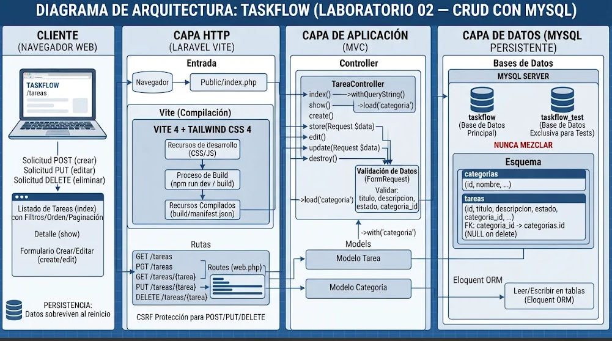

# Laboratorio 02 — CRUD Full-Stack con Laravel y MySQL

**Curso:** Desarrollo de aplicaciones para ambientes Web Avanzado  
**Capítulo:** 2. Laravel (PHP, Python) + MySQL: CRUD Full-Stack  
**Práctica oficial:** 2.8  
**Duración:** 180 minutos (3 horas de práctica)  
**Proyecto conductor:** TaskFlow, **el mismo proyecto del laboratorio 1**  
**Versiones de referencia:** Laravel 13.x · PHP 8.3+ · MySQL 8.4 LTS · Tailwind CSS 4 · Vite · Node.js 24 LTS  
**Terminales admitidas:** Bash (Ubuntu/Linux/WSL) y PowerShell (Windows 11 nativo)

> **Cómo utilizar esta guía.** El alumno debe ejecutar los comandos y crear o modificar los archivos indicados. **No se distribuye un proyecto nuevo ni archivos de código adicionales**: el contenido necesario está escrito íntegramente en este Markdown. No borre ni reinicialice TaskFlow. Este laboratorio introduce persistencia, pero **no introduce usuarios, roles, autenticación ni APIs**; esos temas se desarrollarán más adelante.
>
> **Seguridad del entorno:** los ejemplos son para un laboratorio local. El CRUD permanecerá sin autenticación hasta el capítulo 3; no exponga este servidor a Internet. No suba `.env`, `.env.testing` ni contraseñas a Git.

---

## 1. Objetivo, alcance y resultado final

**Objetivo:** convertir TaskFlow, que en el laboratorio 1 utilizaba un arreglo PHP, en una aplicación **CRUD persistente** con MySQL. Al finalizar deberá permitir crear, consultar, editar y eliminar tareas; asignar categorías opcionales; validar entradas; y listar tareas con ordenamiento y paginación limitados desde Laravel.


## Diagrama



### Evidencias de aprendizaje

- [ ] Reutilizar el proyecto Laravel y la rama creada en el laboratorio 1.
- [ ] Conectar Laravel con una base MySQL y verificar la conexión.
- [ ] Crear las tablas `categorias` y `tareas` con migraciones ordenadas y una clave foránea.
- [ ] Definir los modelos `Categoria` y `Tarea`, `$fillable` y las relaciones `hasMany` / `belongsTo`.
- [ ] Sustituir el arreglo `TareaController::TAREAS` por consultas Eloquent.
- [ ] Implementar las siete acciones CRUD: `index`, `show`, `create`, `store`, `edit`, `update` y `destroy`.
- [ ] Aprovechar el layout y los componentes Blade del laboratorio 1.
- [ ] Validar formularios, conservar valores anteriores y mostrar errores y mensajes de éxito.
- [ ] Usar `paginate()`, `withQueryString()` y una lista blanca de columnas de ordenamiento.
- [ ] Ejecutar pruebas automáticas contra una **base de datos de pruebas separada**.
- [ ] Comprobar que las tareas sobreviven al reinicio de Laravel.

### Tiempo de trabajo (180 minutos)

| Bloque | Actividades | Minutos |
|---|---|---:|
| 1 | Continuidad, conexión a MySQL y migraciones | 30 |
| 2 | Modelos, relaciones y controlador CRUD | 70 |
| 3 | Formularios Blade, CSRF y validaciones | 50 |
| 4 | Paginación, pruebas, persistencia y evidencias | 30 |
| **Total** | | **180** |

> La **instalación inicial** de MySQL debe realizarse antes de contar estos 180 minutos. Si aún no se dispone del servidor o no se completó el laboratorio 1, resolver esos prerrequisitos antes de iniciar el cronómetro.

---

## 2. Antes de comenzar: confirmar el laboratorio 1

### Paso 0.1 — Abrir el proyecto que ya existe

**Ubuntu / Bash** (si su laboratorio 1 está en `~/labs/taskflow`):

```bash
cd ~/labs/taskflow
pwd
```

**Windows / PowerShell** (si instaló el laboratorio 1 en `Documents` o en otra ruta, ajuste la ruta real):

```powershell
Set-Location "$HOME\labs\taskflow"
Get-Location
```

**En ambas terminales, desde la raíz de TaskFlow:**

```bash
php artisan --version
php -v
composer --version
node -v
npm -v
git status --short
git branch --show-current
```

**Resultado esperado:** Laravel 13.x, herramientas disponibles y los archivos del laboratorio 1 presentes.

Confirme la existencia de estas rutas (Bash y PowerShell admiten los siguientes comandos):

```bash
php artisan route:list --path=tareas
php -l app/Http/Controllers/TareaController.php
php -l app/View/Components/TarjetaTarea.php
```

En VS Code revise que existan los archivos:

```text
app/Http/Controllers/TareaController.php
app/View/Components/TarjetaTarea.php
resources/views/layouts/app.blade.php
resources/views/tareas/index.blade.php
resources/views/tareas/show.blade.php
resources/views/components/tarjeta-tarea.blade.php
resources/views/components/alerta.blade.php
tests/Feature/TareaViewTest.php
```

**No continúe si le falta el proyecto o si el código original del laboratorio 1 aún falla.** Este ejercicio modifica los mismos archivos.

### Paso 0.2 — Conservar el estado anterior con Git

Primero guarde los cambios pendientes del laboratorio 1 mediante un commit, si corresponde. Verifique que `.env` esté ignorado:

```bash
git check-ignore .env
git status --short
```

Cree la rama para el segundo laboratorio:

```bash
git switch -c lab-02-crud-mysql
```

Si ya existe, **no la recree**:

```bash
git switch lab-02-crud-mysql
```

**Verificación:**

```bash
git branch --show-current
```

Debe aparecer `lab-02-crud-mysql`. Si Git reporta cambios locales que pueden sobrescribirse, guárdelos antes de cambiar de rama.

### Paso 0.3 — Confirmar MySQL y su controlador PHP

```bash
mysql --version
php -m
```

Debe estar disponible el cliente MySQL y la extensión PHP **`pdo_mysql`**. Si `mysql` indica comando desconocido, instale MySQL Community Server 8.4 y su cliente, o agregue el cliente al `PATH`. Si falta `pdo_mysql`, habilite la extensión correspondiente a su instalación de PHP.

**Ubuntu 24.04:** si utiliza paquetes del sistema y tiene un servidor MySQL compatible instalado, la extensión suele instalarse con:

```bash
sudo apt install php-mysql
```

No ejecute comandos de reinstalación sobre una instancia MySQL que ya tenga bases de datos de otras aplicaciones. En Windows, la extensión se habilita desde la distribución de PHP utilizada (Herd, PHP instalado manualmente, etc.).

---

## 3. Bloque 1 — Conexión a MySQL y migraciones (30 min)

### Paso 1.1 — Crear las bases de datos y el usuario local

Abra una terminal y conéctese con una cuenta administradora de MySQL:

```bash
mysql -h 127.0.0.1 -u root -p
```

Escriba la contraseña de administrador cuando se solicite. **Las siguientes instrucciones SQL se ejecutan dentro del cliente MySQL, no en Bash ni en PowerShell.** Sustituya `CAMBIA_ESTA_CLAVE_LOCAL` por una contraseña propia que conservará de manera privada.

```sql
-- Esquema usado por la aplicación durante los laboratorios.
CREATE DATABASE IF NOT EXISTS taskflow
  CHARACTER SET utf8mb4 COLLATE utf8mb4_unicode_ci;

-- Esquema SEPARADO, reservado para los tests automatizados.
CREATE DATABASE IF NOT EXISTS taskflow_test
  CHARACTER SET utf8mb4 COLLATE utf8mb4_unicode_ci;

-- Usuario local; la aplicación se conectará mediante TCP a 127.0.0.1.
CREATE USER IF NOT EXISTS 'taskflow'@'127.0.0.1'
  IDENTIFIED BY 'CAMBIA_ESTA_CLAVE_LOCAL';

GRANT ALL PRIVILEGES ON taskflow.*
  TO 'taskflow'@'127.0.0.1';
GRANT ALL PRIVILEGES ON taskflow_test.*
  TO 'taskflow'@'127.0.0.1';

SHOW DATABASES LIKE 'taskflow%';
EXIT;
```

> Si el usuario `taskflow` **ya existía**, `CREATE USER IF NOT EXISTS` no modifica su contraseña. Utilice sus credenciales actuales o solicite al administrador que actualice únicamente esa cuenta. No cambie credenciales de otros usuarios ni de otras bases de datos.
>
> **No use la contraseña del ejemplo literalmente.** No la copie a capturas, commits ni entregables.

**Resultado esperado:** aparecen `taskflow` y `taskflow_test`, que permanecerán **separadas**.

Compruebe la conexión TCP con el usuario recién configurado:

```bash
mysql -h 127.0.0.1 -u taskflow -p taskflow
```

Dentro de MySQL:

```sql
SELECT DATABASE();
EXIT;
```

Debe responder `taskflow`.

### Paso 1.2 — Modificar `.env` sin eliminar la configuración anterior

Abra el archivo **ya existente** `.env` y reemplace o agregue **solo** estas variables. Sustituya la contraseña por la configurada en MySQL:

```dotenv
APP_NAME=TaskFlow
APP_ENV=local
APP_DEBUG=true
APP_URL=http://127.0.0.1:8000

DB_CONNECTION=mysql
DB_HOST=127.0.0.1
DB_PORT=3306
DB_DATABASE=taskflow
DB_USERNAME=taskflow
DB_PASSWORD=CAMBIA_ESTA_CLAVE_LOCAL

SESSION_DRIVER=file
CACHE_STORE=file
QUEUE_CONNECTION=sync
```

**Mantenga `APP_KEY` y las demás variables que ya funcionan.** `SESSION_DRIVER=file` y `CACHE_STORE=file` conservan el comportamiento del laboratorio 1; todavía no necesitamos almacenar sesiones o caché en MySQL.

En la raíz del proyecto ejecute:

```bash
php artisan config:clear
php artisan db:show
```

**Resultado esperado:** Laravel informa la conexión MySQL y muestra la base `taskflow`. Si recibe `could not find driver`, compruebe `pdo_mysql`; si recibe `Access denied`, compruebe usuario, contraseña y host.

> Si alguna instalación requiere un `DB_SOCKET`, esa es una variante local no utilizada en esta guía; aquí trabajamos con `DB_HOST=127.0.0.1` y puerto TCP `3306`.

### Paso 1.3 — Crear los modelos sin sobrescribir archivos existentes

```bash
php artisan make:model Categoria
php artisan make:model Tarea
```

**Resultado esperado:** existen:

```text
app/Models/Categoria.php
app/Models/Tarea.php
```

Si alguno ya existe, revise su contenido y **no lo regenere encima de cambios propios**.

### Paso 1.4 — Generar las dos migraciones en orden

Ejecute primero:

```bash
php artisan make:migration create_categorias_table --create=categorias
```

Espere al menos **un segundo** para garantizar nombres de archivo distintos y su orden cronológico (Bash: `sleep 1`; PowerShell: `Start-Sleep -Seconds 1`). Después ejecute:

```bash
php artisan make:migration create_tareas_table --create=tareas
```

Laravel genera dos archivos dentro de `database/migrations/` con un prefijo de fecha/hora. **No invente nombres de archivo; edite los que Artisan haya generado.** La migración de categorías debe estar ordenada **antes** de la de tareas, pues la segunda contiene una clave foránea.

#### Archivo 1: `database/migrations/AAAA_MM_DD_HHMMSS_create_categorias_table.php`

Reemplace el contenido del archivo generado para categorías por:

```php
<?php

use Illuminate\Database\Migrations\Migration;
use Illuminate\Database\Schema\Blueprint;
use Illuminate\Support\Facades\Schema;

return new class extends Migration
{
    public function up(): void
    {
        Schema::create('categorias', function (Blueprint $table) {
            $table->id();
            $table->string('nombre', 80)->unique();
            $table->timestamps();
        });
    }

    public function down(): void
    {
        Schema::dropIfExists('categorias');
    }
};
```

#### Archivo 2: `database/migrations/AAAA_MM_DD_HHMMSS_create_tareas_table.php`

Reemplace el contenido del archivo generado para tareas por:

```php
<?php

use Illuminate\Database\Migrations\Migration;
use Illuminate\Database\Schema\Blueprint;
use Illuminate\Support\Facades\Schema;

return new class extends Migration
{
    public function up(): void
    {
        Schema::create('tareas', function (Blueprint $table) {
            $table->id();
            $table->string('titulo', 150);
            $table->text('descripcion')->nullable();
            $table->string('estado', 20)->default('Pendiente');
            $table->foreignId('categoria_id')
                ->nullable()
                ->constrained('categorias')
                ->nullOnDelete();
            $table->timestamps();
        });
    }

    public function down(): void
    {
        Schema::dropIfExists('tareas');
    }
};
```

**Conceptos que debe identificar:** `up()` aplica la migración; `down()` define cómo revertirla; `categoria_id` permite asociar una tarea con una categoría; `nullOnDelete()` conserva la tarea si su categoría se elimina y deja su clave foránea en `NULL`.

### Paso 1.5 — Aplicar y verificar las migraciones

```bash
php artisan migrate:status
php artisan migrate --step
php artisan migrate:status
php artisan db:table categorias
php artisan db:table tareas
```

**Resultado esperado:** ambas tablas están creadas, y las migraciones se muestran como ejecutadas. En una instalación Laravel limpia, es normal que también se ejecuten las migraciones predeterminadas (por ejemplo, `users`, `cache`, `jobs`); **no las borre**, pues se utilizarán en capítulos posteriores.

> **Advertencia sobre rollback:** `php artisan migrate:rollback` puede revertir más tablas que las esperadas si varias migraciones comparten lote. Para esta práctica **no ejecute** `migrate:fresh`, `migrate:refresh` ni `rollback` sobre la base `taskflow`. El comando `--step` registra individualmente migraciones nuevas, pero no elimina por sí solo el riesgo de pérdida de datos.

**Verificación opcional desde MySQL**:

```bash
mysql -h 127.0.0.1 -u taskflow -p taskflow
```

```sql
SHOW TABLES;
DESCRIBE categorias;
DESCRIBE tareas;
EXIT;
```

---

## 4. Bloque 2 — Modelos, relaciones y controlador CRUD (70 min)

### Paso 2.1 — Completar el modelo `Categoria`

Abra `app/Models/Categoria.php` y reemplace su contenido:

```php
<?php
// Archivo: app/Models/Categoria.php

namespace App\Models;

use Illuminate\Database\Eloquent\Model;
use Illuminate\Database\Eloquent\Relations\HasMany;

class Categoria extends Model
{
    protected $table = 'categorias';

    protected $fillable = ['nombre'];

    public function tareas(): HasMany
    {
        return $this->hasMany(Tarea::class, 'categoria_id');
    }
}
```

### Paso 2.2 — Completar el modelo `Tarea`

Abra `app/Models/Tarea.php` y reemplace su contenido:

```php
<?php
// Archivo: app/Models/Tarea.php

namespace App\Models;

use Illuminate\Database\Eloquent\Model;
use Illuminate\Database\Eloquent\Relations\BelongsTo;

class Tarea extends Model
{
    protected $table = 'tareas';

    protected $fillable = [
        'titulo',
        'descripcion',
        'estado',
        'categoria_id',
    ];

    public function categoria(): BelongsTo
    {
        return $this->belongsTo(Categoria::class, 'categoria_id');
    }
}
```

**Qué debe comprender:** `$table` establece el nombre español exacto de la tabla; `$fillable` permite asignar únicamente esos atributos con `create()` y `update()`; `belongsTo()` y `hasMany()` describen la relación uno a muchos.

**Verificación de sintaxis:**

```bash
php -l app/Models/Categoria.php
php -l app/Models/Tarea.php
```

### Paso 2.3 — Crear datos iniciales sin escribir SQL manual por cada tarea

Vamos a conservar las dos tareas del laboratorio 1, pero ahora como registros MySQL. Genere un seeder:

```bash
php artisan make:seeder TaskFlowSeeder
```

Reemplace **completamente** `database/seeders/TaskFlowSeeder.php` por:

```php
<?php
// Archivo: database/seeders/TaskFlowSeeder.php

namespace Database\Seeders;

use App\Models\Categoria;
use App\Models\Tarea;
use Illuminate\Database\Seeder;

class TaskFlowSeeder extends Seeder
{
    public function run(): void
    {
        $trabajo = Categoria::firstOrCreate(['nombre' => 'Trabajo']);
        $estudio = Categoria::firstOrCreate(['nombre' => 'Estudio']);

        Tarea::firstOrCreate(
            ['titulo' => 'Preparar informe'],
            [
                'descripcion' => 'Redactar propuesta.',
                'estado' => 'Pendiente',
                'categoria_id' => $trabajo->id,
            ]
        );

        Tarea::firstOrCreate(
            ['titulo' => 'Revisar UI'],
            [
                'descripcion' => 'Validar pantallas Blade.',
                'estado' => 'En progreso',
                'categoria_id' => $estudio->id,
            ]
        );
    }
}
```

Ejecute el seeder **solo en la base de desarrollo `taskflow`**:

```bash
php artisan db:seed --class=TaskFlowSeeder
```

**Resultado esperado:** dos tareas y dos categorías. `firstOrCreate()` evita duplicar estas filas al repetir el seeder, siempre que los títulos originales permanezcan sin modificar.

**Verificación mediante Tinker (opcional):**

```bash
php artisan tinker
```

Dentro de Tinker:

```php
\App\Models\Categoria::count();
\App\Models\Tarea::with('categoria')->get(['id', 'titulo', 'estado', 'categoria_id']);
```

Salga escribiendo `exit`.

### Paso 2.4 — Sustituir el controlador del laboratorio 1 por Eloquent

**Punto de continuidad:** en el laboratorio 1 el controlador definía una constante `private const TAREAS`. **A partir de ahora desaparecerá esa constante**: MySQL se convierte en la fuente de información.

Abra `app/Http/Controllers/TareaController.php` y **reemplace el archivo completo** por lo siguiente. Se incluyen todas las acciones, pero en el bloque 3 terminaremos de crear sus formularios:

```php
<?php
// Archivo: app/Http/Controllers/TareaController.php

namespace App\Http\Controllers;

use App\Models\Categoria;
use App\Models\Tarea;
use Illuminate\Http\RedirectResponse;
use Illuminate\Http\Request;
use Illuminate\View\View;

class TareaController extends Controller
{
    public function index(Request $request): View
    {
        // Nunca utilice directamente una columna enviada por el cliente.
        $allowed = ['id', 'titulo', 'estado', 'created_at'];
        $sort = $request->query('sort', 'id');
        if (!is_string($sort) || !in_array($sort, $allowed, true)) {
            $sort = 'id';
        }

        $direction = $request->query('direction', 'desc');
        $direction = is_string($direction) ? strtolower($direction) : 'desc';
        if (!in_array($direction, ['asc', 'desc'], true)) {
            $direction = 'desc';
        }

        $perPage = filter_var(
            $request->query('per_page', 10),
            FILTER_VALIDATE_INT,
            ['options' => ['min_range' => 1, 'max_range' => 50]]
        );
        if ($perPage === false) {
            $perPage = 10;
        }

        $query = Tarea::query()
            ->with('categoria') // Evita consultas N+1 al mostrar categorías.
            ->orderBy($sort, $direction);

        if ($sort !== 'id') {
            $query->orderBy('id', 'asc'); // Orden determinista en empates.
        }

        $tareas = $query->paginate($perPage)->withQueryString();

        return view('tareas.index', compact(
            'tareas', 'sort', 'direction', 'perPage'
        ));
    }

    public function show(Tarea $tarea): View
    {
        $tarea->load('categoria');
        return view('tareas.show', compact('tarea'));
    }

    public function create(): View
    {
        $categorias = Categoria::orderBy('nombre')->get();
        return view('tareas.create', compact('categorias'));
    }

    public function store(Request $request): RedirectResponse
    {
        $datos = $request->validate([
            'titulo' => ['required', 'string', 'max:150'],
            'descripcion' => ['nullable', 'string', 'max:1000'],
            'estado' => ['required', 'in:Pendiente,En progreso,Completada'],
            'categoria_id' => ['nullable', 'integer', 'exists:categorias,id'],
        ]);

        Tarea::create($datos);

        return redirect()->route('tareas.index')
            ->with('success', 'Tarea creada.');
    }

    public function edit(Tarea $tarea): View
    {
        $categorias = Categoria::orderBy('nombre')->get();
        return view('tareas.edit', compact('tarea', 'categorias'));
    }

    public function update(Request $request, Tarea $tarea): RedirectResponse
    {
        $datos = $request->validate([
            'titulo' => ['required', 'string', 'max:150'],
            'descripcion' => ['nullable', 'string', 'max:1000'],
            'estado' => ['required', 'in:Pendiente,En progreso,Completada'],
            'categoria_id' => ['nullable', 'integer', 'exists:categorias,id'],
        ]);

        $tarea->update($datos);

        return redirect()->route('tareas.show', $tarea)
            ->with('success', 'Tarea actualizada.');
    }

    public function destroy(Tarea $tarea): RedirectResponse
    {
        $tarea->delete();

        return redirect()->route('tareas.index')
            ->with('success', 'Tarea eliminada.');
    }
}
```

**Observaciones:** el parámetro `Tarea $tarea` permite que Laravel busque por ID el registro de la ruta y devuelva **404** si no existe. `with('categoria')` precarga las categorías. Los valores permitidos de `sort`, `direction` y `per_page` impiden construir consultas arbitrarias y evitar páginas excesivamente grandes.

### Paso 2.5 — Actualizar todas las rutas web sin duplicarlas

En el laboratorio 1, `routes/web.php` contenía `/`, `/tareas` y `/tareas/{id}`. Es importante **reemplazar** esas rutas, no repetirlas.

Abra `routes/web.php` y deje este contenido completo:

```php
<?php
// Archivo: routes/web.php

use App\Http\Controllers\TareaController;
use Illuminate\Support\Facades\Route;

// Conserva la página principal del laboratorio 1.
Route::get('/', [TareaController::class, 'index']);

// Primero las rutas estáticas, después los parámetros dinámicos.
Route::get('/tareas', [TareaController::class, 'index'])
    ->name('tareas.index');

Route::get('/tareas/crear', [TareaController::class, 'create'])
    ->name('tareas.create');

Route::post('/tareas', [TareaController::class, 'store'])
    ->name('tareas.store');

Route::get('/tareas/{tarea}', [TareaController::class, 'show'])
    ->whereNumber('tarea')
    ->name('tareas.show');

Route::get('/tareas/{tarea}/editar', [TareaController::class, 'edit'])
    ->whereNumber('tarea')
    ->name('tareas.edit');

Route::put('/tareas/{tarea}', [TareaController::class, 'update'])
    ->whereNumber('tarea')
    ->name('tareas.update');

Route::delete('/tareas/{tarea}', [TareaController::class, 'destroy'])
    ->whereNumber('tarea')
    ->name('tareas.destroy');
```

**Verificación:**

```bash
php -l app/Http/Controllers/TareaController.php
php -l routes/web.php
php artisan route:clear
php artisan route:list --path=tareas
```

Debe ver las siete rutas CRUD nombradas. La raíz `/` se mantiene para que TaskFlow siga funcionando también desde la página principal.

---

## 5. Bloque 3 — Blade, formularios, validaciones y CSRF (50 min)

### Paso 3.1 — Mantener el layout del laboratorio 1 y actualizar su indicador

La estructura del layout y el `@vite` original **se conservan**. Abra `resources/views/layouts/app.blade.php`. Para una versión reproducible, su contenido al finalizar será:

```blade
{{-- Archivo: resources/views/layouts/app.blade.php --}}
<!DOCTYPE html>
<html lang="es">
<head>
    <meta charset="UTF-8">
    <meta name="viewport" content="width=device-width, initial-scale=1.0">
    <title>@yield('title', 'TaskFlow')</title>
    @vite(['resources/css/app.css', 'resources/js/app.js'])
</head>
<body class="min-h-screen bg-slate-50 text-slate-900">
    <header class="border-b border-slate-200 bg-white">
        <div class="mx-auto flex max-w-4xl items-center justify-between p-6">
            <a href="{{ route('tareas.index') }}"
               class="text-xl font-bold text-blue-900">TaskFlow</a>
            <span class="text-sm text-slate-500">Laboratorio 02</span>
        </div>
    </header>

    <main class="mx-auto max-w-4xl p-6">
        @yield('content')
    </main>
</body>
</html>
```

**No elimine** `@vite`, el enlace `tareas.index` ni los archivos de CSS/JS construidos en el laboratorio 1.

### Paso 3.2 — Crear la carpeta y el partial de campos reutilizables

**Bash:**

```bash
mkdir -p resources/views/tareas/partials
```

**PowerShell:**

```powershell
New-Item -ItemType Directory -Force resources/views/tareas/partials
```

Cree `resources/views/tareas/partials/_campos.blade.php` en VS Code y escriba:

```blade
{{-- Archivo: resources/views/tareas/partials/_campos.blade.php --}}
<div class="space-y-5">
    <div>
        <label for="titulo" class="mb-1 block font-medium">Título</label>
        <input id="titulo" name="titulo" type="text" required maxlength="150"
               value="{{ old('titulo', $tarea?->titulo ?? '') }}"
               class="w-full rounded-lg border border-slate-300 p-3">
        @error('titulo')
            <p class="mt-1 text-sm text-red-700" role="alert">{{ $message }}</p>
        @enderror
    </div>

    <div>
        <label for="descripcion" class="mb-1 block font-medium">Descripción</label>
        <textarea id="descripcion" name="descripcion" rows="4" maxlength="1000"
                  class="w-full rounded-lg border border-slate-300 p-3">{{ old('descripcion', $tarea?->descripcion ?? '') }}</textarea>
        @error('descripcion')
            <p class="mt-1 text-sm text-red-700" role="alert">{{ $message }}</p>
        @enderror
    </div>

    <div>
        <label for="estado" class="mb-1 block font-medium">Estado</label>
        <select id="estado" name="estado" required
                class="w-full rounded-lg border border-slate-300 p-3">
            @foreach (['Pendiente', 'En progreso', 'Completada'] as $estado)
                <option value="{{ $estado }}"
                    @selected(old('estado', $tarea?->estado ?? 'Pendiente') === $estado)>
                    {{ $estado }}
                </option>
            @endforeach
        </select>
        @error('estado')
            <p class="mt-1 text-sm text-red-700" role="alert">{{ $message }}</p>
        @enderror
    </div>

    <div>
        <label for="categoria_id" class="mb-1 block font-medium">Categoría</label>
        <select id="categoria_id" name="categoria_id"
                class="w-full rounded-lg border border-slate-300 p-3">
            <option value="">Sin categoría</option>
            @foreach ($categorias as $categoria)
                <option value="{{ $categoria->id }}"
                    @selected((string) old('categoria_id', $tarea?->categoria_id ?? '') === (string) $categoria->id)>
                    {{ $categoria->nombre }}
                </option>
            @endforeach
        </select>
        @error('categoria_id')
            <p class="mt-1 text-sm text-red-700" role="alert">{{ $message }}</p>
        @enderror
    </div>
</div>
```

**Conceptos:** `old()` recupera lo introducido si falla la validación. `@error()` muestra el mensaje asociado a un campo. `@selected()` mantiene el estado o la categoría elegidos; `{{ }}` escapa texto. Tanto creación como edición utilizarán **el mismo partial**.

### Paso 3.3 — Crear el formulario de alta

Cree `resources/views/tareas/create.blade.php`:

```blade
{{-- Archivo: resources/views/tareas/create.blade.php --}}
@extends('layouts.app')

@section('title', 'Nueva tarea - TaskFlow')

@section('content')
    <div class="mb-6 flex items-center justify-between">
        <h1 class="text-3xl font-bold text-blue-900">Nueva tarea</h1>
        <a href="{{ route('tareas.index') }}" class="text-blue-700 underline">Volver</a>
    </div>

    <form method="POST" action="{{ route('tareas.store') }}"
          class="space-y-5 rounded-xl border bg-white p-6 shadow-sm">
        @csrf
        @include('tareas.partials._campos', ['tarea' => null])

        <button type="submit"
                class="rounded-lg bg-blue-800 px-5 py-3 font-medium text-white hover:bg-blue-900">
            Guardar tarea
        </button>
    </form>
@endsection
```

**Importante:** `@csrf` es obligatorio para el formulario POST. La validación definitiva ocurre en el **backend**, incluso si el navegador también aplica `required` y `maxlength`.

### Paso 3.4 — Crear el formulario de edición

Cree `resources/views/tareas/edit.blade.php`:

```blade
{{-- Archivo: resources/views/tareas/edit.blade.php --}}
@extends('layouts.app')

@section('title', 'Editar tarea - TaskFlow')

@section('content')
    <div class="mb-6 flex items-center justify-between">
        <h1 class="text-3xl font-bold text-blue-900">Editar tarea</h1>
        <a href="{{ route('tareas.show', $tarea) }}" class="text-blue-700 underline">
            Volver al detalle
        </a>
    </div>

    <form method="POST" action="{{ route('tareas.update', $tarea) }}"
          class="space-y-5 rounded-xl border bg-white p-6 shadow-sm">
        @csrf
        @method('PUT')
        @include('tareas.partials._campos', ['tarea' => $tarea])

        <button type="submit"
                class="rounded-lg bg-blue-800 px-5 py-3 font-medium text-white hover:bg-blue-900">
            Actualizar tarea
        </button>
    </form>

    <form method="POST" action="{{ route('tareas.destroy', $tarea) }}"
          class="mt-6">
        @csrf
        @method('DELETE')
        <button type="submit"
                class="rounded-lg bg-red-700 px-5 py-3 text-white hover:bg-red-800">
            Eliminar tarea
        </button>
    </form>
@endsection
```

**Por qué existen `@method('PUT')` y `@method('DELETE')`:** HTML envía formularios mediante GET/POST; Laravel interpreta el verbo simulado indicado en el campo oculto generado por `@method()`.

### Paso 3.5 — Adaptar la vista de detalle al modelo Eloquent

En el laboratorio 1 se leían campos de un arreglo (`$tarea['titulo']`). Ahora se consultan propiedades del modelo (`$tarea->titulo`). **Reemplace** `resources/views/tareas/show.blade.php` por:

```blade
{{-- Archivo: resources/views/tareas/show.blade.php --}}
@extends('layouts.app')

@section('title', 'Detalle de tarea - TaskFlow')

@section('content')
    @if (session('success'))
        <x-alerta tipo="exito" class="mb-6">{{ session('success') }}</x-alerta>
    @endif

    <div class="mb-6 flex items-center justify-between">
        <h1 class="text-3xl font-bold text-blue-900">Detalle de tarea</h1>
        <a href="{{ route('tareas.index') }}" class="text-blue-700 underline">
            Volver al listado
        </a>
    </div>

    <x-tarjeta-tarea
        :titulo="$tarea->titulo"
        :estado="$tarea->estado"
        :descripcion="$tarea->descripcion ?? ''">
        <x-slot:acciones>
            <p class="mb-3 text-sm text-slate-600">
                Categoría: {{ $tarea->categoria?->nombre ?? 'Sin categoría' }}
            </p>
            <a href="{{ route('tareas.edit', $tarea) }}"
               class="text-blue-700 underline">Editar tarea</a>
        </x-slot:acciones>
    </x-tarjeta-tarea>
@endsection
```

Se reutiliza el componente de clase **`TarjetaTarea`** del laboratorio 1. Se pasa `''` cuando `descripcion` es nula, pues ese componente recibe una cadena `string`.

### Paso 3.6 — Adaptar el listado y añadir filtros, ordenamiento y paginación

**Reemplace completamente** `resources/views/tareas/index.blade.php` por:

```blade
{{-- Archivo: resources/views/tareas/index.blade.php --}}
@extends('layouts.app')

@section('title', 'Mis tareas - TaskFlow')

@section('content')
    <div class="mb-6 flex flex-wrap items-center justify-between gap-3">
        <h1 class="text-3xl font-bold text-blue-900">Mis tareas</h1>
        <a href="{{ route('tareas.create') }}"
           class="rounded-lg bg-blue-800 px-4 py-2 text-white hover:bg-blue-900">
            + Nueva tarea
        </a>
    </div>

    @if (session('success'))
        <x-alerta tipo="exito" class="mb-6">{{ session('success') }}</x-alerta>
    @endif

    <form method="GET" action="{{ route('tareas.index') }}"
          class="mb-6 grid gap-3 rounded-xl border bg-white p-4 sm:grid-cols-4">
        <div>
            <label for="sort" class="block text-sm font-medium">Ordenar por</label>
            <select id="sort" name="sort" class="mt-1 w-full rounded border p-2">
                <option value="id" @selected($sort === 'id')>Identificador</option>
                <option value="titulo" @selected($sort === 'titulo')>Título</option>
                <option value="estado" @selected($sort === 'estado')>Estado</option>
                <option value="created_at" @selected($sort === 'created_at')>Fecha de creación</option>
            </select>
        </div>
        <div>
            <label for="direction" class="block text-sm font-medium">Dirección</label>
            <select id="direction" name="direction" class="mt-1 w-full rounded border p-2">
                <option value="asc" @selected($direction === 'asc')>Ascendente</option>
                <option value="desc" @selected($direction === 'desc')>Descendente</option>
            </select>
        </div>
        <div>
            <label for="per_page" class="block text-sm font-medium">Por página</label>
            <select id="per_page" name="per_page" class="mt-1 w-full rounded border p-2">
                @foreach ([10, 25, 50] as $n)
                    <option value="{{ $n }}" @selected($perPage === $n)>
                        {{ $n }} tareas
                    </option>
                @endforeach
            </select>
        </div>
        <div class="flex items-end">
            <button type="submit"
                    class="w-full rounded-lg bg-slate-800 px-4 py-2 text-white">
                Aplicar
            </button>
        </div>
    </form>

    <div class="grid gap-4 md:grid-cols-2">
        @forelse ($tareas as $tarea)
            <x-tarjeta-tarea
                :titulo="$tarea->titulo"
                :estado="$tarea->estado"
                :descripcion="$tarea->descripcion ?? ''">
                <x-slot:acciones>
                    <p class="mb-2 text-xs text-slate-600">
                        Categoría: {{ $tarea->categoria?->nombre ?? 'Sin categoría' }}
                    </p>
                    <div class="flex gap-4 text-sm">
                        <a href="{{ route('tareas.show', $tarea) }}"
                           class="text-blue-700 underline">Ver detalle</a>
                        <a href="{{ route('tareas.edit', $tarea) }}"
                           class="text-blue-700 underline">Editar</a>
                    </div>
                </x-slot:acciones>
            </x-tarjeta-tarea>
        @empty
            <p class="text-slate-600">No hay tareas registradas.</p>
        @endforelse
    </div>

    <div class="mt-8">
        {{ $tareas->links() }}
    </div>
@endsection
```

**Nota sobre Tailwind CSS 4:** las vistas de paginación de Laravel están en `vendor/` y, según cómo se configure la detección de archivos de Tailwind, quizá deba indicar explícitamente esa ubicación. Compruébelo en el siguiente paso.

### Paso 3.7 — Asegurar los estilos de paginación en Tailwind CSS 4

Conserve `vite.config.js` y el plugin de Tailwind configurados en el laboratorio 1. Abra `resources/css/app.css` y asegúrese de tener **al menos**:

```css
/* Archivo: resources/css/app.css */
@import "tailwindcss";

/* Incluir los estilos utilizados por las vistas de paginación Laravel. */
@source "../../vendor/laravel/framework/src/Illuminate/Pagination/resources/views/*.blade.php";
```

Si su archivo ya contiene estilos adicionales del laboratorio 1, **consérvelos**. No reinstale Tailwind ni cambie la versión de Vite.

Para comprobar la compilación:

```bash
php artisan view:clear
php artisan view:cache
npm run build
```

**Resultado esperado:** las vistas se compilan y Vite genera `public/build/manifest.json`. La vista ya tendrá todos los enlaces, pero las pruebas de navegación vienen a continuación.

---

## 6. Bloque 4 — Pruebas, paginación y persistencia (30 min)

### Paso 4.1 — Probar el CRUD en el navegador

Abra dos terminales en la raíz del mismo proyecto.

**Terminal A:**

```bash
php artisan serve --host=127.0.0.1 --port=8000
```

**Terminal B:**

```bash
npm run dev
```

Abra `http://127.0.0.1:8000/tareas` y realice **en este orden**:

| Acción | Resultado esperado |
|---|---|
| Abrir el listado | Aparecen `Preparar informe` y `Revisar UI` desde MySQL. |
| Entrar al detalle | Muestra el título, la descripción, el estado y la categoría. |
| Pulsar **Nueva tarea** | Se abre `/tareas/crear`. |
| Crear una tarea con estado `Pendiente` | Se guarda y redirige al listado con un mensaje de éxito. |
| Editar la nueva tarea | Se recuperan sus valores actuales; guarda los cambios. |
| Seleccionar una categoría | Se observa en el listado y el detalle. |
| Enviar un título vacío | Laravel rechaza la operación y muestra el error. |
| Indicar una categoría que no existe (prueba HTTP automatizada) | La validación rechaza la solicitud. |
| Eliminar la tarea creada | Desaparece del listado, pero las demás continúan. |
| Abrir `/tareas/999999` | Respuesta HTTP 404, no error 500. |

**Comprobación de persistencia:** detenga solo `php artisan serve` con `Ctrl+C`, vuelva a iniciarlo y abra `/tareas`. **Las tareas deben seguir ahí**, porque ya no dependen de un arreglo en memoria.

### Paso 4.2 — Verificar ordenamiento y paginación

Use el formulario del listado para ordenar por título ascendente y descendente, por estado y por fecha de creación. Compruebe que cambiar el tamaño de página conserva el orden.

Pruebe las siguientes URL en el navegador:

```text
http://127.0.0.1:8000/tareas?sort=titulo&direction=asc&per_page=10
http://127.0.0.1:8000/tareas?sort=estado&direction=desc&per_page=25
http://127.0.0.1:8000/tareas?sort=created_at&direction=desc&per_page=50
http://127.0.0.1:8000/tareas?sort=campo_inventado&direction=incorrecta&per_page=1000000
```

**Resultado esperado:** la última dirección **no produce SQL arbitrario ni una consulta enorme**: vuelve a `sort=id`, `direction=desc` y `per_page=10`.

> Con solo dos tareas iniciales, los controles de paginación quizá no muestren una segunda página. Para probar que `links()` funciona, agregue tareas adicionales **mediante el formulario** hasta superar el tamaño de página seleccionado. No modifique el controlador para simular una segunda página.

### Paso 4.3 — Preparar una base de datos EXCLUSIVA para tests

**MUY IMPORTANTE:** el trait `RefreshDatabase` puede ejecutar migraciones y limpiar el estado de la base de datos utilizada por las pruebas. **Nunca ejecute estos tests contra `taskflow`**; se utilizará **`taskflow_test`**, creada en el paso 1.1.

Compruebe que la base de pruebas existe:

```bash
mysql -h 127.0.0.1 -u taskflow -p taskflow_test
```

En MySQL:

```sql
SELECT DATABASE();
EXIT;
```

La salida debe ser **`taskflow_test`**. Si no es así, deténgase.

Cree el archivo local `.env.testing` como copia de `.env`:

**Bash:**

```bash
cp .env .env.testing
```

**PowerShell:**

```powershell
Copy-Item .env .env.testing
```

Abra `.env.testing` en VS Code. **Mantenga las variables que ya funcionan, especialmente `APP_KEY`, pero ajuste:**

```dotenv
APP_ENV=testing
APP_DEBUG=true

DB_CONNECTION=mysql
DB_HOST=127.0.0.1
DB_PORT=3306
DB_DATABASE=taskflow_test
DB_USERNAME=taskflow
DB_PASSWORD=CAMBIA_ESTA_CLAVE_LOCAL

SESSION_DRIVER=array
CACHE_STORE=array
QUEUE_CONNECTION=sync
```

El valor de `DB_PASSWORD` deberá ser su contraseña local real, no el texto de ejemplo. **No confirme `.env.testing` en Git**.

Abra `phpunit.xml` del proyecto y busque si la sección `<php>` contiene estas entradas predeterminadas o equivalentes:

```xml
<env name="DB_CONNECTION" value="sqlite"/>
<env name="DB_DATABASE" value=":memory:"/>
```

**Si están presentes, elimine solo esas dos líneas** para que PHPUnit utilice los valores de `.env.testing`. No elimine el resto de `phpunit.xml` ni escriba contraseñas en ese archivo. Si existen otros `DB_*` que sobreescriban la conexión, revíselos para que tampoco apunten a la base de desarrollo.

**Comprobación obligatoria antes de ejecutar pruebas:**

```bash
php artisan config:clear
php artisan db:show --env=testing
```

La conexión debe ser **MySQL** y la base debe llamarse **`taskflow_test`**. Además, verifique que `phpunit.xml` no contiene `DB_DATABASE=taskflow` ni un valor que remplace la base de pruebas.

> **Bloqueo de seguridad:** si el resultado no identifica inequívocamente `taskflow_test`, **no ejecute** `php artisan test`, `migrate:fresh`, `migrate:refresh` ni las pruebas con `RefreshDatabase`. Corrija primero las variables y vuelva a verificar.

### Paso 4.4 — Actualizar las pruebas del laboratorio 1

Las cinco pruebas del laboratorio 1 daban por hecho que `TareaController` almacenaba un arreglo constante. Ahora los datos son persistentes y el controlador obtiene registros con Eloquent; por eso **reemplazaremos** el archivo existente `tests/Feature/TareaViewTest.php` para que siga siendo útil.

```php
<?php
// Archivo: tests/Feature/TareaViewTest.php

namespace Tests\Feature;

use App\Models\Tarea;
use Database\Seeders\TaskFlowSeeder;
use Illuminate\Foundation\Testing\RefreshDatabase;
use Tests\TestCase;

class TareaViewTest extends TestCase
{
    use RefreshDatabase;

    protected function setUp(): void
    {
        parent::setUp();
        $this->withoutVite();
        $this->seed(TaskFlowSeeder::class);
    }

    public function test_el_listado_muestra_las_dos_tareas(): void
    {
        $this->get(route('tareas.index'))
            ->assertOk()
            ->assertViewIs('tareas.index')
            ->assertSee('Preparar informe')
            ->assertSee('Revisar UI');
    }

    public function test_la_raiz_muestra_el_listado(): void
    {
        $this->get('/')->assertOk();
    }

    public function test_el_detalle_muestra_una_tarea(): void
    {
        $tarea = Tarea::where('titulo', 'Preparar informe')->firstOrFail();

        $this->get(route('tareas.show', $tarea))
            ->assertOk()
            ->assertViewIs('tareas.show')
            ->assertSee('Redactar propuesta.');
    }

    public function test_una_tarea_inexistente_devuelve_404(): void
    {
        $this->get('/tareas/999999')->assertNotFound();
    }

    public function test_blade_escapa_html_peligroso_en_el_detalle(): void
    {
        $tarea = Tarea::create([
            'titulo' => '<script>alert(1)</script>',
            'descripcion' => 'Texto de prueba',
            'estado' => 'Pendiente',
        ]);

        $this->get(route('tareas.show', $tarea))
            ->assertOk()
            ->assertSee('&lt;script&gt;alert(1)&lt;/script&gt;', false)
            ->assertDontSee('<script>alert(1)</script>', false);
    }
}
```

**Diferencia con el laboratorio 1:** seguimos comprobando el renderizado, los 404 y el escape HTML, pero los registros se generan en la **base exclusiva de pruebas**.

### Paso 4.5 — Añadir las pruebas del CRUD

Genere una nueva clase:

```bash
php artisan make:test TareaCrudTest
```

Reemplace el contenido de `tests/Feature/TareaCrudTest.php` por:

```php
<?php
// Archivo: tests/Feature/TareaCrudTest.php

namespace Tests\Feature;

use App\Models\Categoria;
use App\Models\Tarea;
use Database\Seeders\TaskFlowSeeder;
use Illuminate\Foundation\Testing\RefreshDatabase;
use Tests\TestCase;

class TareaCrudTest extends TestCase
{
    use RefreshDatabase;

    protected function setUp(): void
    {
        parent::setUp();
        $this->withoutVite();
        $this->seed(TaskFlowSeeder::class);
    }

    public function test_crear_una_tarea(): void
    {
        $categoria = Categoria::firstOrFail();

        $this->post(route('tareas.store'), [
            'titulo' => 'Escribir pruebas',
            'descripcion' => 'Crear pruebas del CRUD',
            'estado' => 'Pendiente',
            'categoria_id' => $categoria->id,
        ])->assertRedirect(route('tareas.index'));

        $this->assertDatabaseHas('tareas', [
            'titulo' => 'Escribir pruebas',
            'categoria_id' => $categoria->id,
        ]);
    }

    public function test_actualizar_una_tarea(): void
    {
        $tarea = Tarea::firstOrFail();

        $this->put(route('tareas.update', $tarea), [
            'titulo' => 'Informe actualizado',
            'descripcion' => 'Nueva descripción',
            'estado' => 'Completada',
            'categoria_id' => null,
        ])->assertRedirect(route('tareas.show', $tarea));

        $this->assertDatabaseHas('tareas', [
            'id' => $tarea->id,
            'titulo' => 'Informe actualizado',
            'estado' => 'Completada',
        ]);
    }

    public function test_eliminar_una_tarea(): void
    {
        $tarea = Tarea::firstOrFail();

        $this->delete(route('tareas.destroy', $tarea))
            ->assertRedirect(route('tareas.index'));

        $this->assertDatabaseMissing('tareas', ['id' => $tarea->id]);
    }

    public function test_no_acepta_titulo_vacio_ni_estado_invalido(): void
    {
        $this->post(route('tareas.store'), [
            'titulo' => '',
            'descripcion' => 'Texto',
            'estado' => 'Superusuario',
        ])->assertSessionHasErrors(['titulo', 'estado']);
    }

    public function test_no_acepta_una_categoria_inexistente(): void
    {
        $this->post(route('tareas.store'), [
            'titulo' => 'Categoría inválida',
            'estado' => 'Pendiente',
            'categoria_id' => 999999,
        ])->assertSessionHasErrors('categoria_id');
    }

    public function test_paginacion_tiene_limite_superior_y_ordenamiento_seguro(): void
    {
        $response = $this->get(
            '/tareas?sort=columna_falsa&direction=otro&per_page=1000000'
        );

        $response->assertOk()
            ->assertViewHas('sort', 'id')
            ->assertViewHas('direction', 'desc')
            ->assertViewHas('perPage', 10);
    }

    public function test_muestra_404_al_editar_registro_inexistente(): void
    {
        $this->get('/tareas/999999/editar')->assertNotFound();
    }
}
```

Estas pruebas demuestran las operaciones CRUD, el rechazo de entradas inválidas, la protección frente a columnas de ordenamiento inesperadas y el 404 de *route model binding*.

### Paso 4.6 — Ejecutar las pruebas SOLO en `taskflow_test`

**Antes de continuar, repita la comprobación del paso 4.3**:

```bash
php artisan db:show --env=testing
```

Confirme visualmente `taskflow_test`. Compruebe de nuevo la configuración de `phpunit.xml`. Después ejecute:

```bash
php artisan test --filter=TareaViewTest
php artisan test --filter=TareaCrudTest
```

**Resultado esperado:** **5 pruebas del laboratorio 1 actualizadas** y **7 pruebas nuevas del laboratorio 2** aprobadas. El número de *assertions* dependerá de la versión de PHPUnit.

Si ambas clases funcionan, ejecute la suite completa:

```bash
php artisan test
```

**No se requieren proyectos o archivos externos** para ejecutar los tests. El mismo Laravel cargará los modelos, migraciones y clases que usted creó.

**Si alguna prueba falla**, lea la primera traza de error y confirme: 

- Que la base utilizada por PHPUnit sea `taskflow_test`, no `taskflow`.
- Que las migraciones estén ordenadas: primero `categorias`, después `tareas`.
- Que el controlador use modelos, nunca el arreglo `TAREAS` del laboratorio 1.
- Que los nombres `tareas.*` y los nombres de archivo coincidan exactamente.
- Que `TareaViewTest` haya sido reemplazado por su versión para Eloquent.

### Paso 4.7 — Verificar la integridad de los datos de desarrollo

Vuelva a la aplicación normal (sin `--env=testing`):

```bash
php artisan db:show
php artisan migrate:status
```

Confirme que ahora la base mostrada es `taskflow` y que sus tareas creadas desde el navegador continúan presentes. **Los tests no deben haber modificado ni eliminado esos registros.**

---

## 7. Problemas frecuentes y cómo resolverlos

### A. `SQLSTATE[HY000] [1045] Access denied for user`

Laravel no puede autenticarse en MySQL.

1. Revise `DB_HOST=127.0.0.1`, usuario, contraseña y puerto.
2. Pruebe la misma cuenta fuera de Laravel:

   ```bash
   mysql -h 127.0.0.1 -u taskflow -p taskflow
   ```

3. Ejecute `php artisan config:clear` y vuelva a intentar.
4. Si la cuenta ya existía, compruebe su contraseña real; `CREATE USER IF NOT EXISTS` no la restablece.

### B. `could not find driver`

Falta el controlador PDO para MySQL en la instalación de PHP que utiliza Composer/Laravel:

```bash
php -m
```

Busque `pdo_mysql`. En Ubuntu, normalmente se instala con `php-mysql`; en Windows compruebe la configuración del PHP de su entorno.

### C. `Table 'taskflow.tareas' doesn't exist`

```bash
php artisan migrate:status
php artisan db:table tareas
```

Compruebe que la migración fue creada en el proyecto correcto y que el archivo de `tareas` está ordenado **después** del de `categorias`. No ejecute `migrate:fresh` como primera solución.

### D. `Cannot add foreign key constraint`

La tabla `categorias` debe existir antes de crear `tareas`. Asegure que ambas usan claves `id` compatibles, que `categoria_id` está declarado como `foreignId`, y que ambas tablas utilizan el mismo motor compatible de MySQL. No cambie el orden a mano sobre una base con datos existentes sin revisar el historial de migraciones.

### E. `View [tareas.create] not found`

Compruebe en VS Code estos nombres:

```text
resources/views/tareas/create.blade.php
resources/views/tareas/edit.blade.php
resources/views/tareas/show.blade.php
resources/views/tareas/index.blade.php
resources/views/tareas/partials/_campos.blade.php
```

```bash
php artisan view:clear
```

### F. `Route [tareas.edit] not defined` o detalle 404 inesperado

```bash
php artisan route:list --path=tareas
php artisan route:clear
```

Compruebe que el parámetro se llama `{tarea}` y que `TareaController` recibe `Tarea $tarea`. No conserve la antigua ruta `{id}` del laboratorio 1.

### G. `419 Page Expired` al guardar o eliminar

Compruebe `@csrf` dentro de cada formulario POST. Asegure que el navegador admite cookies y que el servidor Laravel no cambió de host entre `localhost` y `127.0.0.1`. La aplicación se usa aquí en `http://127.0.0.1:8000`.

### H. El formulario vuelve atrás con errores pero no los muestra

Confirme que los atributos HTML se llaman exactamente `titulo`, `descripcion`, `estado` y `categoria_id`, y que `_campos.blade.php` utiliza `@error(...)` y `old(...)` con esas mismas claves.

### I. La paginación aparece sin estilos

Compruebe la importación `@import "tailwindcss";` y la instrucción `@source` del paso 3.7. A continuación:

```bash
npm run build
php artisan view:clear
```

### J. Los tests amenazan con modificar la base real

**No ejecute nada.** Abra `.env.testing` y `phpunit.xml`; compruebe que ambas configuraciones apuntan inequívocamente a `taskflow_test`. Ejecute:

```bash
php artisan db:show --env=testing
```

Si no puede demostrar que está usando `taskflow_test`, detenga la práctica y solicite revisión al instructor.

---

## 8. Evidencias y entrega del laboratorio

### Capturas o comprobaciones solicitadas

1. `php artisan --version` mostrando Laravel 13.x.
2. `php artisan db:show` mostrando la base **`taskflow`**.
3. `php artisan migrate:status` con `categorias` y `tareas` ejecutadas.
4. `php artisan route:list --path=tareas` con las siete rutas CRUD.
5. Pantalla `/tareas` mostrando registros persistidos, categorías y controles de ordenamiento.
6. Formulario de creación y formulario de edición, ambos con estilos correctos.
7. Pantalla que muestra un error de validación junto al campo afectado.
8. Prueba de que una tarea persiste después de reiniciar el servidor Laravel.
9. Terminal con **5 + 7 pruebas aprobadas** y confirmación de que corrieron sobre **`taskflow_test`**.
10. Evidencia del commit y la rama `lab-02-crud-mysql`.

### Guardar el avance en Git

Detenga Laravel y Vite con `Ctrl+C` cuando termine. Verifique archivos locales que **no** deben subirse:

```bash
git check-ignore .env
git check-ignore .env.testing
git check-ignore node_modules
git status --short
```

Si `.env.testing` **no** está ignorado, agregue una regla para `.env.testing` a `.gitignore` antes de confirmar los cambios. No suba credenciales, directorios `vendor/`, `node_modules/` ni `public/build/` si están ignorados por el proyecto.

```bash
git add .
git status --short
git commit -m "lab02: CRUD TaskFlow con MySQL, Blade y paginacion"
git log -1 --oneline
```

> Antes del commit, verifique en `git status --short` que **no aparecen** `.env` ni `.env.testing`. Si aparecen, elimínelos del área de *staging* y corrija `.gitignore`.

### Lista de comprobación final

- [ ] TaskFlow **no se reinstaló**; continúa el proyecto del laboratorio 1.
- [ ] La base principal se llama `taskflow` y la de pruebas `taskflow_test`.
- [ ] `categorias` y `tareas` están enlazadas por `categoria_id` nullable.
- [ ] `Tarea` y `Categoria` utilizan `$fillable` y relaciones Eloquent.
- [ ] `TareaController` tiene las siete acciones CRUD y no contiene `private const TAREAS`.
- [ ] Los formularios Blade validan, conservan valores anteriores y usan CSRF.
- [ ] La relación categoría se ve sin provocar consultas N+1.
- [ ] Las tareas se pueden ordenar y paginar sin aceptar valores arbitrarios.
- [ ] `TareaViewTest` y `TareaCrudTest` pasan en la base de **pruebas**.
- [ ] Los registros sobreviven al reinicio del servidor.
- [ ] Git conserva el avance del laboratorio 2 y las credenciales no se publicaron.

---

## 9. Continuidad hacia el laboratorio 3

**Conserve** estas clases, migraciones, tablas, rutas, componentes y vistas. En el siguiente laboratorio incorporaremos **registro, login, logout, middleware de autenticación y roles**, protegiendo las operaciones de TaskFlow. **No implemente aún `User`, Breeze ni rutas `auth` en este laboratorio.**

El estado alcanzado será la base del capítulo 3:

```text
TaskFlow (Laravel 13)
 ├── MySQL: taskflow
 │    ├── categorias
 │    └── tareas (categoria_id -> categorias.id)
 ├── Modelos: Categoria y Tarea
 ├── Controlador: TareaController
 ├── Rutas web: tareas.*
 ├── Blade: layout + componentes + listado + detalle + formularios
 └── Tests aislados: taskflow_test
```

## 10. Referencias oficiales y material de referencia

- Presentación aprobada del curso: **capítulo 2, diapositivas 82–166** de la versión corregida.
- [Laboratorio original del repositorio](https://github.com/Netec-Mx/DESAPP_AVZ/blob/main/Capitulo02/README.md): fuente de contraste; **no mezcle** las clases `Task`, `TaskController`, rutas `tasks.*` y tabla `tasks` de la versión antigua con esta guía.
- [Laravel 13 — Configuración y conexión a bases de datos](https://laravel.com/docs/13.x/database).
- [Laravel 13 — Migraciones](https://laravel.com/docs/13.x/migrations).
- [Laravel 13 — Modelos Eloquent](https://laravel.com/docs/13.x/eloquent).
- [Laravel 13 — Relaciones Eloquent](https://laravel.com/docs/13.x/eloquent-relationships).
- [Laravel 13 — Validación de entradas](https://laravel.com/docs/13.x/validation).
- [Laravel 13 — Paginación](https://laravel.com/docs/13.x/pagination).
- [Laravel 13 — Pruebas de bases de datos](https://laravel.com/docs/13.x/database-testing).
- [Laravel 13 — Pruebas HTTP](https://laravel.com/docs/13.x/http-tests).
- [Tailwind CSS 4 con Laravel y Vite](https://tailwindcss.com/docs/installation/framework-guides/laravel/vite).

---

**Fin del laboratorio 02.** Las instrucciones se han preparado para una aplicación Laravel 13; la validación final de comportamiento debe realizarla el alumno/instructor ejecutando el laboratorio completo en su máquina con MySQL 8.4.
