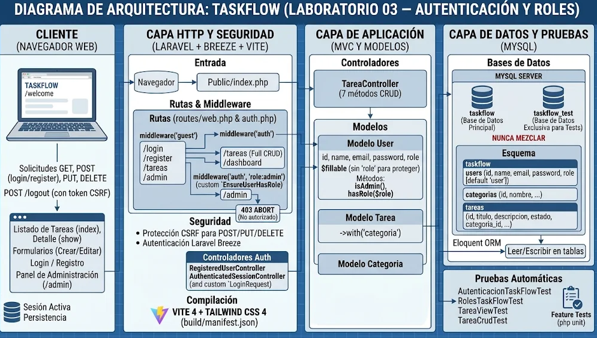

<!--  -->
# Laboratorio 03 — Autenticación básica y roles en TaskFlow

**Curso:** Desarrollo de aplicaciones para ambientes Web Avanzado  
**Capítulo:** 3. Autenticación Básica y Roles  
**Práctica oficial:** 3.7 — Autenticación y gestión básica de roles  
**Duración:** 180 minutos (3 horas de práctica; la instalación de herramientas es prerrequisito)  
**Proyecto conductor:** **TaskFlow existente**, resultado de los laboratorios 1 y 2  
**Versiones de referencia:** Laravel 13.x · PHP 8.3+ · Breeze 2.4.x (Blade) · MySQL 8.4 LTS · Node.js 24 LTS · Vite y Tailwind CSS 4  
**Terminales admitidas:** Bash (Ubuntu/Linux/WSL) o PowerShell (Windows 11)

> **Regla de continuidad.** No cree un nuevo proyecto ni reinicie la base de datos. Todo el laboratorio se realiza en el **mismo TaskFlow** del laboratorio 2. Las tablas `categorias` y `tareas`, sus datos, el controlador `TareaController`, las rutas `tareas.*`, las vistas Blade y los componentes de interfaz deben conservarse.
>
> **Qué entrega esta guía:** comandos, rutas exactas, código completo de los archivos que vamos a crear o sustituir, verificaciones, pruebas y solución de errores. **No se entrega ningún ZIP ni proyecto preconfigurado.**
>
> **Uso local:** no publique el servidor de desarrollo en Internet. Nunca confirme `.env` o `.env.testing` en Git, ni utilice contraseñas reales de otras cuentas para las pruebas.

---

## 1. Objetivo, alcance y tiempos

Al terminar esta práctica, TaskFlow permitirá **registrar usuarios, iniciar sesión, cerrar sesión y proteger el CRUD**, además de distinguir dos roles sencillos (`user` y `admin`) almacenados en la tabla `users`. Una pantalla administrativa de ejemplo solo será accesible para administradores. Las vistas de registro y acceso compartirán la identidad de TaskFlow.

## Diagrama



### Lo que aprenderá el alumno

- [ ] Instalar Breeze **Blade** dentro de TaskFlow sin perder los archivos del proyecto anterior.
- [ ] Reconocer las rutas y controladores que proporciona Breeze para autenticación web.
- [ ] Usar las tablas de usuarios de MySQL, sesiones y contraseñas almacenadas como hashes.
- [ ] Verificar registro, login y logout (logout mediante POST y CSRF).
- [ ] Proteger `/tareas` y sus operaciones CRUD con `auth`, sin duplicar rutas.
- [ ] Añadir a `users` una columna `role` con valor inicial `user`.
- [ ] Impedir que un usuario se asigne `admin` desde el formulario de registro.
- [ ] Registrar un middleware `role:admin` en `bootstrap/app.php`.
- [ ] Personalizar las pantallas de acceso con Blade y Tailwind CSS 4.
- [ ] Adaptar las pruebas del laboratorio 2 y agregar pruebas de autenticación y roles.

| Bloque | Actividades | Tiempo |
|---|---|---:|
| 1 | Respaldo, instalación de Breeze y restauración del frontend TaskFlow | 35 min |
| 2 | Registro, login, logout y rutas protegidas | 40 min |
| 3 | Migración de roles, middleware y zona administrativa | 55 min |
| 4 | Personalización Blade, pruebas, evidencias y Git | 50 min |
| **Total** | | **180 min** |

**Fuera de alcance:** OAuth, Sanctum, JWT, políticas de acceso por propietario de tareas, API REST y verificación de correo obligatoria. Esos asuntos se abordarán en capítulos posteriores si corresponden al temario. **En este ejercicio todos los usuarios autenticados pueden ver y gestionar las tareas compartidas**; las tareas **aún no tienen un campo `user_id`**. No presente la autenticación por sí sola como aislamiento de datos entre usuarios.

---

## 2. Antes de comenzar: comprobar que el laboratorio 2 funciona

### Paso 0.1 — Abrir el proyecto existente

En **Bash**, ajuste la ruta si utilizó otra ubicación:

```bash
cd ~/labs/taskflow
pwd
```

En **PowerShell**:

```powershell
Set-Location "$HOME\labs\taskflow"
Get-Location
```

Ejecute desde la raíz de TaskFlow (los comandos siguientes funcionan en ambas terminales):

```bash
php artisan --version
php -v
composer --version
node -v
npm -v
git status --short
php artisan route:list --path=tareas
php artisan migrate:status
php artisan db:show
```

**Debe comprobar:** Laravel 13.x, conexión a MySQL **`taskflow`**, tablas `categorias` y `tareas`, y rutas `tareas.index`, `tareas.create`, `tareas.store`, `tareas.show`, `tareas.edit`, `tareas.update` y `tareas.destroy`.

Revise en VS Code que se conservan estos archivos del laboratorio 2:

```text
app/Http/Controllers/TareaController.php
app/Models/Tarea.php
app/Models/Categoria.php
resources/views/layouts/app.blade.php
resources/views/tareas/index.blade.php
resources/views/tareas/show.blade.php
resources/views/tareas/create.blade.php
resources/views/tareas/edit.blade.php
resources/views/tareas/partials/_campos.blade.php
resources/views/components/tarjeta-tarea.blade.php
resources/views/components/alerta.blade.php
resources/css/app.css
vite.config.js
tests/Feature/TareaViewTest.php
tests/Feature/TareaCrudTest.php
```

**No continúe** si se está conectando a `taskflow_test` en vez de `taskflow`, si faltan tablas o si no funciona el CRUD del laboratorio 2.

### Paso 0.2 — Guardar el punto de retorno con Git

Compruebe que sus cambios del laboratorio 2 ya están guardados en un commit. Si `git status --short` muestra cambios, revíselos y confírmelos **antes** de avanzar.

```bash
git check-ignore .env
git check-ignore .env.testing
git status --short
git log -1 --oneline
```

**Resultado esperado:** ambos `.env` están ignorados; `git status --short` no muestra archivos pendientes importantes.

Cree la rama del laboratorio 3:

```bash
git switch -c lab-03-autenticacion-roles
```

Si ya existe, use `git switch lab-03-autenticacion-roles` y **no cree una segunda rama**.

Ahora marque el último commit del laboratorio 2 para poder restaurar únicamente los archivos del frontend que Breeze pudiera sustituir:

```bash
git tag lab02-base-antes-breeze
```

> Si la etiqueta ya existe, **no la mueva sin verificarla** (`git show lab02-base-antes-breeze --stat`). Es importante que apunte al estado correcto antes de instalar Breeze.

**Por qué es imprescindible:** Breeze publica rutas, controladores, componentes y archivos de frontend. Parte de ese *scaffolding* puede sustituir `resources/views/layouts/app.blade.php`, `resources/css/app.css`, `package.json` y `vite.config.js`; TaskFlow ya tiene su propio layout `@extends` y trabaja con Tailwind 4. Debemos conservar ambas capacidades sin mezclar versiones.

### Paso 0.3 — Verificar la base de datos de pruebas antes de continuar

El laboratorio 2 creó una base **`taskflow_test`** y el archivo local `.env.testing`.

```bash
php artisan config:clear
php artisan db:show
php artisan db:show --env=testing
```

Verifique estos **dos resultados distintos**:

| Comando | Base esperada |
|---|---|
| `php artisan db:show` | `taskflow` |
| `php artisan db:show --env=testing` | `taskflow_test` |

Si necesita comprobar el archivo **`.env.testing`** creado en el laboratorio 2, debe conservar su clave `APP_KEY` y contener, entre otras variables, estas entradas (sustituya el valor de contraseña por la suya):

```dotenv
APP_ENV=testing
DB_CONNECTION=mysql
DB_HOST=127.0.0.1
DB_PORT=3306
DB_DATABASE=taskflow_test
DB_USERNAME=taskflow
DB_PASSWORD=CAMBIA_ESTA_CLAVE_LOCAL
SESSION_DRIVER=array
CACHE_STORE=array
QUEUE_CONNECTION=sync
```

**Revise también `phpunit.xml`:** si todavía define `<env name="DB_CONNECTION" value="sqlite"/>` o `<env name="DB_DATABASE" value=":memory:"/>`, elimine **solo** esas sobrescrituras para que se use la base aislada de `.env.testing`. No copie contraseñas dentro de `phpunit.xml`.

> **Bloqueo de seguridad.** Si el segundo comando muestra `taskflow` o no puede confirmar de forma inequívoca la base de pruebas, **no ejecute las pruebas con `RefreshDatabase`**. Corrija primero `.env.testing` y cualquier sobrescritura `DB_*` en `phpunit.xml`. Nunca utilice `migrate:fresh` o `migrate:refresh` sobre la base de desarrollo.

---

## 3. Bloque 1 — Instalar Breeze dentro de TaskFlow (35 min)

### Paso 1.1 — Instalar la versión compatible del paquete

En la raíz del proyecto:

```bash
composer require "laravel/breeze:^2.4" --dev
```

Compruebe la versión:

```bash
composer show laravel/breeze
```

**Resultado esperado:** Breeze 2.4.x. Breeze es una opción anterior a los starter kits actuales de Laravel, pero se mantiene aquí porque el **tema 3.1 lo exige expresamente**. La rama 2.4 declara compatibilidad con Laravel 13.

### Paso 1.2 — Publicar autenticación con Blade, NO con React/Vue

```bash
php artisan breeze:install blade
```

Si el instalador pregunta qué stack utilizar, seleccione **Blade**. Si pregunta por un runner de pruebas, conserve **PHPUnit**, que es el utilizado en el laboratorio 2. Si ofrece instalar dependencias frontend de inmediato, puede continuar, pero **la restauración selectiva del siguiente paso debe realizarse antes de volver a instalar paquetes**.

**No ejecute `composer create-project`, `laravel new` ni otros generadores de proyecto.**

Compruebe los nuevos archivos:

```text
routes/auth.php
app/Http/Controllers/Auth/RegisteredUserController.php
app/Http/Controllers/Auth/AuthenticatedSessionController.php
app/Http/Requests/Auth/LoginRequest.php
resources/views/auth/login.blade.php
resources/views/auth/register.blade.php
resources/views/layouts/guest.blade.php
```

Inspeccione también `resources/views/components/`: Breeze añade componentes para etiquetas, entradas y mensajes de error.

### Paso 1.3 — Recuperar solamente la configuración visual que ya funcionaba

Antes de restaurar, inspeccione qué archivos modificó Breeze:

```bash
git status --short
git diff -- vite.config.js package.json resources/css/app.css resources/js/app.js resources/views/layouts/app.blade.php
```

**Conserve** las nuevas rutas `routes/auth.php`, los controladores de `Auth/`, los componentes nuevos de Breeze y `resources/views/layouts/guest.blade.php`.

Para devolver **solo el frontend principal de TaskFlow** al estado del laboratorio 2, ejecute:

```bash
git restore --source=lab02-base-antes-breeze -- \
  resources/views/layouts/app.blade.php \
  resources/css/app.css \
  resources/js/app.js \
  vite.config.js \
  package.json
```

> **PowerShell:** ejecute la misma instrucción en una sola línea (sin las barras `\` de continuación):
>
> ```powershell
> git restore --source=lab02-base-antes-breeze -- resources/views/layouts/app.blade.php resources/css/app.css resources/js/app.js vite.config.js package.json
> ```

Si `package-lock.json` estaba versionado antes de instalar Breeze, compruébelo con `git ls-files package-lock.json` y restáurelo también **antes** de ejecutar `npm install`:

```bash
git restore --source=lab02-base-antes-breeze -- package-lock.json
```

> No ejecute este último comando si Git indica que `package-lock.json` no está versionado. En tal caso, revise el archivo existente y deje que `npm install` regenere su contenido a partir del `package.json` correcto.

Ejecute:

```bash
npm install
npm run build
```

**Verifique:**

- `resources/css/app.css` sigue incluyendo `@import "tailwindcss";` y la directiva `@source` agregada en el laboratorio 2 para la paginación.
- `vite.config.js` sigue usando `@tailwindcss/vite`.
- `resources/views/layouts/app.blade.php` conserva `@yield('content')`, porque `tareas/*.blade.php` utilizan `@extends('layouts.app')`.
- `resources/views/layouts/guest.blade.php` puede seguir usando el layout propio publicado por Breeze para registro y login.
- `npm run build` genera `public/build/manifest.json` sin error.

**Nota:** algunos archivos publicados por Breeze usan el estilo de Tailwind 3, pero **no reinstale Tailwind 3 ni elimine Tailwind 4**. Los formularios que adaptaremos usarán utilidades compatibles con la configuración actual.

### Paso 1.4 — Confirmar tablas y rutas generadas

```bash
php artisan migrate:status
php artisan migrate
php artisan route:list --name=login
php artisan route:list --name=register
php artisan route:list --name=logout
```

`users`, `password_reset_tokens` y `sessions` pueden haber sido creadas por las migraciones iniciales de Laravel durante el laboratorio 2. **No intente recrearlas ni editar retroactivamente esas migraciones.** El nuevo campo `role` se creará después mediante una migración adicional.

En este momento Breeze puede haber sustituido `routes/web.php`; lo corregiremos en el paso 2.3. No se preocupe si temporalmente desaparecieron las rutas `tareas.*`. No borre los modelos ni las vistas previas.

---

## 4. Bloque 2 — Registro, login, logout y protección del CRUD (40 min)

### Paso 2.1 — Revisar `User` y modificar únicamente el backend de registro

Abra `app/Models/User.php`. Laravel ya proporciona este modelo. **No cree otro `User` ni una nueva tabla de usuarios.** En el bloque 3 añadiremos métodos de rol.

A continuación sustituya **completamente** `app/Http/Controllers/Auth/RegisteredUserController.php` por este código, que conserva la validación y los eventos de Breeze pero redirige a TaskFlow:

```php
<?php
// Archivo: app/Http/Controllers/Auth/RegisteredUserController.php

namespace App\Http\Controllers\Auth;

use App\Http\Controllers\Controller;
use App\Models\User;
use Illuminate\Auth\Events\Registered;
use Illuminate\Http\RedirectResponse;
use Illuminate\Http\Request;
use Illuminate\Support\Facades\Auth;
use Illuminate\Support\Facades\Hash;
use Illuminate\Validation\Rules;
use Illuminate\View\View;

class RegisteredUserController extends Controller
{
    public function create(): View
    {
        return view('auth.register');
    }

    public function store(Request $request): RedirectResponse
    {
        $request->validate([
            'name' => ['required', 'string', 'max:255'],
            'email' => ['required', 'string', 'email', 'max:255', 'unique:users,email'],
            'password' => ['required', 'confirmed', Rules\Password::defaults()],
        ]);

        $user = User::create([
            'name' => $request->input('name'),
            'email' => $request->input('email'),
            'password' => Hash::make($request->input('password')),
            // NO leer ni guardar $request->input('role').
        ]);

        event(new Registered($user));
        Auth::login($user);

        return redirect()->route('tareas.index');
    }
}
```

**Puntos de seguridad:** el backend ignora cualquier campo `role` enviado por el navegador; la contraseña se guarda como hash; el registro inicia la sesión y continúa hacia `tareas.index`.

### Paso 2.2 — Adaptar login y logout al proyecto conductor

Reemplace **completamente** `app/Http/Controllers/Auth/AuthenticatedSessionController.php`:

```php
<?php
// Archivo: app/Http/Controllers/Auth/AuthenticatedSessionController.php

namespace App\Http\Controllers\Auth;

use App\Http\Controllers\Controller;
use App\Http\Requests\Auth\LoginRequest;
use Illuminate\Http\RedirectResponse;
use Illuminate\Http\Request;
use Illuminate\Support\Facades\Auth;
use Illuminate\View\View;

class AuthenticatedSessionController extends Controller
{
    public function create(): View
    {
        return view('auth.login');
    }

    public function store(LoginRequest $request): RedirectResponse
    {
        // Breeze valida credenciales y limita los intentos fallidos.
        $request->authenticate();

        // Evita reutilizar el identificador de sesión anterior al login.
        $request->session()->regenerate();

        return redirect()->intended(route('tareas.index'));
    }

    public function destroy(Request $request): RedirectResponse
    {
        Auth::guard('web')->logout();
        $request->session()->invalidate();
        $request->session()->regenerateToken();

        return redirect('/');
    }
}
```

**Conserve** `app/Http/Requests/Auth/LoginRequest.php` generado por Breeze: allí reside la lógica de autenticación y limitación de intentos. También conserve `routes/auth.php`. **No cree un logout GET**; la operación correcta es POST + `@csrf`.

### Paso 2.3 — Sustituir las rutas de TaskFlow por su versión autenticada

Breeze puede sobrescribir `routes/web.php`. Debemos reconstruir allí el CRUD **sin duplicar rutas** y añadir `require __DIR__.'/auth.php';`.

Abra `routes/web.php` y **reemplace completamente el contenido** por:

```php
<?php
// Archivo: routes/web.php

use App\Http\Controllers\TareaController;
use Illuminate\Support\Facades\Route;

// Página de bienvenida pública; logout redirige aquí.
Route::view('/', 'welcome')->name('home');

// Compatibilidad con enlaces predeterminados de Breeze.
Route::get('/dashboard', fn () => redirect()->route('tareas.index'))
    ->middleware('auth')
    ->name('dashboard');

// Se conservan EXACTAMENTE los nombres y URLs del laboratorio 2.
Route::middleware('auth')->group(function () {
    Route::get('/tareas', [TareaController::class, 'index'])
        ->name('tareas.index');

    Route::get('/tareas/crear', [TareaController::class, 'create'])
        ->name('tareas.create');

    Route::post('/tareas', [TareaController::class, 'store'])
        ->name('tareas.store');

    Route::get('/tareas/{tarea}', [TareaController::class, 'show'])
        ->whereNumber('tarea')->name('tareas.show');

    Route::get('/tareas/{tarea}/editar', [TareaController::class, 'edit'])
        ->whereNumber('tarea')->name('tareas.edit');

    Route::put('/tareas/{tarea}', [TareaController::class, 'update'])
        ->whereNumber('tarea')->name('tareas.update');

    Route::delete('/tareas/{tarea}', [TareaController::class, 'destroy'])
        ->whereNumber('tarea')->name('tareas.destroy');
});

// Breeze mantiene sus rutas públicas y de sesión en este archivo separado.
require __DIR__.'/auth.php';
```

Más adelante, en el bloque 3, añadiremos la ruta `admin.index` protegida por rol. **No cree otra vez rutas `tareas.*` dentro del middleware de roles**.

### Paso 2.4 — Crear una página pública de bienvenida

Para que `GET /` sea realmente público y el logout vuelva a una página de TaskFlow (en lugar de mostrar el listado privado), reemplace el archivo **existente** `resources/views/welcome.blade.php` por:

```blade
{{-- Archivo: resources/views/welcome.blade.php --}}
<!DOCTYPE html>
<html lang="es">
<head>
    <meta charset="UTF-8">
    <meta name="viewport" content="width=device-width, initial-scale=1">
    <title>Bienvenido a TaskFlow</title>
    @vite(['resources/css/app.css', 'resources/js/app.js'])
</head>
<body class="flex min-h-screen items-center justify-center bg-slate-50 p-6">
    <main class="w-full max-w-lg rounded-2xl border border-slate-200 bg-white p-8 shadow-sm">
        <h1 class="text-3xl font-bold text-blue-900">TaskFlow</h1>
        <p class="mt-3 text-slate-700">
            Organiza tareas, administra categorías y da seguimiento a tu trabajo.
        </p>
        <div class="mt-6 flex flex-wrap gap-3">
            @auth
                <a href="{{ route('tareas.index') }}"
                   class="rounded-lg bg-blue-800 px-5 py-3 text-white">Entrar a mis tareas</a>
            @else
                <a href="{{ route('login') }}"
                   class="rounded-lg bg-blue-800 px-5 py-3 text-white">Iniciar sesión</a>
                <a href="{{ route('register') }}"
                   class="rounded-lg border border-blue-800 px-5 py-3 text-blue-800">Registrarme</a>
            @endauth
        </div>
    </main>
</body>
</html>
```

### Paso 2.5 — Comprobar el comportamiento antes de añadir roles

Ejecute:

```bash
php artisan route:clear
php artisan view:clear
php artisan route:list --path=tareas -v
php artisan route:list --name=register
php artisan route:list --name=logout
php -l app/Http/Controllers/Auth/RegisteredUserController.php
php -l app/Http/Controllers/Auth/AuthenticatedSessionController.php
php -l routes/web.php
```

Inicie dos terminales:

**Terminal A:**

```bash
php artisan serve --host=127.0.0.1 --port=8000
```

**Terminal B:**

```bash
npm run dev
```

Abra `http://127.0.0.1:8000/tareas` en una ventana privada del navegador. **Resultado esperado:** redirección a `/login`. Registre un usuario con un correo de prueba y una contraseña única para este laboratorio. El sistema debe redirigir a `/tareas` sin perder las tareas existentes.

Compruebe que el correo quedó almacenado en `users` y no se modificaron las tablas `tareas` y `categorias`:

```bash
php artisan tinker
```

Dentro de Tinker:

```php
\App\Models\User::query()->get(['id', 'name', 'email']);
\App\Models\Tarea::count();
```

Salga con `exit`. No imprima ni fotografíe las contraseñas almacenadas.

---

## 5. Bloque 3 — Roles simples y autorización de servidor (55 min)

### Paso 3.1 — Crear una migración adicional para `users.role`

En el laboratorio 2 ya se aplicaron las migraciones iniciales de Laravel. **No edite el archivo antiguo `create_users_table.php`**: eso no cambiaría la tabla ya creada. Genere una migración **nueva**:

```bash
php artisan make:migration add_role_to_users_table --table=users
```

Abra el archivo recién generado `database/migrations/AAAA_MM_DD_HHMMSS_add_role_to_users_table.php` y sustituya su contenido:

```php
<?php
// Archivo: migración generada add_role_to_users_table

use Illuminate\Database\Migrations\Migration;
use Illuminate\Database\Schema\Blueprint;
use Illuminate\Support\Facades\Schema;

return new class extends Migration
{
    public function up(): void
    {
        Schema::table('users', function (Blueprint $table) {
            $table->string('role', 20)->default('user');
        });
    }

    public function down(): void
    {
        Schema::table('users', function (Blueprint $table) {
            $table->dropColumn('role');
        });
    }
};
```

Ejecute **solo** las migraciones pendientes:

```bash
php artisan migrate
php artisan migrate:status
php artisan db:table users
```

**Resultado esperado:** `users.role` existe y su valor predeterminado es `user`. Los usuarios creados antes de la migración reciben `user` al añadirse la columna con valor por defecto. **No ejecute `migrate:fresh`, `migrate:refresh` ni `migrate:rollback` sobre `taskflow`.**

### Paso 3.2 — Completar `User` sin asignación masiva del rol

Sustituya el contenido de `app/Models/User.php` por:

```php
<?php
// Archivo: app/Models/User.php

namespace App\Models;

use Illuminate\Database\Eloquent\Factories\HasFactory;
use Illuminate\Foundation\Auth\User as Authenticatable;
use Illuminate\Notifications\Notifiable;

class User extends Authenticatable
{
    use HasFactory, Notifiable;

    // Intencionadamente NO contiene 'role'.
    protected $fillable = [
        'name',
        'email',
        'password',
    ];

    protected $hidden = [
        'password',
        'remember_token',
    ];

    protected function casts(): array
    {
        return [
            'email_verified_at' => 'datetime',
            'password' => 'hashed',
        ];
    }

    public function isAdmin(): bool
    {
        return $this->role === 'admin';
    }

    public function hasRole(string|array $roles): bool
    {
        return in_array($this->role, (array) $roles, true);
    }
}
```

**Por qué es importante:** `$fillable` restringe la asignación masiva; el código de registro tampoco lee `role` desde la petición. El valor inicial lo determina MySQL. **Ocultar un campo en la vista nunca sustituye la protección del servidor.**

### Paso 3.3 — Crear middleware `EnsureUserHasRole`

```bash
php artisan make:middleware EnsureUserHasRole
```

Reemplace `app/Http/Middleware/EnsureUserHasRole.php`:

```php
<?php
// Archivo: app/Http/Middleware/EnsureUserHasRole.php

namespace App\Http\Middleware;

use Closure;
use Illuminate\Http\Request;
use Symfony\Component\HttpFoundation\Response;

class EnsureUserHasRole
{
    public function handle(
        Request $request,
        Closure $next,
        string ...$roles
    ): Response {
        // Esta regla se aplica DESPUÉS del middleware auth.
        if (!$request->user()?->hasRole($roles)) {
            abort(403, 'No tienes permiso para entrar a esta sección.');
        }

        return $next($request);
    }
}
```

**Concepto:** `auth` responde «¿hay un usuario autenticado?», mientras que `role:admin` responde «¿ese usuario tiene permitido acceder aquí?». Al usar `auth` primero, una visita sin sesión redirige al login; un usuario autenticado sin rol suficiente recibe **HTTP 403**.

### Paso 3.4 — Registrar el alias en `bootstrap/app.php`

Abra `bootstrap/app.php` (en Laravel 13 **no se registra aquí mediante `app/Http/Kernel.php`**, usado por versiones anteriores). **No sustituya todo el archivo**, porque allí pueden existir opciones ya configuradas.

Localice la llamada `->withMiddleware(function (Middleware $middleware): void { ... })` y **agregue el alias** dentro de esa función:

```php
// Fragmento para bootstrap/app.php dentro de withMiddleware(...)
$middleware->alias([
    'role' => \App\Http\Middleware\EnsureUserHasRole::class,
]);
```

Si la función estaba vacía, la sección completa debe quedar así:

```php
->withMiddleware(function (Middleware $middleware): void {
    $middleware->alias([
        'role' => \App\Http\Middleware\EnsureUserHasRole::class,
    ]);
})
```

> Mantenga las importaciones, `withRouting(...)`, `withExceptions(...)` y cualquier otro middleware preexistente. Si ya hay un `alias([...])`, **añada** `'role'` a su arreglo en lugar de crear una segunda definición contradictoria.

Compruebe la sintaxis:

```bash
php -l app/Models/User.php
php -l app/Http/Middleware/EnsureUserHasRole.php
php -l bootstrap/app.php
```

### Paso 3.5 — Crear la vista administrativa

**Bash:**

```bash
mkdir -p resources/views/admin
```

**PowerShell:**

```powershell
New-Item -ItemType Directory -Force resources/views/admin
```

Cree `resources/views/admin/index.blade.php`:

```blade
{{-- Archivo: resources/views/admin/index.blade.php --}}
@extends('layouts.app')

@section('title', 'Administración - TaskFlow')

@section('content')
    <div class="rounded-xl border border-slate-200 bg-white p-6 shadow-sm">
        <h1 class="text-3xl font-bold text-blue-900">Administración</h1>
        <p class="mt-3 text-slate-700">
            Esta pantalla es visible únicamente para usuarios con rol admin.
        </p>
        <p class="mt-3 text-sm text-slate-600">
            Cuenta: {{ auth()->user()->email }}
        </p>
        <a href="{{ route('tareas.index') }}"
           class="mt-6 inline-block text-blue-700 underline">Volver a tareas</a>
    </div>
@endsection
```

**Importante:** no estamos implementando una administración real de cuentas. La pantalla permite demostrar el control de acceso por rol de forma segura y verificable.

### Paso 3.6 — Registrar la ruta administrativa sin cambiar las rutas del CRUD

Abra otra vez `routes/web.php`. **Conserve todo lo creado en el paso 2.3.** Añada, **después del grupo de tareas y antes de `require __DIR__.'/auth.php';`**, esta ruta:

```php
// Agregar a routes/web.php; no borrar las rutas anteriores.
Route::get('/admin', fn () => view('admin.index'))
    ->middleware(['auth', 'role:admin'])
    ->name('admin.index');
```

La estructura final debe conservar:

```text
GET  /                   -> welcome (pública)
GET  /dashboard          -> redirección a tareas (auth)
GET  /tareas             -> tareas.index (auth)
GET  /tareas/crear       -> tareas.create (auth)
POST /tareas             -> tareas.store (auth)
GET  /tareas/{tarea}     -> tareas.show (auth)
GET  /tareas/{tarea}/editar -> tareas.edit (auth)
PUT  /tareas/{tarea}     -> tareas.update (auth)
DELETE /tareas/{tarea}   -> tareas.destroy (auth)
GET  /admin              -> admin.index (auth + role:admin)
routes/auth.php          -> login, register, logout, etc.
```

Verifique:

```bash
php artisan route:clear
php artisan route:list --path=admin -v
php artisan route:list --path=tareas -v
```

### Paso 3.7 — Crear un administrador únicamente mediante consola confiable

**No agregue una opción de rol al formulario de registro.** Registre **dos usuarios de prueba** desde `/register`, con correos propios de laboratorio, por ejemplo:

```text
usuario@taskflow.test  -> seguirá con role=user
admin@taskflow.test    -> se elevará a role=admin desde la consola
```

**Las contraseñas las elige el alumno al registrarse; no se publican en el material.**

Después, **solo en su máquina local**, abra Tinker:

```bash
php artisan tinker
```

Ejecute las siguientes instrucciones **una por una dentro de Tinker**, no en Bash ni PowerShell:

```php
$admin = \App\Models\User::where('email', 'admin@taskflow.test')->firstOrFail();
$admin->role = 'admin';
$admin->save();
$admin->refresh()->role;
```

Debe mostrar `'admin'`. Para confirmar el usuario estándar:

```php
\App\Models\User::where('email', 'usuario@taskflow.test')->firstOrFail()->role;
```

Debe mostrar `'user'`. Salga con `exit`.

> Si usó otros correos, sustituya los del ejemplo por los suyos. **No modifique roles con parámetros recibidos del navegador**. Para aplicaciones de producción se requieren procesos administrativos auditables y permisos más finos.

### Paso 3.8 — Verificar los tres casos de autorización

En el navegador, compruebe:

| Sesión | Solicitud | Resultado esperado |
|---|---|---|
| Sin sesión | `GET /tareas` | Redirección a `/login` |
| Sin sesión | `GET /admin` | Redirección a `/login` |
| `role=user` | `GET /tareas` | HTTP 200 |
| `role=user` | `GET /admin` | HTTP 403 |
| `role=admin` | `GET /admin` | HTTP 200 |
| Cualquier usuario autenticado | Enviar logout POST | Sesión finalizada y retorno a `/` |

Utilice ventanas privadas o cierre sesión entre pruebas para no confundir cuentas.

---

## 6. Bloque 4 — Vistas personalizadas, pruebas y entrega (50 min)

### Paso 4.1 — Mejorar la navegación de TaskFlow

El layout del laboratorio 2 mostraba solo el nombre y «Laboratorio 02». Reemplace **completamente** `resources/views/layouts/app.blade.php` por esta versión, que conserva la estructura `@extends` / `@yield` y muestra la cuenta activa:

```blade
{{-- Archivo: resources/views/layouts/app.blade.php --}}
<!DOCTYPE html>
<html lang="es">
<head>
    <meta charset="UTF-8">
    <meta name="viewport" content="width=device-width, initial-scale=1.0">
    <title>@yield('title', 'TaskFlow')</title>
    @vite(['resources/css/app.css', 'resources/js/app.js'])
</head>
<body class="min-h-screen bg-slate-50 text-slate-900">
    <header class="border-b border-slate-200 bg-white">
        <div class="mx-auto flex max-w-4xl flex-wrap items-center justify-between gap-4 p-6">
            <a href="{{ route('tareas.index') }}"
               class="text-xl font-bold text-blue-900">TaskFlow</a>

            @auth
                <div class="flex flex-wrap items-center gap-3 text-sm">
                    <span class="text-slate-600">
                        {{ auth()->user()->name }} ({{ auth()->user()->role }})
                    </span>

                    @if (auth()->user()->isAdmin())
                        <a href="{{ route('admin.index') }}"
                           class="font-medium text-blue-700 underline">Administración</a>
                    @endif

                    <form method="POST" action="{{ route('logout') }}">
                        @csrf
                        <button type="submit"
                                class="rounded-lg bg-slate-800 px-4 py-2 text-white hover:bg-slate-900">
                            Cerrar sesión
                        </button>
                    </form>
                </div>
            @endauth
        </div>
    </header>

    <main class="mx-auto max-w-4xl p-6">
        @yield('content')
    </main>
</body>
</html>
```

**Advertencia:** mostrar u ocultar el enlace a «Administración» no es la autorización real. La protección efectiva es `->middleware(['auth', 'role:admin'])` en el servidor.

### Paso 4.2 — Personalizar el formulario de login de Breeze

Breeze agregó componentes Blade que debemos conservar. Reemplace `resources/views/auth/login.blade.php`:

```blade
{{-- Archivo: resources/views/auth/login.blade.php --}}
<x-guest-layout>
    <div class="mb-6 text-center">
        <h1 class="text-3xl font-bold text-blue-900">TaskFlow</h1>
        <p class="mt-2 text-sm text-slate-600">Accede para gestionar tus tareas</p>
    </div>

    <x-auth-session-status class="mb-4" :status="session('status')" />

    <form method="POST" action="{{ route('login') }}" class="space-y-5">
        @csrf

        <div>
            <x-input-label for="email" value="Correo electrónico" />
            <x-text-input id="email" name="email" type="email"
                          class="mt-1 block w-full" :value="old('email')"
                          required autofocus autocomplete="username" />
            <x-input-error :messages="$errors->get('email')" class="mt-2" />
        </div>

        <div>
            <x-input-label for="password" value="Contraseña" />
            <x-text-input id="password" name="password" type="password"
                          class="mt-1 block w-full"
                          required autocomplete="current-password" />
            <x-input-error :messages="$errors->get('password')" class="mt-2" />
        </div>

        <label class="inline-flex items-center gap-2 text-sm text-slate-700">
            <input type="checkbox" name="remember" class="rounded border-slate-300">
            Recordarme
        </label>

        <div class="flex flex-wrap items-center justify-between gap-3">
            <a class="text-sm text-blue-700 underline" href="{{ route('register') }}">
                Crear cuenta
            </a>
            <button type="submit"
                    class="rounded-lg bg-blue-800 px-5 py-3 text-white hover:bg-blue-900">
                Iniciar sesión
            </button>
        </div>

        @if (Route::has('password.request'))
            <a class="block text-sm text-slate-600 underline"
               href="{{ route('password.request') }}">
                ¿Olvidaste tu contraseña?
            </a>
        @endif
    </form>
</x-guest-layout>
```

No cambie los atributos `name="email"`, `name="password"`, `name="remember"`, la ruta `login` ni `@csrf`: son parte del contrato entre Blade y el backend de Breeze.

### Paso 4.3 — Personalizar el registro (sin campo de rol)

Reemplace `resources/views/auth/register.blade.php`:

```blade
{{-- Archivo: resources/views/auth/register.blade.php --}}
<x-guest-layout>
    <div class="mb-6 text-center">
        <h1 class="text-3xl font-bold text-blue-900">Crear cuenta TaskFlow</h1>
        <p class="mt-2 text-sm text-slate-600">
            Los usuarios nuevos se registran con permisos estándar.
        </p>
    </div>

    <form method="POST" action="{{ route('register') }}" class="space-y-5">
        @csrf

        <div>
            <x-input-label for="name" value="Nombre" />
            <x-text-input id="name" name="name" type="text"
                          class="mt-1 block w-full" :value="old('name')"
                          required autofocus autocomplete="name" />
            <x-input-error :messages="$errors->get('name')" class="mt-2" />
        </div>

        <div>
            <x-input-label for="email" value="Correo electrónico" />
            <x-text-input id="email" name="email" type="email"
                          class="mt-1 block w-full" :value="old('email')"
                          required autocomplete="username" />
            <x-input-error :messages="$errors->get('email')" class="mt-2" />
        </div>

        <div>
            <x-input-label for="password" value="Contraseña" />
            <x-text-input id="password" name="password" type="password"
                          class="mt-1 block w-full" required
                          autocomplete="new-password" />
            <x-input-error :messages="$errors->get('password')" class="mt-2" />
        </div>

        <div>
            <x-input-label for="password_confirmation" value="Confirmar contraseña" />
            <x-text-input id="password_confirmation" name="password_confirmation"
                          type="password" class="mt-1 block w-full" required
                          autocomplete="new-password" />
        </div>

        <div class="flex flex-wrap items-center justify-between gap-3">
            <a href="{{ route('login') }}" class="text-sm text-blue-700 underline">
                Ya tengo cuenta
            </a>
            <button type="submit"
                    class="rounded-lg bg-blue-800 px-5 py-3 text-white hover:bg-blue-900">
                Registrarme
            </button>
        </div>
    </form>
</x-guest-layout>
```

**Compruebe:** el formulario solo envía `name`, `email`, `password` y `password_confirmation`. El rol no se solicita. Incluso si un cliente malicioso agregara `role=admin`, el controlador lo ignoraría.

### Paso 4.4 — Actualizar las pruebas del laboratorio 2: vistas y acceso

**Importante:** las 12 pruebas del laboratorio 2 accedían a `/tareas` sin iniciar sesión. Después de aplicar `auth`, **debemos autenticar usuarios de prueba**, no eliminar esas pruebas.

Abra y **sustituya** `tests/Feature/TareaViewTest.php` por:

```php
<?php
// Archivo: tests/Feature/TareaViewTest.php

namespace Tests\Feature;

use App\Models\Tarea;
use App\Models\User;
use Database\Seeders\TaskFlowSeeder;
use Illuminate\Foundation\Testing\RefreshDatabase;
use Tests\TestCase;

class TareaViewTest extends TestCase
{
    use RefreshDatabase;

    protected function setUp(): void
    {
        parent::setUp();
        $this->withoutVite();
        $this->seed(TaskFlowSeeder::class);
        $this->actingAs(User::factory()->create());
    }

    public function test_el_listado_muestra_las_dos_tareas(): void
    {
        $this->get(route('tareas.index'))
            ->assertOk()
            ->assertViewIs('tareas.index')
            ->assertSee('Preparar informe')
            ->assertSee('Revisar UI');
    }

    public function test_la_pagina_publica_carga(): void
    {
        $this->get('/')->assertOk()->assertSee('TaskFlow');
    }

    public function test_el_detalle_muestra_una_tarea(): void
    {
        $tarea = Tarea::where('titulo', 'Preparar informe')->firstOrFail();

        $this->get(route('tareas.show', $tarea))
            ->assertOk()
            ->assertViewIs('tareas.show')
            ->assertSee('Redactar propuesta.');
    }

    public function test_una_tarea_inexistente_devuelve_404(): void
    {
        $this->get('/tareas/999999')->assertNotFound();
    }

    public function test_blade_escapa_html_peligroso_en_el_detalle(): void
    {
        $tarea = Tarea::create([
            'titulo' => '<script>alert(1)</script>',
            'descripcion' => 'Texto de prueba',
            'estado' => 'Pendiente',
        ]);

        $this->get(route('tareas.show', $tarea))
            ->assertOk()
            ->assertSee('&lt;script&gt;alert(1)&lt;/script&gt;', false)
            ->assertDontSee('<script>alert(1)</script>', false);
    }
}
```

Esta versión conserva cinco pruebas: listado, página principal, detalle, 404 y escape HTML.

### Paso 4.5 — Actualizar las pruebas del CRUD

Abra y **sustituya** `tests/Feature/TareaCrudTest.php` por:

```php
<?php
// Archivo: tests/Feature/TareaCrudTest.php

namespace Tests\Feature;

use App\Models\Categoria;
use App\Models\Tarea;
use App\Models\User;
use Database\Seeders\TaskFlowSeeder;
use Illuminate\Foundation\Testing\RefreshDatabase;
use Tests\TestCase;

class TareaCrudTest extends TestCase
{
    use RefreshDatabase;

    protected function setUp(): void
    {
        parent::setUp();
        $this->withoutVite();
        $this->seed(TaskFlowSeeder::class);
        $this->actingAs(User::factory()->create());
    }

    public function test_crear_una_tarea(): void
    {
        $categoria = Categoria::firstOrFail();

        $this->post(route('tareas.store'), [
            'titulo' => 'Escribir pruebas',
            'descripcion' => 'Crear pruebas del CRUD',
            'estado' => 'Pendiente',
            'categoria_id' => $categoria->id,
        ])->assertRedirect(route('tareas.index'));

        $this->assertDatabaseHas('tareas', [
            'titulo' => 'Escribir pruebas',
            'categoria_id' => $categoria->id,
        ]);
    }

    public function test_actualizar_una_tarea(): void
    {
        $tarea = Tarea::firstOrFail();

        $this->put(route('tareas.update', $tarea), [
            'titulo' => 'Informe actualizado',
            'descripcion' => 'Nueva descripción',
            'estado' => 'Completada',
            'categoria_id' => null,
        ])->assertRedirect(route('tareas.show', $tarea));

        $this->assertDatabaseHas('tareas', [
            'id' => $tarea->id,
            'titulo' => 'Informe actualizado',
            'estado' => 'Completada',
        ]);
    }

    public function test_eliminar_una_tarea(): void
    {
        $tarea = Tarea::firstOrFail();

        $this->delete(route('tareas.destroy', $tarea))
            ->assertRedirect(route('tareas.index'));

        $this->assertDatabaseMissing('tareas', ['id' => $tarea->id]);
    }

    public function test_no_acepta_titulo_vacio_ni_estado_invalido(): void
    {
        $this->post(route('tareas.store'), [
            'titulo' => '',
            'descripcion' => 'Texto',
            'estado' => 'Superusuario',
        ])->assertSessionHasErrors(['titulo', 'estado']);
    }

    public function test_no_acepta_una_categoria_inexistente(): void
    {
        $this->post(route('tareas.store'), [
            'titulo' => 'Categoría inválida',
            'estado' => 'Pendiente',
            'categoria_id' => 999999,
        ])->assertSessionHasErrors('categoria_id');
    }

    public function test_paginacion_tiene_limite_superior_y_ordenamiento_seguro(): void
    {
        $this->get('/tareas?sort=columna_falsa&direction=otro&per_page=1000000')
            ->assertOk()
            ->assertViewHas('sort', 'id')
            ->assertViewHas('direction', 'desc')
            ->assertViewHas('perPage', 10);
    }

    public function test_muestra_404_al_editar_registro_inexistente(): void
    {
        $this->get('/tareas/999999/editar')->assertNotFound();
    }
}
```

**Motivo del cambio:** la lógica del CRUD **no cambia** respecto al laboratorio 2; solo cambia el requisito de iniciar sesión para poder usarla.

### Paso 4.6 — Agregar pruebas de autenticación y roles

Genere los dos archivos:

```bash
php artisan make:test AutenticacionTaskFlowTest
php artisan make:test RolesTaskFlowTest
```

Sustituya **`tests/Feature/AutenticacionTaskFlowTest.php`**:

```php
<?php
// Archivo: tests/Feature/AutenticacionTaskFlowTest.php

namespace Tests\Feature;

use App\Models\User;
use Illuminate\Foundation\Testing\RefreshDatabase;
use Illuminate\Support\Facades\Hash;
use Tests\TestCase;

class AutenticacionTaskFlowTest extends TestCase
{
    use RefreshDatabase;

    protected function setUp(): void
    {
        parent::setUp();
        $this->withoutVite();
    }

    public function test_visitante_no_puede_entrar_al_crud(): void
    {
        $this->get(route('tareas.index'))
            ->assertRedirect(route('login'));
    }

    public function test_registro_crea_usuario_estandar_e_ignora_rol_falso(): void
    {
        $this->post(route('register'), [
            'name' => 'Alumno',
            'email' => 'alumno@taskflow.test',
            'password' => 'ClaveSegura123!',
            'password_confirmation' => 'ClaveSegura123!',
            'role' => 'admin', // Intento de manipulación del cliente.
        ])->assertRedirect(route('tareas.index'));

        $this->assertAuthenticated();
        $usuario = User::where('email', 'alumno@taskflow.test')->firstOrFail();
        $this->assertSame('user', $usuario->role);
        $this->assertNotEquals('ClaveSegura123!', $usuario->password);
        $this->assertTrue(Hash::check('ClaveSegura123!', $usuario->password));
    }

    public function test_login_con_credenciales_correctas(): void
    {
        $usuario = User::factory()->create([
            'password' => Hash::make('ClaveSegura123!'),
        ]);

        $this->post(route('login'), [
            'email' => $usuario->email,
            'password' => 'ClaveSegura123!',
        ])->assertRedirect(route('tareas.index'));

        $this->assertAuthenticatedAs($usuario);
    }

    public function test_login_rechaza_contrasena_incorrecta(): void
    {
        $usuario = User::factory()->create([
            'password' => Hash::make('ClaveSegura123!'),
        ]);

        $this->post(route('login'), [
            'email' => $usuario->email,
            'password' => 'NoEsLaClave',
        ])->assertSessionHasErrors('email');

        $this->assertGuest();
    }

    public function test_logout_cierra_sesion_y_vuelve_al_inicio(): void
    {
        $this->actingAs(User::factory()->create())
            ->post(route('logout'))
            ->assertRedirect('/');

        $this->assertGuest();
    }
}
```

Sustituya **`tests/Feature/RolesTaskFlowTest.php`**:

```php
<?php
// Archivo: tests/Feature/RolesTaskFlowTest.php

namespace Tests\Feature;

use App\Models\User;
use Illuminate\Foundation\Testing\RefreshDatabase;
use Tests\TestCase;

class RolesTaskFlowTest extends TestCase
{
    use RefreshDatabase;

    protected function setUp(): void
    {
        parent::setUp();
        $this->withoutVite();
    }

    public function test_visitante_es_redirigido_al_login_admin(): void
    {
        $this->get(route('admin.index'))
            ->assertRedirect(route('login'));
    }

    public function test_usuario_estandar_recibe_403(): void
    {
        $this->actingAs(User::factory()->create())
            ->get(route('admin.index'))
            ->assertForbidden();
    }

    public function test_administrador_puede_entrar(): void
    {
        $admin = User::factory()->create();
        $admin->role = 'admin';
        $admin->save();

        $this->actingAs($admin)
            ->get(route('admin.index'))
            ->assertOk()
            ->assertSee('Administración');
    }

    public function test_un_usuario_nuevo_no_es_administrador(): void
    {
        $usuario = User::factory()->create();

        $this->assertSame('user', $usuario->refresh()->role);
        $this->assertFalse($usuario->isAdmin());
    }
}
```

**Nota de seguridad:** las pruebas HTTP de Laravel normalmente omiten la verificación de CSRF para facilitar los tests. **No interprete eso como prueba de que CSRF funciona.** Compruebe manualmente en el navegador que el formulario de logout contiene `@csrf`; el capítulo 4 profundizará en la protección CSRF.

### Paso 4.7 — Ejecutar pruebas EXCLUSIVAMENTE contra `taskflow_test`

**Antes de ejecutar cualquier prueba con `RefreshDatabase`** repita:

```bash
php artisan config:clear
php artisan db:show --env=testing
```

**Debe indicar MySQL y `taskflow_test`.** Revise que `phpunit.xml` **no** imponga otra base (`DB_CONNECTION=sqlite`, `DB_DATABASE=:memory:` ni `DB_DATABASE=taskflow`) sobre `.env.testing`. Si es necesario, corrija las entradas `DB_*` como se indicó en el laboratorio 2.

> **Si no se identifica claramente `taskflow_test`, DETÉNGASE.** `RefreshDatabase` puede alterar las tablas de la conexión activa. Las contraseñas y los datos reales del laboratorio permanecen únicamente en `taskflow`.

Luego ejecute:

```bash
php artisan test --filter=TareaViewTest
php artisan test --filter=TareaCrudTest
php artisan test --filter=AutenticacionTaskFlowTest
php artisan test --filter=RolesTaskFlowTest
```

**Resultado esperado:** 5 pruebas de vistas, 7 de CRUD, 5 de autenticación y 4 de roles = **21 pruebas del curso**, sin errores. El número exacto de *assertions* depende de PHPUnit.

**Sobre `php artisan test` sin filtro:** Breeze añade sus propias pruebas de autenticación y perfil. Algunas están escritas para las rutas, redirecciones o layouts originales del scaffolding; si falla una prueba de Breeze, **no la suprima para que el contador salga verde**. Revise su comportamiento esperado y adáptela a las rutas del proyecto. La validación mínima de esta práctica son las **21 pruebas indicadas**. La suite completa puede requerir ajustar las pruebas de perfil ajenas al alcance del capítulo.

Verifique de nuevo, ya fuera del entorno de pruebas:

```bash
php artisan db:show
php artisan migrate:status
```

El primero debe indicar **`taskflow`**, y sus tareas del laboratorio 2 deben permanecer intactas.

### Paso 4.8 — Comprobación final en navegador

Con `php artisan serve` y `npm run dev` activos, verifique de manera secuencial:

| Acción | Resultado esperado |
|---|---|
| Abrir `/` sin sesión | Bienvenida TaskFlow con enlaces a login y registro |
| Abrir `/tareas` sin sesión | Redirige a `/login` |
| Registrar usuario nuevo | Inicia sesión y redirige a `/tareas` |
| Recargar `/tareas` | Las tareas y categorías del laboratorio 2 siguen allí |
| Editar y crear una tarea | Continúan funcionando los formularios y CSRF |
| Pulsar «Cerrar sesión» | Envía POST, finaliza la sesión y vuelve a `/` |
| Iniciar sesión con usuario normal | Acceso permitido a tareas |
| Abrir `/admin` como usuario normal | HTTP 403 |
| Iniciar sesión con usuario admin | Acceso a `/admin`, HTTP 200 |
| Intentar registrar `role=admin` desde el cliente | El servidor crea siempre un usuario con rol `user` |

### Paso 4.9 — Solución de problemas frecuentes

**A. `Route [login] not defined` al abrir `/tareas`.** Verifique que `routes/web.php` termina con `require __DIR__.'/auth.php';`, que existe `routes/auth.php` y que `php artisan route:list --name=login` devuelve la ruta.

**B. `Route [tareas.index] not defined` tras instalar Breeze.** El scaffolding probablemente sustituyó `routes/web.php`. Reaplique el contenido del **paso 2.3**; no duplique rutas ni elimine `routes/auth.php`.

**C. `Undefined variable $slot` o desaparece el contenido de las vistas `tareas.*`.** El layout de Breeze usa un patrón de componentes distinto al `@extends('layouts.app')` de TaskFlow. Restaure `resources/views/layouts/app.blade.php` con el paso 1.3 y aplique luego el layout definitivo del paso 4.1.

**D. Tailwind dejó de funcionar / `Unknown at rule @tailwind` / errores de Vite.** Compruebe que conservó `package.json`, el plugin `@tailwindcss/vite`, `vite.config.js` y el CSS del laboratorio 2. Ejecute `npm install`, `npm run build` y después `npm run dev`.

**E. `Unknown column 'role'` o `role` aparece nulo.** Confirme la migración `add_role_to_users_table` con `php artisan migrate:status`. Ejecute `php artisan migrate` contra `taskflow` si está pendiente. No edite ni reejecute por la fuerza la migración inicial de usuarios.

**F. Usuario normal accede a `/admin`.** Compruebe que la ruta tiene `['auth', 'role:admin']`, que el alias está en `bootstrap/app.php`, que el middleware comprueba `$request->user()?->hasRole(...)` y que el usuario realmente conserva `role=user`.

**G. `403` para un administrador recién elevado.** Cierre sesión y vuelva a iniciar para renovar el estado del usuario. Revise en Tinker que `role` es exactamente `'admin'`, en minúsculas.

**H. `419 Page Expired` al cerrar sesión.** El logout debe ser un **formulario POST con `@csrf`**. Verifique que la sesión está habilitada y que no está mezclando hosts `localhost` y `127.0.0.1` al navegar.

**I. `419` o problemas de sesión después del registro.** Conserve `APP_KEY`, `SESSION_DRIVER=file` y `APP_URL` coherentes con el servidor. No regenere la clave de la aplicación en un proyecto existente para solucionar arbitrariamente el problema.

**J. Fallan pruebas de Breeze `ProfileTest`.** Compruebe si el scaffolding creó rutas y vistas de perfil adicionales. Este laboratorio no implementa edición de perfiles; no considere esas pruebas como parte de las 21 pruebas requeridas sin revisar primero su contrato. No borre los archivos de pruebas en silencio.

**K. `SQLSTATE ... access denied`.** Verifique la configuración del laboratorio 2, la conexión MySQL y las variables de `.env`. No cree bases nuevas ni sobrescriba credenciales ajenas para solucionar la incidencia.

### Paso 4.10 — Guardar evidencias y confirmar el avance

Registre evidencias de:

1. `php artisan --version` y `composer show laravel/breeze`.
2. `php artisan migrate:status` con la migración de `users.role` aplicada.
3. `php artisan route:list --path=tareas -v` mostrando el middleware `auth`.
4. `php artisan route:list --path=admin -v` mostrando `auth` + `role:admin`.
5. Pantallas `/register` y `/login` con la identidad de TaskFlow.
6. Redirección de invitado desde `/tareas` a `/login`.
7. Acceso a tareas con usuario registrado, manteniendo los datos anteriores.
8. HTTP 403 para un usuario normal en `/admin`, y acceso correcto para el administrador.
9. Cierre de sesión mediante POST.
10. Las **21 pruebas** aprobadas sobre la base **`taskflow_test`**.

**No capture ni entregue contraseñas o el contenido de `.env`.**

Detenga Laravel y Vite con `Ctrl + C` cuando termine. Compruebe:

```bash
git check-ignore .env
git check-ignore .env.testing
git status --short
git diff --stat
```

Examine los cambios antes de confirmar:

```bash
git add .
git status --short
git commit -m "lab03: autenticacion Breeze, roles y rutas protegidas TaskFlow"
git log -1 --oneline
```

> Si `git status --short` muestra `.env`, `.env.testing` o secretos en el área de staging, **no realice el commit** hasta retirar esos archivos y corregir `.gitignore`.

---

## 7. Lista de comprobación final

- [ ] Continúa el **mismo** proyecto TaskFlow de los laboratorios 1 y 2.
- [ ] Breeze 2.4.x se instaló sobre Laravel 13 y se conservó Blade.
- [ ] El frontend utiliza Tailwind CSS 4 con Vite, sin reinstalar versiones antiguas.
- [ ] `users` tiene la columna `role`, predeterminada a `user`.
- [ ] `User::$fillable` **no** contiene `role`.
- [ ] Registro, login y logout funcionan con MySQL y sesiones web.
- [ ] Los usuarios no pueden elegir su rol durante el registro.
- [ ] Todas las rutas `tareas.*` están protegidas con `auth`.
- [ ] La ruta `/admin` solo funciona con `role=admin`.
- [ ] Los visitantes son redirigidos a login, y los usuarios sin permisos reciben HTTP 403.
- [ ] Registro y login muestran la identidad visual de TaskFlow.
- [ ] Los datos del CRUD del laboratorio 2 siguen presentes.
- [ ] Las pruebas se ejecutaron **solo** sobre `taskflow_test`.
- [ ] Se aprobaron las **21 pruebas del curso**.
- [ ] Se guardó el avance en Git sin archivos confidenciales.

---

## 8. Continuidad hacia el laboratorio 4

Conserve **todos** los archivos y tablas. La siguiente práctica profundizará en validación segura, CSRF, mitigación de XSS, mejores prácticas de formularios, hashing y subida segura de archivos. **No implementaremos adjuntos todavía.**

Estado final de TaskFlow:

```text
TaskFlow (Laravel 13)
├── MySQL: taskflow
│   ├── categorias
│   ├── tareas
│   └── users (role: user | admin)
├── Modelos: Categoria, Tarea, User
├── Controladores: TareaController + Auth/* (Breeze)
├── Rutas públicas: /, /login, /register
├── Rutas autenticadas: /tareas y todas las operaciones CRUD
├── Ruta restringida: /admin (auth + role:admin)
├── Blade: vistas de tareas + login/registro + admin
├── Frontend: Vite + Tailwind CSS 4
└── Pruebas: taskflow_test, aislada de taskflow
```

## 9. Referencias para consulta

- Presentación corregida del curso, capítulo 3: **diapositivas 167–217**, temas 3.1 a 3.7.
- [Laravel 13 — Autenticación](https://laravel.com/docs/13.x/authentication).
- [Laravel 13 — Middleware](https://laravel.com/docs/13.x/middleware).
- [Laravel 13 — Autorización](https://laravel.com/docs/13.x/authorization).
- [Laravel 13 — Starter Kits](https://laravel.com/docs/13.x/starter-kits).
- [Breeze en Packagist](https://packagist.org/packages/laravel/breeze): versión 2.4.x compatible con Laravel 13.
- [Laravel 13 — Hashing](https://laravel.com/docs/13.x/hashing).
- [Laravel 13 — HTTP Tests](https://laravel.com/docs/13.x/http-tests).
- [Laravel 13 — Database Testing](https://laravel.com/docs/13.x/database-testing).
- [Guía anterior del repositorio Netec](https://github.com/Netec-Mx/DESAPP_AVZ/blob/main/Capitulo03/README.md): referencia de contraste. **No mezcle** sus rutas `tasks.*`, `TaskController` o la referencia antigua a Laravel 11 con esta guía.

---

**Fin del laboratorio 03.** Este material proporciona los comandos y los archivos necesarios para ejecutar la práctica, pero **no sustituye una ejecución real de extremo a extremo** en un equipo con Laravel 13, MySQL y Breeze instalados. Documente cualquier incidencia encontrada durante la validación del instructor.

<!--  -->
