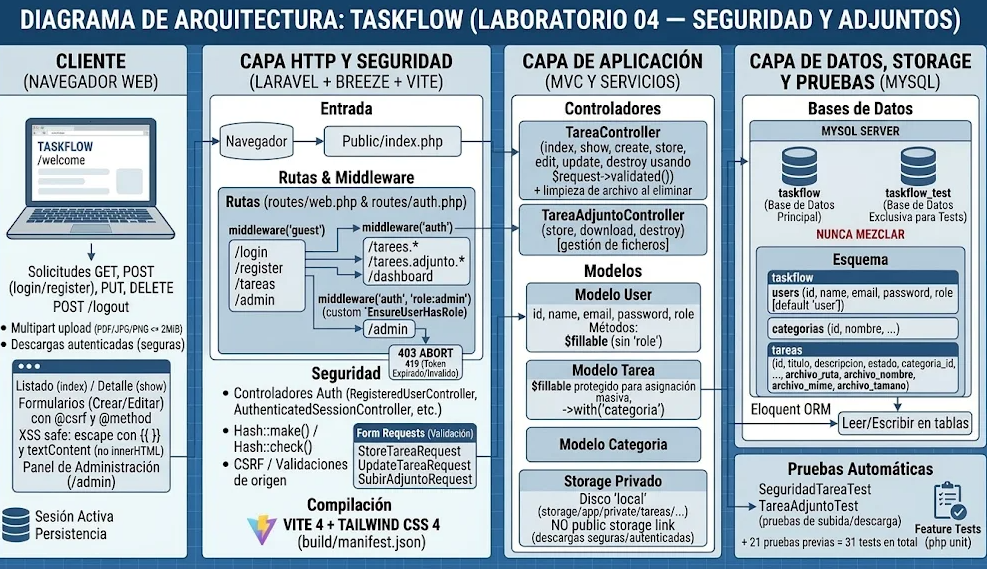

# Laboratorio 04 — Seguridad web esencial en TaskFlow
<!--  -->

**Curso:** Desarrollo de aplicaciones para ambientes Web Avanzado  
**Capítulo:** 4. Seguridad Web Esencial en Laravel (PHP, Python)  
**Práctica oficial:** 4.7 — Seguridad esencial en aplicaciones Laravel  
**Duración:** **180 minutos de práctica**  
**Proyecto:** el **mismo TaskFlow** de los laboratorios 1, 2 y 3  
**Stack:** Laravel 13.x · PHP 8.3+ · MySQL 8.4 LTS · Breeze Blade · Vite · Tailwind CSS 4  
**Terminales:** Bash (Ubuntu/WSL/Linux) y PowerShell (Windows 11)

> **Regla de continuidad:** **No cree otro proyecto Laravel**, no reinstale Breeze y no reinicie MySQL. Deben conservarse las tablas `categorias`, `tareas`, `users`, los roles `user/admin`, el controlador `TareaController`, las rutas `tareas.*`, el layout de TaskFlow y las pruebas de los laboratorios anteriores.
>
> **Un alcance explícito:** el laboratorio 3 implementó autenticación y roles, pero **las tareas son compartidas entre todos los usuarios autenticados**. Este laboratorio protege adjuntos con `auth` y almacenamiento privado; **no introduce permisos por propietario de tarea**. No afirme que un usuario está impedido de acceder a los adjuntos de otra cuenta si su aplicación todavía no relaciona tareas con usuarios.
>
> **Solo instrucciones:** este documento contiene los comandos y el código que debe introducir el alumno. No requiere un ZIP, proyecto de arranque ni modificar el repositorio del curso.

---

## 1. Objetivo, resultados y distribución

**Objetivo:** reforzar TaskFlow para validar entradas en el backend, mantener formularios con protección CSRF, evitar la ejecución accidental de HTML/JavaScript al mostrar datos, verificar correctamente el hashing de contraseñas y añadir un adjunto privado (PDF o imagen) a cada tarea, con carga, descarga y eliminación controladas.

## Diagrama



Al finalizar, el alumno debe poder:

- [ ] Aplicar **Form Requests** a la creación y actualización de tareas sin alterar las rutas del CRUD.
- [ ] Usar solamente los atributos validados y explicar por qué `required` en HTML no sustituye la validación del servidor.
- [ ] Identificar `@csrf`, `@method` y la diferencia entre HTTP 419 (token) y HTTP 403 (origen/permisos, según configuración).
- [ ] Mostrar títulos y descripciones mediante `{{ }}` y evitar `innerHTML` con contenido no confiable.
- [ ] Conservar `old()`, `@error()` y las redirecciones POST–Redirect–GET de los laboratorios anteriores.
- [ ] Diferenciar `Hash::make()` y `Hash::check()` sin guardar contraseñas en claro.
- [ ] Aceptar **un adjunto por tarea**, de tipo PDF, JPG/JPEG o PNG, con límite de **2 MiB** (2048 KiB).
- [ ] Guardar el adjunto en el disco **`local` privado**, sin crear un enlace público de almacenamiento.
- [ ] Descargar y eliminar el archivo solo desde rutas autenticadas.
- [ ] Ejecutar pruebas sin borrar el contenido de la base real `taskflow`.

| Bloque | Trabajo | Tiempo |
|---|---|---:|
| A | Preparación, validaciones seguras y atributos permitidos | 35 min |
| B | CSRF, XSS, formularios y hashing | 30 min |
| C | Adjunto privado: migración, validación, rutas, controlador y Blade | 75 min |
| D | Pruebas automatizadas, comprobaciones y entrega | 40 min |
| **Total** | | **180 min** |

**Qué no implementaremos:** Sanctum, API REST, antivirus, inspección profunda de documentos, firma de archivos, almacenamiento en la nube, propiedad individual de tareas, autorización por registro y un gestor de múltiples adjuntos. Estas extensiones son para fases posteriores; para producción se requerirán controles adicionales.

---

## 2. Preparación y comprobaciones (sin perder el avance)

### Paso 0.1 — Entrar en TaskFlow y verificar el laboratorio 3

**Bash:**

```bash
cd ~/labs/taskflow
pwd
```

**PowerShell:**

```powershell
Set-Location "$HOME\labs\taskflow"
Get-Location
```

Desde la raíz del proyecto, en cualquiera de las dos terminales:

```bash
php artisan --version
php artisan about
php artisan migrate:status
php artisan route:list --path=tareas
php artisan route:list --path=admin
php artisan db:show
composer show laravel/breeze
npm run build
```

**Compruebe:** Laravel 13.x; existe la base de desarrollo `taskflow`, con tablas `tareas`, `categorias`, `users`; la tabla `users` tiene `role`; las rutas `tareas.*` requieren `auth`; `/admin` utiliza `auth` y `role:admin`; la compilación frontend termina correctamente.

Conserve especialmente:

```text
app/Models/Tarea.php
app/Models/Categoria.php
app/Models/User.php
app/Http/Controllers/TareaController.php
app/Http/Controllers/Auth/*
app/Http/Middleware/EnsureUserHasRole.php
routes/web.php
routes/auth.php
resources/views/layouts/app.blade.php
resources/views/tareas/index.blade.php
resources/views/tareas/show.blade.php
resources/views/tareas/create.blade.php
resources/views/tareas/edit.blade.php
resources/views/tareas/partials/_campos.blade.php
resources/views/components/tarjeta-tarea.blade.php
resources/css/app.css
vite.config.js
database/seeders/TaskFlowSeeder.php
```

**No continúe si el CRUD o el login dejaron de funcionar.** Corrija primero el laboratorio 3.

### Paso 0.2 — Proteger la base de datos y crear la rama de trabajo

```bash
git status --short
git log -1 --oneline
git check-ignore .env
git check-ignore .env.testing
php artisan config:clear
php artisan db:show
php artisan db:show --env=testing
```

Debe ver **`taskflow`** para desarrollo y **`taskflow_test`** para testing. Las variables de prueba deben estar en `.env.testing`, con una clave `APP_KEY` válida, `APP_ENV=testing`, `DB_CONNECTION=mysql`, `DB_DATABASE=taskflow_test`, `SESSION_DRIVER=array`, `CACHE_STORE=array` y `QUEUE_CONNECTION=sync`.

> ⚠️ **Peligro de pérdida de datos.** `RefreshDatabase` modifica las tablas de la base a la que apunte la aplicación. **No ejecute `php artisan test`, `migrate:fresh`, `migrate:refresh` ni `db:wipe` hasta comprobar expresamente `taskflow_test`.** Nunca utilice `--env=testing` para probar si el nombre de la base es `taskflow`.

Confirme los cambios previos, si existen, siguiendo el procedimiento de Git del laboratorio 3. Después:

```bash
git switch -c lab-04-seguridad
```

Si la rama ya existe, use `git switch lab-04-seguridad` y no cree otra. Verifique:

```bash
git branch --show-current
```

### Paso 0.3 — Confirmar que PHP puede manejar subidas

```bash
php --ini
php -r "echo 'upload_max_filesize=', ini_get('upload_max_filesize'), PHP_EOL; echo 'post_max_size=', ini_get('post_max_size'), PHP_EOL; echo 'file_uploads=', ini_get('file_uploads'), PHP_EOL;"
php -m
```

La directiva `file_uploads` debe estar habilitada. Para aceptar archivos de hasta 2 MiB, configure en el `php.ini` usado por el **servidor web PHP** un `upload_max_filesize` suficientemente alto y `post_max_size` algo mayor (por ejemplo, 4M y 8M). El límite de la aplicación continuará siendo **2048 KiB**. Reinicie `php artisan serve` si modifica `php.ini`.

En PHP CLI y PHP servido por otro proceso pueden cargarse configuraciones distintas; compruebe cuál está usando realmente antes de modificar archivos de configuración.

---

## 3. Bloque A — Validación segura y asignación masiva (35 min)

### Paso 1.1 — Generar el Form Request de creación

En el laboratorio 2, `TareaController::store()` y `update()` llamaban a `$request->validate()`. Ahora moveremos esas reglas a clases independientes.

```bash
php artisan make:request StoreTareaRequest
php artisan make:request UpdateTareaRequest
```

Abra **`app/Http/Requests/StoreTareaRequest.php`** y sustituya todo su contenido:

```php
<?php
// Archivo: app/Http/Requests/StoreTareaRequest.php

namespace App\Http\Requests;

use Illuminate\Foundation\Http\FormRequest;

class StoreTareaRequest extends FormRequest
{
    public function authorize(): bool
    {
        // El middleware 'auth' protege la ruta.
        // Las tareas siguen siendo compartidas en este capítulo.
        return true;
    }

    public function rules(): array
    {
        return [
            'titulo' => ['required', 'string', 'max:150'],
            'descripcion' => ['nullable', 'string', 'max:1000'],
            'estado' => ['required', 'in:Pendiente,En progreso,Completada'],
            'categoria_id' => ['nullable', 'integer', 'exists:categorias,id'],
        ];
    }

    public function messages(): array
    {
        return [
            'titulo.required' => 'El título de la tarea es obligatorio.',
            'titulo.max' => 'El título no puede superar 150 caracteres.',
            'descripcion.max' => 'La descripción no puede superar 1000 caracteres.',
            'estado.in' => 'Seleccione un estado válido.',
            'categoria_id.exists' => 'La categoría indicada no existe.',
        ];
    }
}
```

**Por qué funciona:** Laravel valida el `FormRequest` **antes** de entrar al método del controlador. Si el formulario es inválido, redirige y guarda errores en sesión. El servidor seguirá aceptando solo los cuatro campos previstos.

### Paso 1.2 — Generar la validación de edición

Abra **`app/Http/Requests/UpdateTareaRequest.php`** y escriba:

```php
<?php
// Archivo: app/Http/Requests/UpdateTareaRequest.php

namespace App\Http\Requests;

class UpdateTareaRequest extends StoreTareaRequest
{
    // Reutiliza autorización, reglas y mensajes del Form Request base.
    // Se mantiene una clase independiente para introducir reglas
    // distintas de actualización en un ejercicio posterior.
}
```

En esta etapa, la creación y la edición tienen las mismas reglas. No es necesario repetirlas dos veces.

### Paso 1.3 — Actualizar el controlador sin modificar el CRUD existente

Abra **`app/Http/Controllers/TareaController.php`** y reemplace su contenido por este código completo. Conservamos los siete métodos, las vistas y la paginación del laboratorio 2. Los únicos cambios funcionales están en la validación de `store()` y `update()`, y en limpiar un adjunto privado al borrar una tarea:

```php
<?php
// Archivo: app/Http/Controllers/TareaController.php

namespace App\Http\Controllers;

use App\Http\Requests\StoreTareaRequest;
use App\Http\Requests\UpdateTareaRequest;
use App\Models\Categoria;
use App\Models\Tarea;
use Illuminate\Http\RedirectResponse;
use Illuminate\Http\Request;
use Illuminate\Support\Facades\Storage;
use Illuminate\View\View;

class TareaController extends Controller
{
    public function index(Request $request): View
    {
        $permitidas = ['id', 'titulo', 'estado', 'created_at'];
        $sort = $request->query('sort', 'id');
        if (!is_string($sort) || !in_array($sort, $permitidas, true)) {
            $sort = 'id';
        }

        $direction = $request->query('direction', 'desc');
        $direction = is_string($direction) ? strtolower($direction) : 'desc';
        if (!in_array($direction, ['asc', 'desc'], true)) {
            $direction = 'desc';
        }

        $perPage = filter_var(
            $request->query('per_page', 10),
            FILTER_VALIDATE_INT,
            ['options' => ['min_range' => 1, 'max_range' => 50]]
        );
        if ($perPage === false) {
            $perPage = 10;
        }

        $query = Tarea::query()
            ->with('categoria')
            ->orderBy($sort, $direction);

        if ($sort !== 'id') {
            $query->orderBy('id', 'asc');
        }

        $tareas = $query->paginate($perPage)->withQueryString();

        return view('tareas.index', compact('tareas', 'sort', 'direction', 'perPage'));
    }

    public function show(Tarea $tarea): View
    {
        $tarea->load('categoria');
        return view('tareas.show', compact('tarea'));
    }

    public function create(): View
    {
        $categorias = Categoria::orderBy('nombre')->get();
        return view('tareas.create', compact('categorias'));
    }

    public function store(StoreTareaRequest $request): RedirectResponse
    {
        // Nunca pasar $request->all() a Eloquent.
        Tarea::create($request->validated());

        return redirect()->route('tareas.index')
            ->with('success', 'Tarea creada.');
    }

    public function edit(Tarea $tarea): View
    {
        $categorias = Categoria::orderBy('nombre')->get();
        return view('tareas.edit', compact('tarea', 'categorias'));
    }

    public function update(UpdateTareaRequest $request, Tarea $tarea): RedirectResponse
    {
        $tarea->update($request->validated());

        return redirect()->route('tareas.show', $tarea)
            ->with('success', 'Tarea actualizada.');
    }

    public function destroy(Tarea $tarea): RedirectResponse
    {
        $rutaAdjunto = $tarea->archivo_ruta;
        $tarea->delete();

        // El archivo privado deja de ser necesario al borrar la tarea.
        if ($rutaAdjunto) {
            Storage::disk('local')->delete($rutaAdjunto);
        }

        return redirect()->route('tareas.index')
            ->with('success', 'Tarea eliminada.');
    }
}
```

> El método `destroy()` referencia una columna `archivo_ruta` que crearemos en el bloque C. Antes de ejecutar una eliminación de tarea, **complete y aplique esa migración**. También podría posponer esta modificación concreta hasta terminar el paso 3.1.

Verifique la sintaxis de los archivos PHP:

```bash
php -l app/Http/Requests/StoreTareaRequest.php
php -l app/Http/Requests/UpdateTareaRequest.php
php -l app/Http/Controllers/TareaController.php
```

### Paso 1.4 — Conservar los campos permitidos de `Tarea`

En el laboratorio 2, el modelo `app/Models/Tarea.php` declaraba este arreglo:

```php
protected $fillable = [
    'titulo',
    'descripcion',
    'estado',
    'categoria_id',
];
```

**Déjelo exactamente así.** No agregue `archivo_ruta`, `archivo_nombre`, `archivo_mime` ni `archivo_tamano` a `$fillable`: estos datos serán generados o comprobados por el servidor, no por el formulario. Tampoco agregue `role` a `User::$fillable`.

---

## 4. Bloque B — CSRF, XSS, buenas prácticas y hashing (30 min)

### Paso 2.1 — Revisar CSRF en los formularios existentes

Abra `resources/views/tareas/create.blade.php` y `resources/views/tareas/edit.blade.php` y compruebe que sus formularios sigan teniendo:

```blade
{{-- Crear tarea: POST --}}
<form method="POST" action="{{ route('tareas.store') }}">
    @csrf
    {{-- Partial de campos y botón de guardar --}}
</form>

{{-- Editar tarea: PUT simulado desde HTML --}}
<form method="POST" action="{{ route('tareas.update', $tarea) }}">
    @csrf
    @method('PUT')
    {{-- Partial de campos y botón de actualizar --}}
</form>

{{-- Eliminar tarea: DELETE simulado --}}
<form method="POST" action="{{ route('tareas.destroy', $tarea) }}">
    @csrf
    @method('DELETE')
    <button type="submit">Eliminar tarea</button>
</form>
```

**Esto es un fragmento de revisión, NO un reemplazo de los archivos existentes.** Conserve todo el HTML y Tailwind de los laboratorios anteriores.

En el navegador, inicie sesión, abra «Nueva tarea», presione **F12 → Elements/Elementos**, inspeccione el formulario y localice el campo oculto `_token` generado por `@csrf`. Compruebe también que editar y eliminar utilicen un `_method` (`PUT` o `DELETE`).

Laravel 13 incluye comprobaciones del origen de la petición y compatibilidad con tokens CSRF. Según la configuración, una petición rechazada puede recibir **419** (token ausente/incorrecto) o **403** (origen no permitido, especialmente con `originOnly`). **No elimine el middleware CSRF ni lo excluya de las rutas de TaskFlow.** Las pruebas HTTP automatizadas de Laravel suelen omitir la comprobación CSRF; por ello, estas pruebas no reemplazan la inspección manual en navegador.

### Paso 2.2 — Probar XSS sin ejecutar scripts

Abra `resources/views/tareas/show.blade.php` y localice cómo se presenta la descripción y el título. TaskFlow utiliza el componente `<x-tarjeta-tarea>`, que recibe los valores del modelo y debe imprimirlos con **`{{ ... }}`**, no con `{!! ... !!}`.

En el navegador, cree una tarea con este título de **prueba de texto**:

```text
<strong>Revisión XSS</strong>
```

Abra su detalle. **Resultado esperado:** deben verse los caracteres `<strong>` como texto literal; el navegador no debería mostrarlos como una etiqueta que aplica negritas.

Si añade contenido de usuario mediante JavaScript en un ejercicio posterior, use:

```javascript
// Mostrar texto sin interpretarlo como HTML.
const tituloSeguro = document.createElement('p');
tituloSeguro.textContent = '<strong>Revisión XSS</strong>';
// Incorpore tituloSeguro dentro del contenedor previsto en su página.
```

No introduzca contenido de usuario mediante `innerHTML`. Tampoco suponga que una validación de longitud evita XSS: la medida principal al renderizar es el **escape adecuado al contexto**.

### Paso 2.3 — Verificar formularios y el patrón POST–Redirect–GET

Abra el partial **`resources/views/tareas/partials/_campos.blade.php`** del laboratorio 2 y verifique:

- `old('titulo', ...)` y `old('descripcion', ...)` para recuperar valores tras una validación fallida.
- `@error('titulo')`, `@error('descripcion')`, `@error('estado')` y `@error('categoria_id')` para mostrar errores.
- `{{ ... }}` en lugar de impresiones HTML sin escape.
- `@selected(...)` para mantener opciones de estado y categoría.

Realice una creación con el título vacío: el servidor debe rechazarla y regresar con el mensaje del `FormRequest`. Después cree una tarea válida: deberá volver al listado con el aviso «Tarea creada.» y una URL de tipo GET, evitando reenviar el POST por una recarga normal de esa página.

> **Envíos repetidos:** el patrón POST–Redirect–GET reduce reenvíos accidentales tras una recarga, pero **no garantiza idempotencia** ante un doble clic o reintentos simultáneos. No lo presente como una garantía contra duplicados.

### Paso 2.4 — Comprobar hashing sin alterar contraseñas reales

El laboratorio 3 ya utiliza Breeze: `User` tiene un cast `password => hashed` y el registro usa `Hash::make(...)`. **No vuelva a crear la tabla `users`, no almacene contraseñas en claro y no cambie el flujo de login.**

Abra Tinker en el proyecto:

```bash
php artisan tinker
```

Dentro de Tinker ejecute estas expresiones, una por línea:

```php
$temporal = 'ClaveDemostracionSoloLocal-2026';
$hash = \Illuminate\Support\Facades\Hash::make($temporal);
\Illuminate\Support\Facades\Hash::check($temporal, $hash);
\Illuminate\Support\Facades\Hash::check('Incorrecta', $hash);
```

**Resultado esperado:** la primera comprobación devuelve `true` y la segunda `false`. El hash no es una contraseña reversible. **No copie el ejemplo a una contraseña real ni deje secretos de usuarios en evidencias o capturas.** Escriba `exit` para salir.

---
## 5. Bloque C — Subida y descarga segura de adjuntos (75 min)

Añadiremos **un archivo adjunto por tarea**. Solo aceptaremos PDF, PNG o JPG/JPEG de hasta 2048 KiB. El archivo quedará en el disco `local` **privado** de Laravel y solo podrá descargarse pasando por una ruta autenticada.

**Secuencia importante:** primero la migración, luego el `FormRequest`, el controlador, las rutas y la vista. No pruebe cargar archivos hasta completar esos pasos.

### Paso 3.1 — Crear una migración adicional (sin reiniciar datos)

Desde la raíz de TaskFlow:

```bash
php artisan make:migration add_archivo_fields_to_tareas_table --table=tareas
```

Abra el archivo nuevo generado por Artisan en `database/migrations/AAAA_MM_DD_HHMMSS_add_archivo_fields_to_tareas_table.php` (**use el nombre real generado por Artisan**). Reemplace su contenido:

```php
<?php
// Archivo: database/migrations/[fecha]_add_archivo_fields_to_tareas_table.php

use Illuminate\Database\Migrations\Migration;
use Illuminate\Database\Schema\Blueprint;
use Illuminate\Support\Facades\Schema;

return new class extends Migration
{
    public function up(): void
    {
        Schema::table('tareas', function (Blueprint $table) {
            $table->string('archivo_ruta')->nullable();
            $table->string('archivo_nombre', 120)->nullable();
            $table->string('archivo_mime', 100)->nullable();
            $table->unsignedBigInteger('archivo_tamano')->nullable();
        });
    }

    public function down(): void
    {
        Schema::table('tareas', function (Blueprint $table) {
            $table->dropColumn([
                'archivo_ruta',
                'archivo_nombre',
                'archivo_mime',
                'archivo_tamano',
            ]);
        });
    }
};
```

**Por qué agregamos columnas y no una tabla nueva:** en esta práctica cada tarea tendrá como máximo un adjunto. Una tabla de múltiples adjuntos será un ejercicio posterior. Las cuatro columnas son **nullable** para conservar las tareas existentes sin archivos.

**Primero compruebe la base activa** y después migre:

```bash
php artisan db:show
php artisan migrate --step
php artisan migrate:status
php artisan db:table tareas
```

**Resultado esperado:** la base sigue siendo **`taskflow`**, la migración está aplicada y `tareas` incluye las cuatro nuevas columnas sin perder títulos, estados ni categorías.

> No utilice `migrate:fresh`, `migrate:refresh` ni un `rollback` genérico en `taskflow`. El ejercicio necesita conservar todos los datos de los capítulos anteriores.

### Paso 3.2 — Mantener el modelo protegido contra asignación masiva

Abra **`app/Models/Tarea.php`** y compruebe que su `$fillable` **sigue limitado** a los campos de negocio:

```php
protected $fillable = ['titulo', 'descripcion', 'estado', 'categoria_id'];
```

El servidor establecerá `archivo_ruta`, `archivo_nombre`, `archivo_mime` y `archivo_tamano` **después de validar el archivo**. Por eso no deben entrar mediante `$request->all()`, ni formar parte de `$request->validated()` del CRUD normal.

No es necesario reemplazar el resto del modelo `Tarea`: conserve la relación `categoria()` y la tabla `tareas`.

### Paso 3.3 — Crear un Form Request para la subida

```bash
php artisan make:request SubirAdjuntoRequest
```

Reemplace **`app/Http/Requests/SubirAdjuntoRequest.php`** por:

```php
<?php
// Archivo: app/Http/Requests/SubirAdjuntoRequest.php

namespace App\Http\Requests;

use Illuminate\Foundation\Http\FormRequest;

class SubirAdjuntoRequest extends FormRequest
{
    public function authorize(): bool
    {
        // Rutas protegidas por auth; tareas compartidas en este capítulo.
        return true;
    }

    public function rules(): array
    {
        return [
            'archivo' => [
                'required',
                'file',
                'mimes:pdf,jpg,jpeg,png',       // Comprueba el MIME detectado.
                'extensions:pdf,jpg,jpeg,png',  // Comprueba la extensión declarada.
                'max:2048',                    // En archivos: KiB (2 MiB).
            ],
        ];
    }

    public function messages(): array
    {
        return [
            'archivo.required' => 'Seleccione un archivo.',
            'archivo.file' => 'El archivo enviado no es válido.',
            'archivo.mimes' => 'Solo se aceptan archivos PDF, JPG o PNG.',
            'archivo.extensions' => 'La extensión no está permitida.',
            'archivo.max' => 'El archivo no debe superar 2 MiB.',
        ];
    }
}
```

**Interpretación:** `mimes` no se limita al texto de la extensión; inspecciona el tipo de archivo detectado. `extensions` complementa esa comprobación. `max:2048` limita el tamaño admitido por la aplicación. **Estas reglas reducen riesgos, pero no sustituyen un antivirus ni el análisis de archivos en producción.** No permita SVG ni archivos PHP ejecutables en esta práctica.

### Paso 3.4 — Generar un controlador de adjuntos independiente

```bash
php artisan make:controller TareaAdjuntoController
```

Reemplace **`app/Http/Controllers/TareaAdjuntoController.php`** por:

```php
<?php
// Archivo: app/Http/Controllers/TareaAdjuntoController.php

namespace App\Http\Controllers;

use App\Http\Requests\SubirAdjuntoRequest;
use App\Models\Tarea;
use Illuminate\Http\RedirectResponse;
use Illuminate\Support\Facades\Storage;
use RuntimeException;
use Throwable;

class TareaAdjuntoController extends Controller
{
    public function store(SubirAdjuntoRequest $request, Tarea $tarea): RedirectResponse
    {
        // La práctica admite solo un adjunto por tarea.
        if ($tarea->archivo_ruta !== null) {
            return back()->withErrors([
                'archivo' => 'La tarea ya tiene un adjunto. Elimínelo antes de subir otro.',
            ]);
        }

        $archivo = $request->file('archivo');

        // Laravel genera un nombre de almacenamiento no controlado por el usuario.
        $ruta = $archivo->store("tareas/{$tarea->id}/adjuntos", 'local');
        if (!is_string($ruta) || $ruta === '') {
            throw new RuntimeException('No fue posible almacenar el adjunto.');
        }

        // El nombre original se usa solo para mostrar/descargar.
        // Elimine separadores, símbolos y caracteres no ASCII del nombre.
        $nombreCliente = basename(str_replace('\\', '/', $archivo->getClientOriginalName()));
        $nombreSeguro = preg_replace('/[^A-Za-z0-9._-]/', '_', $nombreCliente);
        $nombreSeguro = trim(substr($nombreSeguro ?: 'adjunto', 0, 120), '._');
        if ($nombreSeguro === '') {
            $nombreSeguro = 'adjunto';
        }

        try {
            // No se habilita asignación masiva para metadatos de seguridad.
            $tarea->archivo_ruta = $ruta;
            $tarea->archivo_nombre = $nombreSeguro;
            $tarea->archivo_mime = (string) $archivo->getMimeType();
            $tarea->archivo_tamano = $archivo->getSize();
            $tarea->save();
        } catch (Throwable $e) {
            // Evita dejar un archivo nuevo huérfano si falla MySQL.
            Storage::disk('local')->delete($ruta);
            throw $e;
        }

        return redirect()->route('tareas.show', $tarea)
            ->with('success', 'Adjunto guardado de forma privada.');
    }

    public function download(Tarea $tarea)
    {
        if (!$tarea->archivo_ruta ||
            !Storage::disk('local')->exists($tarea->archivo_ruta)) {
            abort(404, 'No existe un archivo para descargar.');
        }

        // No usar un path suministrado por la URL ni por query string.
        $nombre = $tarea->archivo_nombre ?: 'adjunto';

        return Storage::disk('local')->download(
            $tarea->archivo_ruta,
            $nombre
        );
    }

    public function destroy(Tarea $tarea): RedirectResponse
    {
        if (!$tarea->archivo_ruta) {
            abort(404, 'Esta tarea no tiene adjunto.');
        }

        $ruta = $tarea->archivo_ruta;

        // Primero dejar de referenciar el archivo desde la base de datos.
        $tarea->archivo_ruta = null;
        $tarea->archivo_nombre = null;
        $tarea->archivo_mime = null;
        $tarea->archivo_tamano = null;
        $tarea->save();

        // Eliminar del almacenamiento privado.
        Storage::disk('local')->delete($ruta);

        return redirect()->route('tareas.show', $tarea)
            ->with('success', 'Adjunto eliminado.');
    }
}
```

**Aspectos para comprender:**

1. La ubicación del archivo es generada por Laravel. **No** se usa el nombre original como ruta de almacenamiento.
2. La ruta se recupera desde la fila de `tareas`, no desde un parámetro de URL que permita recorrer directorios.
3. La descarga pasa por `auth` y por un controlador, no por un enlace `/storage/...` público.
4. Si la base de datos falla después de guardar el archivo, el controlador intenta eliminar el archivo recién almacenado.
5. Borrar la tarea desde el CRUD también limpia su archivo privado, mediante el método `destroy()` actualizado en el bloque A.

**Limitación consciente:** para simplificar el laboratorio no implementamos bloqueo concurrente ni consistencia distribuida entre MySQL y el filesystem. Si el sistema se usara en producción con cargas simultáneas, habría que gestionar colisiones, reintentos, archivos huérfanos y controles adicionales de autorización.

### Paso 3.5 — Registrar las tres rutas dentro del middleware existente

**No reemplace todo `routes/web.php`.** El laboratorio 3 configuró allí las rutas de Breeze, el CRUD y la ruta `admin.index`. Consérvelas.

Al principio del archivo agregue esta importación, si aún no existe:

```php
use App\Http\Controllers\TareaAdjuntoController;
```

Después, **dentro del grupo existente** `Route::middleware('auth')->group(function () { ... });`, agregue estas tres rutas:

```php
// Subir un adjunto privado a una tarea existente.
Route::post('/tareas/{tarea}/adjunto', [TareaAdjuntoController::class, 'store'])
    ->whereNumber('tarea')->name('tareas.adjunto.store');

// Descargar un adjunto pasando por la autenticación web.
Route::get('/tareas/{tarea}/adjunto', [TareaAdjuntoController::class, 'download'])
    ->whereNumber('tarea')->name('tareas.adjunto.download');

// Eliminar el archivo asociado a la tarea.
Route::delete('/tareas/{tarea}/adjunto', [TareaAdjuntoController::class, 'destroy'])
    ->whereNumber('tarea')->name('tareas.adjunto.destroy');
```

**No agregue un segundo grupo `auth` innecesario, no cambie los nombres `tareas.*` existentes y no quite `require __DIR__.'/auth.php';`.** Los nombres `tareas.adjunto.*` son nuevos y no reemplazan el CRUD.

Verifique:

```bash
php -l routes/web.php
php -l app/Http/Controllers/TareaAdjuntoController.php
php -l app/Http/Requests/SubirAdjuntoRequest.php
php artisan route:clear
php artisan route:list --path=tareas
```

Debe encontrar las siete rutas CRUD anteriores y **tres nuevas** con los nombres `tareas.adjunto.store`, `tareas.adjunto.download` y `tareas.adjunto.destroy`. Todas deben estar dentro del middleware `auth`.

### Paso 3.6 — Adaptar el detalle de tarea con formulario de carga

Abra **`resources/views/tareas/show.blade.php`**. La siguiente versión conserva el componente `TarjetaTarea`, la relación `categoria` y la navegación existente, y añade el adjunto privado. Sustituya el contenido del archivo por:

```blade
{{-- Archivo: resources/views/tareas/show.blade.php --}}
@extends('layouts.app')

@section('title', 'Detalle de tarea - TaskFlow')

@section('content')
    @if (session('success'))
        <x-alerta tipo="exito" class="mb-6">
            {{ session('success') }}
        </x-alerta>
    @endif

    <div class="mb-6 flex items-center justify-between">
        <h1 class="text-3xl font-bold text-blue-900">Detalle de tarea</h1>
        <a href="{{ route('tareas.index') }}" class="text-blue-700 underline">
            Volver al listado
        </a>
    </div>

    <x-tarjeta-tarea
        :titulo="$tarea->titulo"
        :estado="$tarea->estado"
        :descripcion="$tarea->descripcion ?? ''">
        <x-slot:acciones>
            <p class="mb-3 text-sm text-slate-600">
                Categoría: {{ $tarea->categoria?->nombre ?? 'Sin categoría' }}
            </p>
            <a href="{{ route('tareas.edit', $tarea) }}"
               class="text-blue-700 underline">Editar tarea</a>
        </x-slot:acciones>
    </x-tarjeta-tarea>

    <section class="mt-8 rounded-xl border border-slate-200 bg-white p-6">
        <h2 class="mb-3 text-xl font-semibold text-blue-900">Adjunto privado</h2>
        <p class="mb-4 text-sm text-slate-600">
            Se admite un archivo PDF, JPG o PNG de hasta 2 MiB por tarea.
        </p>

        @if ($tarea->archivo_ruta)
            <p class="mb-3 text-sm">
                Archivo: <strong>{{ $tarea->archivo_nombre }}</strong>
                <span class="text-slate-500">
                    ({{ number_format(($tarea->archivo_tamano ?? 0) / 1024, 1) }} KiB)
                </span>
            </p>

            <div class="flex flex-wrap gap-3">
                <a href="{{ route('tareas.adjunto.download', $tarea) }}"
                   class="rounded-lg bg-blue-800 px-4 py-2 text-white">
                    Descargar archivo
                </a>

                <form method="POST"
                      action="{{ route('tareas.adjunto.destroy', $tarea) }}">
                    @csrf
                    @method('DELETE')
                    <button type="submit"
                            class="rounded-lg bg-red-700 px-4 py-2 text-white">
                        Eliminar adjunto
                    </button>
                </form>
            </div>
        @else
            <form method="POST"
                  action="{{ route('tareas.adjunto.store', $tarea) }}"
                  enctype="multipart/form-data"
                  class="space-y-4">
                @csrf

                <div>
                    <label for="archivo" class="mb-2 block font-medium">
                        Seleccionar archivo
                    </label>
                    <input id="archivo" name="archivo" type="file" required
                           accept=".pdf,.jpg,.jpeg,.png"
                           class="block w-full rounded-lg border border-slate-300 p-3">
                    @error('archivo')
                        <p class="mt-2 text-sm text-red-700" role="alert">
                            {{ $message }}
                        </p>
                    @enderror
                </div>

                <button type="submit"
                        class="rounded-lg bg-blue-800 px-5 py-3 text-white">
                    Subir adjunto
                </button>
            </form>
        @endif
    </section>
@endsection
```

**Por qué `enctype="multipart/form-data"` es obligatorio:** sin ese atributo el navegador no envía correctamente el contenido de un archivo en un formulario HTML.

**Revisión de seguridad del HTML:** el atributo `accept` ayuda al usuario a elegir, pero **no valida en el servidor**. La comprobación real está en `SubirAdjuntoRequest`. La vista imprime el nombre del archivo con `{{ }}` y no con `{!! !!}`.

### Paso 3.7 — Comprobar el comportamiento en el navegador

Levante dos terminales desde la raíz del proyecto:

**Terminal 1:**

```bash
php artisan serve --port=8000
```

**Terminal 2:**

```bash
npm run dev
```

Abra `http://localhost:8000`, inicie sesión y entre al detalle de cualquier tarea existente. Haga estas comprobaciones **en este orden**:

1. Adjunte un PDF pequeño (por ejemplo, menos de 1 MiB). Debe aparecer el nombre del archivo y el botón **Descargar archivo**.
2. Pulse **Descargar archivo**. Debe descargarse el documento, no abrirse una ruta pública `/storage/...`.
3. Abra la misma URL de descarga en una ventana privada **sin sesión**. Debe redirigir al login.
4. Vuelva a iniciar sesión, pulse **Eliminar adjunto** y confirme que el formulario desaparece del modo de descarga y vuelve a permitir una subida.
5. Intente seleccionar un `.php` o `.exe`: la interfaz normalmente no lo mostrará en el selector; la protección real debe mantenerse en el `FormRequest` aunque el cliente manipule el formulario.
6. Intente cargar un archivo PDF mayor de 2 MiB. Debería rechazarse por las reglas del servidor; si el servidor o PHP rechaza antes la petición, revise `upload_max_filesize` y `post_max_size`.
7. Compruebe que `/tareas`, las categorías, editar y eliminar tareas siguen funcionando como antes.

**Nota para el instructor:** como TaskFlow mantiene tareas compartidas, **cualquier usuario autenticado puede consultar un adjunto de cualquier tarea**. Esto es intencionado en este laboratorio; no se ha implementado todavía una política por propietario.

### Paso 3.8 — Confirmar que el adjunto no es público

La configuración predeterminada del disco `local` de Laravel 13 utiliza `storage/app/private` (si no fue alterada). Compruébela en `config/filesystems.php`:

```php
'local' => [
    'driver' => 'local',
    'root' => storage_path('app/private'),
    // ... conserve el resto de opciones de su instalación.
],
```

**Es un fragmento de comprobación, no debe sustituir todo el archivo `config/filesystems.php`.** Verifique que `local` no apunte a `public/` ni sea accesible mediante una URL pública. No ejecute `php artisan storage:link` para los adjuntos de esta práctica.

En Tinker:

```bash
php artisan tinker
```

Dentro de Tinker:

```php
$tarea = \App\Models\Tarea::whereNotNull('archivo_ruta')->first();
$tarea?->archivo_ruta;
$tarea ? \Illuminate\Support\Facades\Storage::disk('local')->exists($tarea->archivo_ruta) : null;
```

Si existe un archivo, la última expresión devuelve `true` y la ruta se parece a `tareas/3/adjuntos/nombre-generado.pdf`. No es una ruta `public/storage/...`.

Escriba `exit` para salir.

---
## 6. Bloque D — Pruebas, diagnósticos y entrega (40 min)

### Paso 4.1 — Revisar la base de pruebas **antes** de ejecutar PHPUnit

Este laboratorio utiliza **los mismos 21 tests del laboratorio 3** y añade **10 pruebas de seguridad**. No elimine ni sobreescriba las clases anteriores (`TareaViewTest`, `TareaCrudTest`, `AutenticacionTaskFlowTest`, `RolesTaskFlowTest`).

**Antes de realizar cualquier prueba automatizada**, ejecute:

```bash
php artisan config:clear
php artisan db:show
php artisan db:show --env=testing
```

Compare los resultados:

| Ambiente | Base de datos esperada |
|---|---|
| Desarrollo (`php artisan db:show`) | `taskflow` |
| Pruebas (`php artisan db:show --env=testing`) | `taskflow_test` |

Abra **`.env.testing`** y `phpunit.xml` y confirme que **ninguna variable `DB_DATABASE` apunta a `taskflow`** durante los tests; en particular, `phpunit.xml` no debe sobrescribir los valores con `DB_CONNECTION=sqlite`, `DB_DATABASE=:memory:` o la base real sin una decisión explícita.

> **Deténgase si no puede demostrar que los tests apuntan a `taskflow_test`.** Las pruebas `RefreshDatabase` pueden vaciar y reconstruir tablas; nunca deben ejecutarse contra los datos reales del alumno.

### Paso 4.2 — Crear pruebas de validación y XSS

Ejecute:

```bash
php artisan make:test SeguridadTareaTest
```

Reemplace **`tests/Feature/SeguridadTareaTest.php`** por:

```php
<?php
// Archivo: tests/Feature/SeguridadTareaTest.php

namespace Tests\Feature;

use App\Models\Tarea;
use App\Models\User;
use Illuminate\Foundation\Testing\RefreshDatabase;
use Tests\TestCase;

class SeguridadTareaTest extends TestCase
{
    use RefreshDatabase;

    protected function setUp(): void
    {
        parent::setUp();
        $this->withoutVite();
        $this->actingAs(User::factory()->create());
    }

    public function test_form_request_rechaza_titulo_vacio(): void
    {
        $this->post(route('tareas.store'), [
            'titulo' => '',
            'descripcion' => 'Texto',
            'estado' => 'Pendiente',
        ])->assertSessionHasErrors('titulo');

        $this->assertDatabaseCount('tareas', 0);
    }

    public function test_no_se_pueden_inyectar_metadatos_del_archivo_en_el_crud(): void
    {
        $this->post(route('tareas.store'), [
            'titulo' => 'Tarea con entrada manipulada',
            'descripcion' => 'Prueba de asignación masiva',
            'estado' => 'Pendiente',
            'archivo_ruta' => 'ruta-falsa/privada.php',
            'archivo_nombre' => 'archivo.php',
        ])->assertRedirect(route('tareas.index'));

        $tarea = Tarea::where('titulo', 'Tarea con entrada manipulada')
            ->firstOrFail();

        $this->assertNull($tarea->archivo_ruta);
        $this->assertNull($tarea->archivo_nombre);
    }

    public function test_blade_escapa_el_html_en_el_detalle_de_tarea(): void
    {
        $tarea = Tarea::create([
            'titulo' => '<strong>Texto sin ejecutar</strong>',
            'descripcion' => '<em>Solo texto</em>',
            'estado' => 'Pendiente',
        ]);

        $this->get(route('tareas.show', $tarea))
            ->assertOk()
            ->assertSee('&lt;strong&gt;Texto sin ejecutar&lt;/strong&gt;', false)
            ->assertDontSee('<strong>Texto sin ejecutar</strong>', false);
    }
}
```

**Qué enseñan estas pruebas:** una entrada inválida no se guarda; aunque el cliente incluya campos internos, el `FormRequest` y `$fillable` no los aceptan; y el componente Blade presenta HTML de usuarios como texto.

### Paso 4.3 — Crear las pruebas de adjuntos privados

```bash
php artisan make:test TareaAdjuntoTest
```

Reemplace **`tests/Feature/TareaAdjuntoTest.php`** por:

```php
<?php
// Archivo: tests/Feature/TareaAdjuntoTest.php

namespace Tests\Feature;

use App\Models\Tarea;
use App\Models\User;
use Illuminate\Foundation\Testing\RefreshDatabase;
use Illuminate\Http\UploadedFile;
use Illuminate\Support\Facades\Storage;
use Tests\TestCase;

class TareaAdjuntoTest extends TestCase
{
    use RefreshDatabase;

    protected function setUp(): void
    {
        parent::setUp();
        $this->withoutVite();
        Storage::fake('local');
    }

    private function tareaDePrueba(): Tarea
    {
        return Tarea::create([
            'titulo' => 'Revisar seguridad',
            'descripcion' => 'Adjunto de prueba.',
            'estado' => 'Pendiente',
        ]);
    }

    private function iniciarSesion(): void
    {
        $this->actingAs(User::factory()->create());
    }

    public function test_visitante_no_puede_subir_archivos(): void
    {
        $tarea = $this->tareaDePrueba();

        $this->post(route('tareas.adjunto.store', $tarea), [
            'archivo' => UploadedFile::fake()
                ->create('informe.pdf', 30, 'application/pdf'),
        ])->assertRedirect(route('login'));

        $this->assertNull($tarea->fresh()->archivo_ruta);
    }

    public function test_usuario_puede_subir_pdf_al_disco_privado(): void
    {
        $tarea = $this->tareaDePrueba();
        $this->iniciarSesion();

        $this->post(route('tareas.adjunto.store', $tarea), [
            'archivo' => UploadedFile::fake()
                ->create('informe.pdf', 30, 'application/pdf'),
        ])->assertRedirect(route('tareas.show', $tarea));

        $tarea->refresh();
        $this->assertNotNull($tarea->archivo_ruta);
        $this->assertSame('informe.pdf', $tarea->archivo_nombre);
        $this->assertStringStartsWith(
            "tareas/{$tarea->id}/adjuntos/",
            $tarea->archivo_ruta
        );
        Storage::disk('local')->assertExists($tarea->archivo_ruta);
    }

    public function test_usuario_autenticado_puede_descargar_adjunto(): void
    {
        $tarea = $this->tareaDePrueba();
        $this->iniciarSesion();

        $this->post(route('tareas.adjunto.store', $tarea), [
            'archivo' => UploadedFile::fake()
                ->create('informe.pdf', 30, 'application/pdf'),
        ])->assertRedirect(route('tareas.show', $tarea));

        $this->get(route('tareas.adjunto.download', $tarea))
            ->assertOk()
            ->assertDownload('informe.pdf');
    }

    public function test_visitante_no_puede_descargar_adjunto(): void
    {
        $tarea = $this->tareaDePrueba();
        $tarea->archivo_ruta = 'tareas/1/adjuntos/prueba.pdf';
        $tarea->archivo_nombre = 'prueba.pdf';
        $tarea->save();

        $this->get(route('tareas.adjunto.download', $tarea))
            ->assertRedirect(route('login'));
    }

    public function test_rechaza_extension_no_permitida(): void
    {
        $tarea = $this->tareaDePrueba();
        $this->iniciarSesion();

        $this->post(route('tareas.adjunto.store', $tarea), [
            'archivo' => UploadedFile::fake()
                ->create('ejecutable.php', 20, 'application/x-php'),
        ])->assertSessionHasErrors('archivo');

        $this->assertNull($tarea->fresh()->archivo_ruta);
    }

    public function test_rechaza_archivo_mayor_de_dos_mib(): void
    {
        $tarea = $this->tareaDePrueba();
        $this->iniciarSesion();

        $this->post(route('tareas.adjunto.store', $tarea), [
            'archivo' => UploadedFile::fake()
                ->create('grande.pdf', 2300, 'application/pdf'),
        ])->assertSessionHasErrors('archivo');
    }

    public function test_se_puede_eliminar_un_adjunto_sin_borrar_la_tarea(): void
    {
        $tarea = $this->tareaDePrueba();
        $this->iniciarSesion();

        $this->post(route('tareas.adjunto.store', $tarea), [
            'archivo' => UploadedFile::fake()
                ->create('informe.pdf', 30, 'application/pdf'),
        ]);

        $ruta = $tarea->fresh()->archivo_ruta;
        $this->assertNotNull($ruta);

        $this->delete(route('tareas.adjunto.destroy', $tarea))
            ->assertRedirect(route('tareas.show', $tarea));

        $this->assertNull($tarea->fresh()->archivo_ruta);
        $this->assertDatabaseHas('tareas', ['id' => $tarea->id]);
        Storage::disk('local')->assertMissing($ruta);
    }
}
```

**Importante:** estas pruebas utilizan `Storage::fake('local')`, de modo que **no crean ni eliminan archivos reales** del disco de desarrollo. `UploadedFile::fake()` simula los archivos subidos. Laravel desactiva normalmente las verificaciones CSRF en sus HTTP tests, así que la prueba manual con el navegador sigue siendo necesaria.

### Paso 4.4 — Ejecutar solo las nuevas pruebas sobre `taskflow_test`

Antes de ejecutarlas, **repita la comprobación**:

```bash
php artisan config:clear
php artisan db:show --env=testing
```

**Debe indicar `taskflow_test`. Si no, DETÉNGASE.**

Ahora ejecute:

```bash
php artisan test --filter=SeguridadTareaTest
php artisan test --filter=TareaAdjuntoTest
```

**Resultado esperado, si la implementación y el entorno son correctos:** 3 pruebas de validación/XSS y 7 de adjuntos = **10 pruebas nuevas**.

Ejecute luego las pruebas de los capítulos anteriores, que deben seguir funcionando:

```bash
php artisan test --filter=TareaViewTest
php artisan test --filter=TareaCrudTest
php artisan test --filter=AutenticacionTaskFlowTest
php artisan test --filter=RolesTaskFlowTest
```

**Resultado esperado del conjunto propio del curso:** 21 pruebas previas + 10 nuevas = **31 pruebas**. El número de *assertions* será mayor. Si además ejecuta `php artisan test` sin filtro, Breeze puede incluir pruebas adicionales de su scaffolding; en ese caso ajuste las expectativas de rutas y vistas, **no oculte fallos deshabilitando pruebas**.

> ⚠️ La comprobación sintáctica de fragmentos PHP no equivale a haber ejecutado exitosamente estos tests en tu equipo. El instructor debe verificar el resultado en un entorno Laravel 13/MySQL antes de dar la práctica por validada.

### Paso 4.5 — Verificar que los datos reales siguen presentes

Desde la terminal (fuera del comando de testing):

```bash
php artisan db:show
php artisan migrate:status
```

Compruebe que está en **`taskflow`**, que las tablas continúan con los usuarios y tareas creados anteriormente y que la nueva migración de adjuntos está aplicada.

Abra Tinker si necesita consultar datos, sin modificar registros:

```bash
php artisan tinker
```

```php
\App\Models\Tarea::count();
\App\Models\User::count();
\App\Models\Tarea::select('id', 'titulo', 'archivo_nombre')->limit(10)->get();
```

Escriba `exit` para cerrar.

---

## 7. Errores frecuentes y cómo resolverlos

### Error A — `SQLSTATE[42S22]: Unknown column 'archivo_ruta'`

**Causa probable:** se editó `TareaController` o se intentó cargar un adjunto antes de aplicar la migración del paso 3.1.

**Revisar:**

```bash
php artisan db:show
php artisan migrate:status
php artisan db:table tareas
```

Si está en `taskflow` y la nueva migración aparece como pendiente, ejecute **solo la migración pendiente** mediante `php artisan migrate --step`. No use `migrate:fresh`.

### Error B — `View [tareas.show] not found` o código de Blade no visible

**Causa probable:** ruta de archivo incorrecta o un error de sintaxis de la vista.

```bash
php artisan view:clear
php artisan view:cache
npm run build
```

Verifique que el archivo esté en `resources/views/tareas/show.blade.php` y no haya sido creado dentro de `public/`.

### Error C — `419 Page Expired` al subir o eliminar

Verifique que el formulario tenga `@csrf`, use `method="POST"` y que el navegador conserve la sesión. Revise el dominio/puerto y no mezcle `localhost` con `127.0.0.1` entre formularios. Laravel 13 también puede devolver 403 para verificaciones de origen fallidas, dependiendo de la configuración. **No solucione el problema desactivando CSRF.**

### Error D — Error `403 Forbidden` al usar una ruta

Compruebe si se trata de **permisos** (`role:admin`) o **verificación de origen** (según el middleware y la configuración de Laravel). Los adjuntos solo requieren `auth` en este laboratorio; no deben colocarse accidentalmente dentro del grupo `role:admin`.

### Error E — El archivo se rechaza aunque tenga `.pdf` o `.png`

La extensión visible no garantiza que el contenido coincida con el tipo detectado. La regla `mimes` analiza el tipo reconocido; `extensions` comprueba la extensión declarada. Pruebe con un PDF o PNG real de origen confiable. No quite ambas reglas para forzar el paso.

### Error F — El archivo de más de 2 MiB no muestra mensaje de validación

Puede deberse a que PHP lo rechazó **antes** de que llegara al `FormRequest`. Revise `upload_max_filesize`, `post_max_size` y el tamaño del formulario. La configuración del servidor debe permitir recibir algo más de 2 MiB; Laravel seguirá limitando a 2048 KiB.

### Error G — Error de permisos o escritura en el directorio de almacenamiento

**Bash:**

```bash
ls -ld storage storage/app storage/framework bootstrap/cache
```

**PowerShell:**

```powershell
Get-Item storage, storage/app, storage/framework, bootstrap/cache
```

Verifique que la cuenta que ejecuta Laravel pueda escribir en el almacenamiento. No aplique permisos universales inseguros (por ejemplo, `chmod -R 777`).

### Error H — Se ve `404` al descargar

Puede que no haya un adjunto asociado a la tarea o que el archivo físico haya sido eliminado manualmente. Compruebe los campos `archivo_ruta` y `archivo_nombre` mediante Tinker y `Storage::disk('local')->exists($ruta)`. No modifique rutas de descarga para aceptar rutas arbitrarias desde el navegador.

### Error I — Fallan las pruebas de archivos falsos

Compruebe que sus pruebas llaman a `Storage::fake('local')` **antes** de subir el archivo y que utilizan `UploadedFile::fake()`. El código de producción usa el mismo nombre de disco (`local`), sin cambiarlo a `public`. Si falla la regla MIME de un PDF simulado, compruebe el MIME efectivo del archivo de prueba y la compatibilidad con las reglas, en vez de quitar la validación del código de producción.

### Error J — Las pruebas modifican tareas de desarrollo

**Detenga inmediatamente la ejecución.** Revise `.env.testing`, `phpunit.xml`, caché de configuración y el nombre mostrado por `php artisan db:show --env=testing`. Las pruebas `RefreshDatabase` solo deben ejecutarse contra `taskflow_test`.

### Error K — Los campos de archivo se pueden cambiar desde el formulario del CRUD

Confirme que `Tarea::$fillable` no incluye columnas internas y que `TareaController` utiliza **`$request->validated()`**, nunca `$request->all()` para `create()` o `update()`.

---

## 8. Evidencias y entrega

### Evidencias mínimas que debe guardar el alumno

1. Captura de `php artisan migrate:status` con la migración adicional aplicada a `tareas`.
2. Captura del formulario que rechaza un título vacío y muestra el error de validación.
3. Captura del título con `<strong>...</strong>` mostrado como texto literal en Blade.
4. Captura del detalle de una tarea con adjunto privado y botón de descarga.
5. Captura del rechazo de un archivo con extensión no permitida.
6. Captura del acceso a la descarga sin iniciar sesión, mostrando la redirección al login.
7. Salida de las 10 pruebas nuevas y confirmación de que se ejecutaron contra `taskflow_test`.
8. Salida de las pruebas del laboratorio 3 y `git status` sin cambios pendientes al finalizar.

No capture ni publique contraseñas, tokens CSRF, valores completos de `.env`, cookies de sesión, claves `APP_KEY` ni documentos privados de otras personas. Utilice **archivos ficticios** para este laboratorio.

### Guardar en Git sin incluir información sensible

Verifique los cambios:

```bash
git status --short
git diff --stat
git check-ignore .env
git check-ignore .env.testing
```

Revise qué va a guardar y confirme solo el código del laboratorio:

```bash
git add app/Http/Requests/StoreTareaRequest.php app/Http/Requests/UpdateTareaRequest.php
git add app/Http/Requests/SubirAdjuntoRequest.php
git add app/Http/Controllers/TareaController.php app/Http/Controllers/TareaAdjuntoController.php
git add routes/web.php resources/views/tareas/show.blade.php
git add database/migrations tests/Feature/SeguridadTareaTest.php tests/Feature/TareaAdjuntoTest.php
git status --short
git commit -m "feat: validar tareas y agregar adjuntos privados en TaskFlow"
```

El directorio `database/migrations` solo debe contener scripts controlados; **revise el `git diff --cached` antes de confirmar** para evitar añadir cambios de otras actividades. No agregue `storage/app/private` ni archivos PDF de prueba; las subidas deben quedar fuera de Git.

### Lista de comprobación final

- [ ] El proyecto sigue siendo el **TaskFlow del laboratorio 3**.
- [ ] Conserva Laravel 13, MySQL, Breeze, vistas Blade, categorías y roles.
- [ ] `StoreTareaRequest` y `UpdateTareaRequest` validan título, descripción, estado y categoría.
- [ ] `TareaController` guarda y actualiza únicamente `$request->validated()`.
- [ ] Los formularios mantienen `@csrf`, `@method`, `old()` y `@error()`.
- [ ] Los títulos y descripciones se muestran con escape de HTML.
- [ ] Se verificó `Hash::make()` y `Hash::check()` sin guardar contraseñas reales.
- [ ] La migración agrega cuatro columnas nullable, sin borrar registros.
- [ ] `Tarea::$fillable` **no** expone los metadatos del archivo.
- [ ] El adjunto se valida por contenido/MIME, extensión y tamaño.
- [ ] Los archivos se guardan en el disco `local` privado, con nombre generado por Laravel.
- [ ] La carga, la descarga y la eliminación requieren autenticación.
- [ ] No hay URL pública directa para el archivo.
- [ ] Se conserva la política actual de **tareas compartidas**: no se inventaron permisos por propietario.
- [ ] Las pruebas nuevas se ejecutaron solo contra `taskflow_test`.
- [ ] Continúan funcionando las pruebas anteriores y el CRUD.
- [ ] El avance está confirmado en la rama `lab-04-seguridad`.

---

## 9. Continuidad hacia el laboratorio 5

**Conserve** usuarios, categorías, tareas, archivos y autenticación. En el capítulo 5 se introducirán las **APIs REST y su consumo con JavaScript/fetch**, reutilizando la información de TaskFlow, pero **sin hacer públicos los adjuntos privados**. Las API deberán definir su propia autenticación, respuestas JSON y errores, diferenciando sesiones de navegador y tokens para clientes externos.

El estado esperado de la aplicación es:

```text
TaskFlow (Laravel 13)
├── MySQL: taskflow
│   ├── categorias
│   ├── tareas (+ archivo_ruta, archivo_nombre, archivo_mime, archivo_tamano)
│   └── users (role: user | admin)
├── Modelos: Categoria, Tarea, User
├── Validación: StoreTareaRequest, UpdateTareaRequest, SubirAdjuntoRequest
├── Controladores: TareaController, TareaAdjuntoController, Auth/*
├── Rutas públicas: /, /login, /register
├── Rutas privadas: tareas.* y tareas.adjunto.* (middleware auth)
├── Ruta administrativa: /admin (auth + role:admin)
├── Vistas: tareas, login/registro, administración
├── Archivos privados: disk local, bajo storage/app/private/tareas/...
├── Frontend: Blade, Vite y Tailwind CSS 4
└── Tests: taskflow_test (aislada de taskflow)
```

## 10. Referencias del curso y documentación oficial

- Presentación corregida del curso, **capítulo 4, diapositivas 218–287**, temas 4.1 a 4.7.
- Temario oficial, **capítulo 4: 120 minutos de teoría + 180 minutos de práctica**.
- [Laravel 13 — Validation](https://laravel.com/docs/13.x/validation).
- [Laravel 13 — CSRF](https://laravel.com/docs/13.x/csrf).
- [Laravel 13 — Blade](https://laravel.com/docs/13.x/blade).
- [Laravel 13 — Hashing](https://laravel.com/docs/13.x/hashing).
- [Laravel 13 — File Storage](https://laravel.com/docs/13.x/filesystem).
- [Laravel 13 — HTTP Tests](https://laravel.com/docs/13.x/http-tests).
- [Laravel 13 — Database Testing](https://laravel.com/docs/13.x/database-testing).
- [Repositorio de referencia previo, capítulo 4 de Netec](https://github.com/Netec-Mx/DESAPP_AVZ/blob/main/Capitulo04/README.md). **No mezcle sus rutas o modelos antiguos en inglés (`tasks`) con esta versión que utiliza `tareas`.**

---

**Fin del laboratorio 04.** Esta guía documenta los procedimientos y el código para que el alumno los realice manualmente. **No incluye ningún proyecto preconstruido ni reemplaza una ejecución integral en Laravel/MySQL**. Durante la validación del instructor registre las incidencias reales y los cambios necesarios en el Markdown.

<!--  -->
