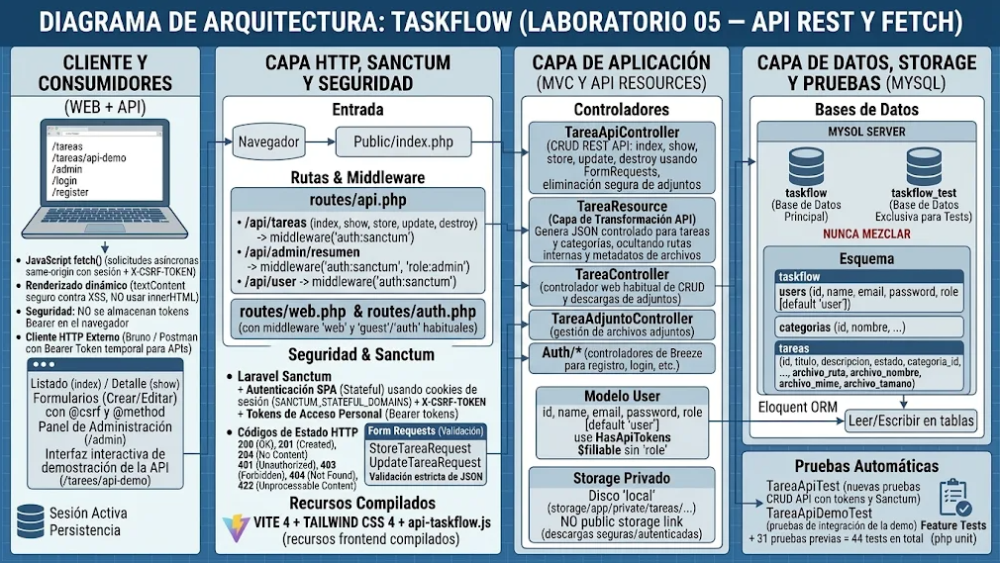

# Laboratorio 05 — Desarrollo y consumo de APIs REST con TaskFlow
<!--  -->

**Curso:** Desarrollo de aplicaciones para ambientes Web Avanzado  
**Capítulo:** 5. APIs Básicas + Consumo desde Frontend  
**Práctica oficial:** 5.8 — Desarrollo y consumo de APIs  
**Duración oficial de la práctica:** **210 minutos** (3 horas y 30 minutos)  
**Proyecto conductor:** el **mismo TaskFlow** desarrollado en los laboratorios 1–4  
**Tecnologías:** Laravel 13.x · PHP 8.3+ · MySQL 8.4 LTS · Laravel Sanctum · Blade · JavaScript `fetch()` · Vite · Tailwind CSS 4  
**Terminales:** Bash (Ubuntu/Linux/WSL) o PowerShell (Windows 11). Los comandos PHP, Composer, Artisan, Git y npm se ejecutan igual en ambas.

> **Regla de continuidad.** **NO cree otro proyecto, NO reinstale Breeze y NO recree las tablas `users`, `categorias` o `tareas`.** Conserve los adjuntos privados, roles, formularios, validaciones y pruebas anteriores. En esta práctica se **agregan** rutas, controladores, una vista y un módulo JavaScript; no se reemplaza el CRUD web.
>
> **Alcance de seguridad real:** todos los usuarios autenticados siguen gestionando tareas compartidas. El esquema aún no contiene `tareas.user_id`; por tanto, `auth:sanctum` no crea aislamiento por propietario. Los adjuntos NO se expondrán por API; la descarga continuará en el controlador web autenticado del laboratorio 4. Nunca almacene tokens de API en `localStorage`, JavaScript, vistas, repositorios o capturas de pantalla.
>
> **Este Markdown contiene todo el procedimiento y código que escribirá el alumno.** No se proporciona un proyecto inicial ni un ZIP. La aplicación se construye editando el TaskFlow ya existente.

---

## 1. Objetivo, alcance y resultados esperados

**Objetivo:** ampliar TaskFlow con una API REST autenticada para consultar, crear, actualizar y eliminar tareas en MySQL, y consumirla desde una página Blade mediante `fetch()` sin recargar la página. El laboratorio diferencia las sesiones de navegador de los tokens destinados a clientes HTTP externos y enseña a interpretar los errores de API.

## Diagrama 




Al terminar, el estudiante podrá:

- [ ] Explicar las diferencias entre una respuesta Blade y JSON, y utilizar correctamente `GET`, `POST`, `PUT` y `DELETE`.
- [ ] Instalar y configurar las rutas API de Laravel 13 y Sanctum **sobre el proyecto existente**.
- [ ] Mantener autenticación web por sesión para las páginas Blade; habilitar **autenticación stateful** de Sanctum para `fetch()` del mismo origen.
- [ ] Utilizar un **token temporal personal** para consultar la API desde Bruno o Postman, sin incrustarlo en el navegador.
- [ ] Implementar `TareaApiController`, `TareaResource`, validaciones y paginación segura.
- [ ] Responder con `200`, `201`, `204`, `401`, `403`, `404` y `422` en sus casos correspondientes; explicar que `500` es un error del servidor y no una validación.
- [ ] Construir un formulario AJAX que envíe JSON y muestre mensajes de validación sin recargar la página.
- [ ] Mostrar textos mediante `textContent`, sin insertar HTML no confiable con `innerHTML`.
- [ ] Conservar archivos privados, CRUD web, usuarios y roles de los laboratorios anteriores.
- [ ] Comprobar las pruebas automatizadas **solamente en `taskflow_test`** y guardar el avance con Git.

### Distribución de los 210 minutos

| Bloque | Actividades | Minutos |
|---|---|---:|
| A | Verificación de TaskFlow; instalación y configuración de Sanctum y rutas | 35 |
| B | Recurso JSON, controlador REST, errores HTTP y token temporal | 65 |
| C | Página Blade y consumo con `fetch()`: listar, crear, editar, eliminar | 70 |
| D | Pruebas de API, verificaciones de seguridad, evidencias y Git | 40 |
| **Total** | | **210** |

**No realizaremos:** un nuevo sistema de login, JWT, OAuth, CORS entre distintos dominios, endpoints de adjuntos, transferencia de archivos por API, propiedad individual de tareas ni autenticación con tokens dentro del navegador. **No** implemente una API pública sin protección para simplificar la práctica.

---

## 2. Preparación: continuar el laboratorio 4 sin perder nada

### Paso 0.1 — Abrir TaskFlow y comprobar los prerrequisitos

**Bash:**

```bash
cd ~/labs/taskflow
pwd
```

**PowerShell:**

```powershell
Set-Location "$HOME\labs\taskflow"
Get-Location
```

En la raíz del proyecto ejecute:

```bash
php artisan --version
php artisan about
php artisan db:show
php artisan migrate:status
php artisan route:list --path=tareas
php artisan route:list --path=admin
php artisan route:list --path=login
composer show laravel/breeze
npm run build
git status --short
```

**Resultado esperado:** Laravel 13.x, base de desarrollo **`taskflow`**, tablas `users`, `categorias`, `tareas`, campo `users.role`, campos `archivo_*` de la tarea, login de Breeze, siete rutas CRUD `tareas.*`, tres rutas de adjuntos `tareas.adjunto.*` y ruta administrativa `admin.index`.

**Compruebe que aún existen:**

```text
app/Models/Tarea.php
app/Models/Categoria.php
app/Models/User.php
app/Http/Requests/StoreTareaRequest.php
app/Http/Requests/UpdateTareaRequest.php
app/Http/Requests/SubirAdjuntoRequest.php
app/Http/Controllers/TareaController.php
app/Http/Controllers/TareaAdjuntoController.php
app/Http/Middleware/EnsureUserHasRole.php
routes/web.php
routes/auth.php
resources/views/layouts/app.blade.php
resources/views/tareas/index.blade.php
resources/views/tareas/show.blade.php
resources/js/app.js
resources/css/app.css
bootstrap/app.php
.env.testing
```

Abra TaskFlow en el navegador e inicie sesión. Confirme que el CRUD y los adjuntos privados siguen funcionando antes de continuar.

### Paso 0.2 — Proteger el estado existente con Git

```bash
git status --short
git log -1 --oneline
git branch --show-current
git check-ignore .env
git check-ignore .env.testing
```

Si hay cambios pendientes, revíselos y confírmelos antes de crear la nueva rama. **No borre archivos del laboratorio 4 para limpiar el estado.**

```bash
git switch -c lab-05-apis
```

Si esa rama ya existe, ejecute `git switch lab-05-apis` en lugar de crear otra. Compruebe:

```bash
git branch --show-current
```

### Paso 0.3 — Revisar ambas bases de datos antes de migrar o probar

```bash
php artisan config:clear
php artisan db:show
php artisan db:show --env=testing
```

La primera debe ser **`taskflow`**, y la última **`taskflow_test`**. Revise además `phpunit.xml`: no debe forzar SQLite ni sobrescribir la conexión de prueba de forma incompatible con `.env.testing`.

> **ALTO si las bases no están separadas.** En los pasos posteriores se utiliza `RefreshDatabase`. **No ejecute `php artisan test` ni ninguna migración destructiva si `--env=testing` conecta a `taskflow`.** Conserve `APP_KEY` válido en `.env.testing`, además de `SESSION_DRIVER=array`, `CACHE_STORE=array` y `QUEUE_CONNECTION=sync`.

### Paso 0.4 — Usar un único origen HTTP durante toda la prueba

Vamos a trabajar desde un único navegador y host, por ejemplo:

```dotenv
# Fragmento de .env — conserve sus demás variables de TaskFlow
APP_URL=http://127.0.0.1:8000
SANCTUM_STATEFUL_DOMAINS=127.0.0.1:8000,localhost:8000
```

Mantenga `SESSION_DOMAIN` **sin definir** si hasta ahora las sesiones locales funcionaban bien. No mezcle en un mismo flujo `localhost`, `127.0.0.1` y otros puertos: aunque lleguen a la misma computadora, sus cookies y políticas de origen pueden ser diferentes.

**Nota:** solo ajuste `APP_URL` si su servidor usa realmente ese host y puerto; si ya utiliza otro dominio local, conserve el suyo e inclúyalo —con su puerto— en `SANCTUM_STATEFUL_DOMAINS`.

---

## 3. Bloque A — Habilitar Laravel Sanctum y registrar la API (35 min)

### Paso 1.1 — Instalar la capa API sin crear otra aplicación

En Laravel 13, el comando de instalación de rutas API configura Sanctum y el archivo `routes/api.php`.

**Primero compruebe si ya se instaló:**

```bash
composer show laravel/sanctum
php artisan route:list --path=api
```

Si **Sanctum NO está instalado**, ejecute **una sola vez**:

```bash
php artisan install:api
```

Si el asistente pregunta si desea ejecutar migraciones, revise **antes** que `php artisan db:show` indique `taskflow`. Puede continuar con migraciones **normales**; **nunca elija borrar o recrear las tablas**.

Si Sanctum ya existe y `routes/api.php` está registrado, **no vuelva a instalarlo**. En caso de existir Sanctum pero faltar solo el registro de rutas API, revise la configuración de `withRouting(api: ...)` en `bootstrap/app.php` y el archivo `routes/api.php` antes de crear nada.

Verifique:

```bash
composer show laravel/sanctum
php artisan migrate:status
php artisan route:list --path=api
```

La migración nueva de `personal_access_tokens` debe estar pendiente o aplicada. Si está pendiente, haga la migración normal tras comprobar la base activa:

```bash
php artisan db:show
php artisan migrate --step
php artisan migrate:status
```

**Resultado esperado:** Sanctum instalado, tabla `personal_access_tokens` disponible y datos previos intactos. **No vuelva a ejecutar `make:auth`, no reinstale Breeze ni edite la migración inicial de usuarios.**

### Paso 1.2 — Configurar la autenticación por sesión para `fetch()`

En `bootstrap/app.php`, busque la llamada existente:

```php
->withMiddleware(function (Middleware $middleware): void {
    // Configuración existente, como el alias 'role'.
})
```

**Agregue únicamente** `$middleware->statefulApi();` dentro de ese bloque, **sin eliminar el alias `role` del laboratorio 3**. Si conserva únicamente el middleware añadido hasta ahora, el bloque debe verse así:

```php
// Fragmento de bootstrap/app.php, NO reemplace el archivo completo.
->withMiddleware(function (Middleware $middleware): void {
    $middleware->statefulApi();

    $middleware->alias([
        'role' => \App\Http\Middleware\EnsureUserHasRole::class,
    ]);
})
```

Conserve el resto de `withRouting(...)`, `withExceptions(...)` y cualquier personalización anterior. Si ya existía `statefulApi()`, no lo duplique.

**Qué significa:** para peticiones del frontend reconocido como propio, Sanctum puede autenticar la solicitud API utilizando la **misma sesión web** creada por Breeze y aplicar protección CSRF. Para peticiones externas sin sesión, `auth:sanctum` puede autenticar mediante token Bearer. Son **dos formas diferentes de consumir las mismas rutas**.

```bash
php -l bootstrap/app.php
php artisan config:clear
php artisan route:clear
```

### Paso 1.3 — Habilitar emisión de tokens en `User` sin debilitar roles

Abra **`app/Models/User.php`**, creado en el laboratorio 3. **No lo reemplace**: agregue la importación de Sanctum junto a los demás `use`:

```php
use Laravel\Sanctum\HasApiTokens;
```

Y agregue el trait a la lista existente:

```php
class User extends Authenticatable
{
    use HasApiTokens, HasFactory, Notifiable;

    // Mantenga lo siguiente del lab 3:
    // $fillable SIN 'role'; $hidden; casts(); isAdmin(); hasRole().
}
```

**Importante:** el fragmento solo señala lo que debe cambiar: **NO elimine** `isAdmin()`, `hasRole()`, el cast `'password' => 'hashed'`, los campos `$hidden` ni las reglas contra la asignación masiva del rol.

```bash
php -l app/Models/User.php
```

### Paso 1.4 — Entender las rutas existentes y las nuevas

**Rutas web (se conservan):** `routes/web.php`, URLs como `/tareas`, acciones `tareas.*`, autenticación `auth`, respuestas Blade y adjuntos privados.

**Rutas API (se agregan):** `routes/api.php`, URLs como `/api/tareas`, autenticación `auth:sanctum`, respuestas JSON, sin formularios Blade ni métodos de adjuntos.

La API de Laravel añade normalmente el prefijo `/api` de forma automática. **No escriba `/api` de nuevo dentro de `routes/api.php`.**

En este laboratorio **no** agregamos `/api/login` ni `/api/register`. El usuario del navegador inicia sesión mediante los formularios web seguros de Breeze.

---

## 4. Bloque B — Crear el CRUD REST y sus respuestas JSON (65 min)

### Paso 2.1 — Crear `TareaResource`: la salida pública controlada de JSON

```bash
php artisan make:resource TareaResource
```

Reemplace completamente **`app/Http/Resources/TareaResource.php`** por:

```php
<?php
// Archivo: app/Http/Resources/TareaResource.php

namespace App\Http\Resources;

use Illuminate\Http\Request;
use Illuminate\Http\Resources\Json\JsonResource;

class TareaResource extends JsonResource
{
    public function toArray(Request $request): array
    {
        return [
            'id' => $this->id,
            'titulo' => $this->titulo,
            'descripcion' => $this->descripcion,
            'estado' => $this->estado,
            'categoria_id' => $this->categoria_id,
            'categoria' => $this->whenLoaded('categoria', function () {
                if ($this->categoria === null) {
                    return null;
                }

                return [
                    'id' => $this->categoria->id,
                    'nombre' => $this->categoria->nombre,
                ];
            }),
            'created_at' => $this->created_at?->toIso8601String(),
            'updated_at' => $this->updated_at?->toIso8601String(),
        ];
    }
}
```

**Observe:** `TareaResource` permite definir exactamente qué campos salen por la API. **No entrega** `archivo_ruta`, `archivo_nombre`, `archivo_mime`, `archivo_tamano`, cookies, contraseñas, roles ni datos internos de configuración. Los archivos privados continuarán gestionándose únicamente a través del controlador web autenticado.

```bash
php -l app/Http/Resources/TareaResource.php
```

### Paso 2.2 — Crear `TareaApiController` sin alterar `TareaController`

```bash
php artisan make:controller Api/TareaApiController --api
```

Reemplace completamente **`app/Http/Controllers/Api/TareaApiController.php`** por:

```php
<?php
// Archivo: app/Http/Controllers/Api/TareaApiController.php

namespace App\Http\Controllers\Api;

use App\Http\Controllers\Controller;
use App\Http\Requests\StoreTareaRequest;
use App\Http\Requests\UpdateTareaRequest;
use App\Http\Resources\TareaResource;
use App\Models\Tarea;
use Illuminate\Http\JsonResponse;
use Illuminate\Http\Request;
use Illuminate\Http\Resources\Json\AnonymousResourceCollection;
use Illuminate\Support\Facades\Storage;
use Symfony\Component\HttpFoundation\Response;

class TareaApiController extends Controller
{
    public function index(Request $request): AnonymousResourceCollection
    {
        // Aceptar solamente estas columnas evita el ordenamiento SQL arbitrario.
        $permitidas = ['id', 'titulo', 'estado', 'created_at'];
        $sort = $request->query('sort', 'id');
        if (!is_string($sort) || !in_array($sort, $permitidas, true)) {
            $sort = 'id';
        }

        $direction = $request->query('direction', 'desc');
        $direction = is_string($direction) ? strtolower($direction) : 'desc';
        if (!in_array($direction, ['asc', 'desc'], true)) {
            $direction = 'desc';
        }

        $perPage = filter_var(
            $request->query('per_page', 10),
            FILTER_VALIDATE_INT,
            ['options' => ['min_range' => 1, 'max_range' => 50]]
        );
        if ($perPage === false) {
            $perPage = 10;
        }

        $query = Tarea::query()
            ->with('categoria')
            ->orderBy($sort, $direction);

        if ($sort !== 'id') {
            $query->orderBy('id');
        }

        $paginador = $query->paginate($perPage)->appends([
            'sort' => $sort,
            'direction' => $direction,
            'per_page' => $perPage,
        ]);

        return TareaResource::collection($paginador);
    }

    public function show(Tarea $tarea): TareaResource
    {
        return new TareaResource($tarea->load('categoria'));
    }

    public function store(StoreTareaRequest $request): JsonResponse
    {
        // Reutilizar las reglas del lab 4 impide crear campos inesperados.
        $tarea = Tarea::create($request->validated());

        return (new TareaResource($tarea->load('categoria')))
            ->response()
            ->setStatusCode(Response::HTTP_CREATED);
    }

    public function update(UpdateTareaRequest $request, Tarea $tarea): TareaResource
    {
        // En esta práctica PUT envía todos los campos obligatorios.
        $tarea->update($request->validated());

        return new TareaResource($tarea->load('categoria'));
    }

    public function destroy(Tarea $tarea): Response
    {
        // Misma política de limpieza del controlador web del lab 4.
        $rutaAdjunto = $tarea->archivo_ruta;
        $tarea->delete();

        if ($rutaAdjunto) {
            Storage::disk('local')->delete($rutaAdjunto);
        }

        return response()->noContent(); // HTTP 204, sin cuerpo JSON.
    }
}
```

**Importante sobre `PUT` y `PATCH`:** para este primer ejercicio registraremos **`PUT`** (sustitución del conjunto de campos del formulario), que reutiliza `UpdateTareaRequest` con `titulo` y `estado` obligatorios. No registraremos `PATCH` para evitar sugerir que se admiten actualizaciones parciales cuando el Form Request todavía las rechazaría. `PATCH` puede añadirse más adelante con una validación específica `sometimes`.

**Importante sobre autorización:** se utiliza `auth:sanctum` para toda la API. **Esto verifica la identidad, no la propiedad de la tarea**. Los permisos granulares serán un desarrollo posterior si se introduce `user_id` y políticas.

Compruebe:

```bash
php -l app/Http/Controllers/Api/TareaApiController.php
```

### Paso 2.3 — Registrar los endpoints en `routes/api.php`

**No reemplace** `routes/web.php`; tampoco modifique `routes/auth.php`. Abra **`routes/api.php`** y conserve la ruta `/user` y cualquier otra ruta que haya creado el instalador. **Añada** las importaciones que falten y el grupo siguiente (el bloque muestra exclusivamente las rutas nuevas):

```php
<?php
// Fragmento para routes/api.php — combine con lo que ya existe.
// NO agregue un segundo <?php si el archivo ya lo tiene.

use App\Http\Controllers\Api\TareaApiController;
use App\Models\Tarea;
use Illuminate\Support\Facades\Route;

// Conserve la ruta GET /user que agregó el instalador.
// Agregue solamente el siguiente grupo nuevo:
Route::middleware('auth:sanctum')->group(function () {
    Route::get('/tareas', [TareaApiController::class, 'index'])
        ->name('api.tareas.index');

    Route::post('/tareas', [TareaApiController::class, 'store'])
        ->name('api.tareas.store');

    Route::get('/tareas/{tarea}', [TareaApiController::class, 'show'])
        ->whereNumber('tarea')->name('api.tareas.show');

    Route::put('/tareas/{tarea}', [TareaApiController::class, 'update'])
        ->whereNumber('tarea')->name('api.tareas.update');

    Route::delete('/tareas/{tarea}', [TareaApiController::class, 'destroy'])
        ->whereNumber('tarea')->name('api.tareas.destroy');
});

// Ejemplo acotado de 403: reutiliza el middleware de roles del lab 3.
Route::middleware(['auth:sanctum', 'role:admin'])
    ->get('/admin/resumen', function () {
        return response()->json([
            'total_tareas' => Tarea::count(),
        ]);
    })->name('api.admin.resumen');
```

> **Conserve GET `/api/user` sin duplicarlo.** En el archivo real solo debe existir **un** encabezado `<?php` y una importación por clase. Si ya existe `use Illuminate\Support\Facades\Route;`, no la repita. En ningún caso agregue el prefijo `api` por segunda vez.
>
> **Nombres:** `api.tareas.*` son distintos de `tareas.*`. Los nombres antiguos seguirán funcionando en las vistas Blade y en los tests anteriores.

Verifique las rutas:

```bash
php -l routes/api.php
php artisan route:clear
php artisan route:list --path=api
php artisan route:list --path=tareas
```

**Debe identificar**, como mínimo:

| Método | URI real | Nombre | Respuesta esperada al autenticar |
|---|---|---|---|
| GET | `/api/tareas` | `api.tareas.index` | 200 y `data/meta/links` |
| GET | `/api/tareas/{tarea}` | `api.tareas.show` | 200 y `data` |
| POST | `/api/tareas` | `api.tareas.store` | 201 y `data` |
| PUT | `/api/tareas/{tarea}` | `api.tareas.update` | 200 y `data` |
| DELETE | `/api/tareas/{tarea}` | `api.tareas.destroy` | 204, sin cuerpo |
| GET | `/api/admin/resumen` | `api.admin.resumen` | 200 para admin; 403 para user |

Las cinco acciones de tareas y el resumen administrativo requieren `auth:sanctum`; el resumen añade `role:admin`.

### Paso 2.4 — Identificar los códigos HTTP y el JSON de Laravel

En una petición válida a **GET `/api/tareas?per_page=5&sort=id&direction=desc`**, el recurso paginado deberá tener una estructura similar a:

```json
{
  "data": [
    {
      "id": 2,
      "titulo": "Preparar sesión de TaskFlow",
      "descripcion": "Probar la API desde Blade",
      "estado": "Pendiente",
      "categoria_id": null,
      "categoria": null,
      "created_at": "2026-11-19T12:00:00+00:00",
      "updated_at": "2026-11-19T12:00:00+00:00"
    }
  ],
  "links": { "first": "...", "last": "...", "prev": null, "next": null },
  "meta": { "current_page": 1, "last_page": 1, "per_page": 5, "total": 1 }
}
```

Los identificadores, las fechas y los enlaces son **ejemplos ilustrativos**, no valores que deban coincidir. Laravel puede añadir otros campos dentro de `meta` y `links`.

| Estado | Cuándo verificarlo | Interpretación |
|---|---|---|
| **200 OK** | GET de una tarea existente; PUT correcto | La operación se realizó y hay JSON |
| **201 Created** | POST válido | Se creó una nueva fila |
| **204 No Content** | DELETE correcto | Se eliminó; **no** intente convertir el cuerpo vacío a JSON |
| **401 Unauthenticated** | API sin sesión ni token | El servidor no reconoció identidad |
| **403 Forbidden** | Usuario normal entra a `/api/admin/resumen` | Se reconoció identidad, pero el rol no tiene permiso |
| **404 Not Found** | GET de un ID inexistente | No existe ese recurso |
| **422 Unprocessable Content** | POST o PUT con campos inválidos | El cuerpo JSON incluye `message` y `errors` por campo |
| **500 Internal Server Error** | Una excepción no controlada del servidor | No es un resultado «esperado»; debe diagnosticarse, no provocarse intencionalmente |

**Nota:** si una respuesta da 302 a `/login` en lugar de 401, compruebe que el cliente envía `Accept: application/json`, que utiliza **`/api/...`** y que está pasando por `auth:sanctum`.

### Paso 2.5 — Obtener un token temporal solo para Bruno o Postman

La página Blade del siguiente bloque **NO** utilizará token Bearer; se autenticará con la sesión normal de Breeze. El token de este paso es **exclusivamente para un cliente externo de pruebas**.

Abra Tinker en la terminal local:

```bash
php artisan tinker
```

Dentro de Tinker, busque un usuario **de pruebas** que ya exista:

```php
$usuario = \App\Models\User::where('email', 'alumno@ejemplo.test')->first();
$usuario?->id;
```

Si devuelve `null`, sustituya el correo por el correo **real de su usuario local de laboratorio**. **No cree usuarios nuevos si ya hay cuentas de prueba.** Cuando la consulta devuelva un usuario:

```php
$token = $usuario->createToken('lab05-cliente-temporal')->plainTextToken;
$token;
```

Copie el token **solo en la variable privada del cliente HTTP**. Se muestra en texto claro una sola vez. **No lo comparta en capturas, chats, Git ni archivos Markdown.** Un token de este tipo tiene los permisos del usuario y debe revocarse al terminar.

En **Bruno o Postman** configure:

```text
GET http://127.0.0.1:8000/api/tareas
Accept: application/json
Authorization: Bearer <TOKEN_TEMPORAL_DEL_LAB>
```

Compruebe 200 y un objeto con `data`, `links` y `meta`. Después retire el encabezado `Authorization`: sin sesión web el resultado deberá ser 401.

**Prueba de creación desde el cliente externo:**

```text
POST http://127.0.0.1:8000/api/tareas
Accept: application/json
Content-Type: application/json
Authorization: Bearer <TOKEN_TEMPORAL_DEL_LAB>
```

```json
{
  "titulo": "Tarea creada desde cliente HTTP",
  "descripcion": "Prueba temporal del laboratorio 5",
  "estado": "Pendiente",
  "categoria_id": null
}
```

**Esperado:** 201 y un ID real. Vuelva a probar `GET /api/tareas` y compruebe que esa tarea aparece también en la vista web `/tareas`. El API y Blade consultan la **misma tabla `tareas` de MySQL**.

**Revocar el token al terminar las pruebas externas:**

```bash
php artisan tinker
```

```php
$usuario = \App\Models\User::where('email', 'alumno@ejemplo.test')->firstOrFail();
$usuario->tokens()->where('name', 'lab05-cliente-temporal')->delete();
```

Utilice el mismo correo real que empleó para crear el token. Tras revocarlo, el cliente deberá obtener 401. **No elimine todos los tokens de otros servicios** ni utilice contraseñas en la URL.

---
## 5. Bloque C — Consumir la API desde Blade con `fetch()` (70 min)

### Paso 3.1 — Añadir el token CSRF al layout web que ya existe

Abra **`resources/views/layouts/app.blade.php`** del laboratorio 3. En el `<head>`, justo después de la etiqueta `viewport`, **agregue esta línea**:

```blade
<meta name="csrf-token" content="{{ csrf_token() }}">
```

Mantenga todo lo demás: `@vite`, navegación, enlaces, logout por POST y diseño visual de TaskFlow. **No pegue un nuevo layout completo** ni cambie el mecanismo de inicio de sesión.

**Qué significa:** la página recibe un token CSRF del servidor mediante su sesión. Nuestro JavaScript lo leerá únicamente para peticiones de escritura realizadas en el **mismo origen** (`POST`, `PUT`, `DELETE`). Este token CSRF **no** es un Bearer token de Sanctum.

### Paso 3.2 — Registrar una nueva pantalla web de demostración

Abra `routes/web.php` y agregue la importación de `Categoria` entre los demás `use`, **sin duplicarla**:

```php
use App\Models\Categoria;
```

Dentro del **grupo `Route::middleware('auth')->group(...)` ya existente**, añada lo siguiente, preferentemente antes de `GET /tareas/{tarea}`:

```php
// Página Blade protegida que usará fetch() para consumir /api/tareas.
Route::get('/tareas/api-demo', function () {
    $categorias = Categoria::query()->orderBy('nombre')->get();

    return view('tareas.api-demo', compact('categorias'));
})->name('tareas.api-demo');
```

**Conserve** las siete rutas CRUD, las tres rutas de adjuntos y la ruta `admin.index`. La URL nueva utiliza texto `api-demo`, por lo que no coincide con la ruta numérica `/tareas/{tarea}` del laboratorio 2.

Ejecute:

```bash
php -l routes/web.php
php artisan route:clear
php artisan route:list --path=tareas
```

**Resultado esperado:** aparece `tareas.api-demo`, protegida por `auth`. El resto de rutas se conserva.

### Paso 3.3 — Crear la vista `tareas/api-demo.blade.php`

Cree el archivo **`resources/views/tareas/api-demo.blade.php`** dentro del directorio de vistas que ya existe. Introduzca el contenido completo:

```blade
{{-- Archivo: resources/views/tareas/api-demo.blade.php --}}
@extends('layouts.app')

@section('title', 'Consumo de API - TaskFlow')

@section('content')
<section data-api-demo class="space-y-6">
    <div class="flex flex-wrap items-center justify-between gap-3">
        <div>
            <h1 class="text-3xl font-bold text-blue-900">TaskFlow — API REST</h1>
            <p class="mt-2 text-slate-600">
                Operaciones sobre MySQL usando Blade y JavaScript fetch().
            </p>
        </div>
        <a href="{{ route('tareas.index') }}"
           class="rounded-lg border border-blue-800 px-4 py-2 text-blue-800">
            Volver al CRUD Blade
        </a>
    </div>

    <p class="rounded-lg bg-blue-50 p-4 text-sm text-blue-900">
        Esta pantalla utiliza la sesión web de Breeze y protección CSRF.
        No necesita ni almacena un token Bearer.
    </p>

    <div id="avisos-api" class="hidden rounded-lg border p-4" role="status"
         aria-live="polite"></div>

    <section class="rounded-xl border border-slate-200 bg-white p-6">
        <h2 class="mb-4 text-xl font-semibold text-blue-900"
            id="titulo-formulario-api">Crear tarea desde la API</h2>

        <form id="form-api-tarea" class="space-y-4">
            {{-- Las reglas efectivas se aplican en el servidor. --}}
            <div>
                <label class="block font-medium" for="api-titulo">Título</label>
                <input id="api-titulo" name="titulo" type="text" maxlength="150"
                       required class="mt-1 w-full rounded-lg border border-slate-300 p-3">
            </div>

            <div>
                <label class="block font-medium" for="api-descripcion">
                    Descripción (opcional)
                </label>
                <textarea id="api-descripcion" name="descripcion" maxlength="1000"
                          rows="3" class="mt-1 w-full rounded-lg border border-slate-300 p-3"></textarea>
            </div>

            <div class="grid gap-4 sm:grid-cols-2">
                <div>
                    <label class="block font-medium" for="api-estado">Estado</label>
                    <select id="api-estado" name="estado"
                            class="mt-1 w-full rounded-lg border border-slate-300 p-3">
                        <option value="Pendiente">Pendiente</option>
                        <option value="En progreso">En progreso</option>
                        <option value="Completada">Completada</option>
                    </select>
                </div>
                <div>
                    <label class="block font-medium" for="api-categoria">Categoría</label>
                    <select id="api-categoria" name="categoria_id"
                            class="mt-1 w-full rounded-lg border border-slate-300 p-3">
                        <option value="">Sin categoría</option>
                        @foreach ($categorias as $categoria)
                            <option value="{{ $categoria->id }}">{{ $categoria->nombre }}</option>
                        @endforeach
                    </select>
                </div>
            </div>

            <div class="flex flex-wrap gap-3">
                <button id="guardar-api" type="submit"
                        class="rounded-lg bg-blue-800 px-5 py-3 text-white">
                    Crear tarea
                </button>
                <button id="cancelar-api" type="button" hidden
                        class="rounded-lg border border-slate-400 px-5 py-3">
                    Cancelar edición
                </button>
            </div>
        </form>
    </section>

    <section class="rounded-xl border border-slate-200 bg-white p-6">
        <div class="mb-4 flex items-center justify-between gap-3">
            <h2 class="text-xl font-semibold text-blue-900">Listado de la API</h2>
            <button type="button" id="recargar-api"
                    class="rounded-lg border border-blue-800 px-4 py-2 text-blue-800">
                Actualizar lista
            </button>
        </div>

        <ul id="lista-api" class="space-y-3" aria-label="Tareas de la API"></ul>

        <div class="mt-6 flex items-center gap-3">
            <button id="anterior-api" type="button"
                    class="rounded-lg border px-3 py-2" disabled>Anterior</button>
            <span id="pagina-api" class="text-sm text-slate-600">Página 1</span>
            <button id="siguiente-api" type="button"
                    class="rounded-lg border px-3 py-2" disabled>Siguiente</button>
        </div>
    </section>
</section>
@endsection
```

**Nota:** no escriba `@csrf` dentro de este `<form>` porque **no se enviará como formulario HTML tradicional**: JavaScript enviará JSON y agregará el encabezado `X-CSRF-TOKEN`. Los formularios HTML anteriores sí deben seguir usando `@csrf`.

### Paso 3.4 — Crear `resources/js/api-taskflow.js`

Cree **`resources/js/api-taskflow.js`** e introduzca todo el código:

```javascript
// Archivo: resources/js/api-taskflow.js
// Solo se ejecuta en la página /tareas/api-demo.

const raiz = document.querySelector('[data-api-demo]');

if (raiz) {
    const formulario = raiz.querySelector('#form-api-tarea');
    const avisos = raiz.querySelector('#avisos-api');
    const lista = raiz.querySelector('#lista-api');
    const paginaTexto = raiz.querySelector('#pagina-api');
    const botonAnterior = raiz.querySelector('#anterior-api');
    const botonSiguiente = raiz.querySelector('#siguiente-api');
    const botonRecargar = raiz.querySelector('#recargar-api');
    const botonCancelar = raiz.querySelector('#cancelar-api');
    const botonGuardar = raiz.querySelector('#guardar-api');
    const tituloFormulario = raiz.querySelector('#titulo-formulario-api');
    const csrf = document.querySelector('meta[name="csrf-token"]')?.content;

    let paginaActual = 1;
    let ultimaPagina = 1;

    function campo(nombre) {
        return formulario.elements.namedItem(nombre);
    }

    function aviso(mensaje, esError = false) {
        avisos.replaceChildren();
        avisos.textContent = mensaje;
        avisos.classList.remove('hidden');
        avisos.classList.toggle('border-red-400', esError);
        avisos.classList.toggle('border-green-500', !esError);
    }

    function mostrarErrorApi(error) {
        const estado = error?.status ?? 'red';
        const cuerpo = error?.body ?? {};
        avisos.replaceChildren();
        avisos.classList.remove('hidden');
        avisos.classList.add('border-red-400');
        avisos.classList.remove('border-green-500');

        const texto = document.createElement('p');
        texto.textContent = `Error ${estado}: ${cuerpo.message ?? 'No se pudo completar la petición.'}`;
        avisos.append(texto);

        if (cuerpo.errors && typeof cuerpo.errors === 'object') {
            const ul = document.createElement('ul');
            ul.className = 'mt-2 list-disc pl-6 text-sm';
            for (const mensajes of Object.values(cuerpo.errors)) {
                for (const mensaje of mensajes) {
                    const li = document.createElement('li');
                    li.textContent = String(mensaje);
                    ul.append(li);
                }
            }
            avisos.append(ul);
        }
    }

    async function peticionApi(url, metodo = 'GET', datos = null) {
        const headers = { Accept: 'application/json' };

        if (datos !== null) {
            headers['Content-Type'] = 'application/json';
        }
        if (metodo !== 'GET') {
            if (!csrf) throw new Error('Falta la etiqueta meta CSRF del layout.');
            headers['X-CSRF-TOKEN'] = csrf;
        }

        const respuesta = await fetch(url, {
            method: metodo,
            headers,
            credentials: 'same-origin',
            ...(datos !== null ? { body: JSON.stringify(datos) } : {}),
        });

        // DELETE devuelve 204 y NO contiene JSON.
        let cuerpo = null;
        const tipo = respuesta.headers.get('content-type') ?? '';
        if (respuesta.status !== 204 && tipo.includes('application/json')) {
            cuerpo = await respuesta.json();
        }

        if (!respuesta.ok) {
            throw {
                status: respuesta.status,
                body: cuerpo ?? { message: 'Error HTTP sin respuesta JSON.' },
            };
        }
        return cuerpo;
    }

    function restaurarFormulario() {
        formulario.reset();
        delete formulario.dataset.id;
        tituloFormulario.textContent = 'Crear tarea desde la API';
        botonGuardar.textContent = 'Crear tarea';
        botonCancelar.hidden = true;
    }

    function entrarEnEdicion(tarea) {
        formulario.dataset.id = String(tarea.id);
        campo('titulo').value = tarea.titulo ?? '';
        campo('descripcion').value = tarea.descripcion ?? '';
        campo('estado').value = tarea.estado;
        campo('categoria_id').value = tarea.categoria_id ?? '';
        tituloFormulario.textContent = `Editar tarea #${tarea.id}`;
        botonGuardar.textContent = 'Guardar cambios';
        botonCancelar.hidden = false;
        formulario.scrollIntoView({ behavior: 'smooth', block: 'start' });
    }

    function mostrarTareas(tareas) {
        lista.replaceChildren();

        if (tareas.length === 0) {
            const vacio = document.createElement('li');
            vacio.textContent = 'No hay tareas en esta página.';
            lista.append(vacio);
            return;
        }

        for (const tarea of tareas) {
            const item = document.createElement('li');
            item.className = 'rounded-lg border border-slate-200 p-4';

            const texto = document.createElement('p');
            texto.className = 'font-semibold';
            texto.textContent = `#${tarea.id} — ${tarea.titulo}`;

            const subtitulo = document.createElement('p');
            subtitulo.className = 'text-sm text-slate-600';
            subtitulo.textContent = `${tarea.estado} · ${tarea.categoria?.nombre ?? 'Sin categoría'}`;

            const acciones = document.createElement('div');
            acciones.className = 'mt-3 flex flex-wrap gap-3';

            const editar = document.createElement('button');
            editar.type = 'button';
            editar.className = 'text-blue-700 underline';
            editar.textContent = 'Editar';
            editar.addEventListener('click', () => entrarEnEdicion(tarea));

            const eliminar = document.createElement('button');
            eliminar.type = 'button';
            eliminar.className = 'text-red-700 underline';
            eliminar.textContent = 'Eliminar';
            eliminar.addEventListener('click', async () => {
                if (!window.confirm(`¿Eliminar la tarea #${tarea.id}?`)) return;
                try {
                    await peticionApi(`/api/tareas/${tarea.id}`, 'DELETE');
                    aviso(`Tarea #${tarea.id} eliminada.`);
                    restaurarFormulario();
                    await cargarLista();
                } catch (error) {
                    mostrarErrorApi(error);
                }
            });

            acciones.append(editar, eliminar);
            item.append(texto, subtitulo, acciones);
            lista.append(item);
        }
    }

    async function cargarLista() {
        try {
            const parametros = new URLSearchParams({
                page: String(paginaActual),
                per_page: '5',
                sort: 'id',
                direction: 'desc',
            });
            const respuesta = await peticionApi(`/api/tareas?${parametros}`);
            paginaActual = Number(respuesta.meta.current_page);
            ultimaPagina = Number(respuesta.meta.last_page);
            mostrarTareas(respuesta.data);
            paginaTexto.textContent = `Página ${paginaActual} de ${ultimaPagina}`;
            botonAnterior.disabled = paginaActual <= 1;
            botonSiguiente.disabled = paginaActual >= ultimaPagina;
        } catch (error) {
            mostrarErrorApi(error);
        }
    }

    formulario.addEventListener('submit', async (evento) => {
        evento.preventDefault();
        botonGuardar.disabled = true;

        const datos = {
            titulo: campo('titulo').value.trim(),
            descripcion: campo('descripcion').value.trim() || null,
            estado: campo('estado').value,
            categoria_id: campo('categoria_id').value
                ? Number(campo('categoria_id').value)
                : null,
        };

        const id = formulario.dataset.id;
        const metodo = id ? 'PUT' : 'POST';
        const url = id ? `/api/tareas/${id}` : '/api/tareas';

        try {
            await peticionApi(url, metodo, datos);
            aviso(id ? `Tarea #${id} actualizada.` : 'Nueva tarea creada.');
            restaurarFormulario();
            paginaActual = 1;
            await cargarLista();
        } catch (error) {
            mostrarErrorApi(error);
        } finally {
            botonGuardar.disabled = false;
        }
    });

    botonCancelar.addEventListener('click', restaurarFormulario);
    botonRecargar.addEventListener('click', () => cargarLista());
    botonAnterior.addEventListener('click', () => {
        if (paginaActual > 1) {
            paginaActual--;
            cargarLista();
        }
    });
    botonSiguiente.addEventListener('click', () => {
        if (paginaActual < ultimaPagina) {
            paginaActual++;
            cargarLista();
        }
    });

    // Primera consulta cuando la página protegida ya está abierta.
    cargarLista();
}
```

**Explicación fundamental de seguridad:** todo contenido originado en MySQL (`titulo`, `estado`, `categoria.nombre`, mensajes de validación) se dibuja como texto con `textContent`. **No utilice `innerHTML` para construir filas con títulos escritos por otros usuarios.**

**Explicación de errores:** si la API responde `422`, Laravel genera un objeto `errors` con mensajes por campo. Si responde `401`, el alumno debe iniciar sesión. Si aparece `419`, revise sesión, origen y CSRF. Un error de red también aparecerá; la API no debe «simular» 200 cuando falló.

### Paso 3.5 — Importar el módulo desde Vite sin alterar Breeze

Abra el archivo **`resources/js/app.js`**, que ya existe. Conserve todas sus importaciones y agregue esta línea **una sola vez** al final:

```javascript
import './api-taskflow.js';
```

No reemplace el archivo completo. El módulo se ejecutará únicamente si la página contiene `data-api-demo`.

Compruebe la sintaxis y compile:

```bash
node --check resources/js/api-taskflow.js
npm run build
```

**Resultado esperado:** no hay errores de sintaxis y Vite genera los recursos correctamente.

### Paso 3.6 — Ejecutar el backend y Vite; probar desde el navegador

Abra **dos terminales** desde la carpeta TaskFlow.

**Terminal 1 — Laravel:**

```bash
php artisan serve --host=127.0.0.1 --port=8000
```

**Terminal 2 — Vite:**

```bash
npm run dev
```

Entre en `http://127.0.0.1:8000/login` e inicie sesión con una cuenta local de pruebas. Después abra:

```text
http://127.0.0.1:8000/tareas/api-demo
```

Realice estas acciones en orden:

1. **Listar.** La página debe cargar tareas desde `GET /api/tareas` y mostrar su título, estado y categoría. Abra las herramientas de desarrollo del navegador (F12) → pestaña **Network / Red**, y compruebe `GET /api/tareas?...` con estado **200**.
2. **Crear.** Escriba un título nuevo, por ejemplo «Prueba fetch Lab 5», seleccione `Pendiente` y guarde. Observe un `POST /api/tareas` con estado **201**. La tarea deberá aparecer también en el CRUD Blade de `/tareas`.
3. **Editar.** Pulse «Editar» en la lista; cambie el estado a «En progreso» y guarde. En Network observe `PUT /api/tareas/{id}` con estado **200**. Confirme el cambio en MySQL mediante el CRUD Blade.
4. **Validar.** Escriba un título vacío o excesivamente largo, o use las herramientas de desarrollo para enviar una petición con `estado` inválido. El servidor debe devolver **422** y la página debe mostrar mensajes por campo. El atributo HTML `required` puede impedir un envío vacío normal; eso **no** sustituye la prueba de validación por API.
5. **Eliminar.** Pulse «Eliminar» sobre una **tarea ficticia creada para la práctica**, confirme y observe `DELETE /api/tareas/{id}` con estado **204**. Compruebe que ya no aparece en el listado Blade.
6. **Paginación.** Si hay más de cinco tareas, utilice «Siguiente» y «Anterior»; si hay pocas, agregue tareas de prueba mediante el formulario. No modifique el backend para fingir páginas.

> **Precaución:** la API opera sobre **la misma MySQL `taskflow` que los laboratorios 1–4**. No borre tareas o adjuntos de otros ejercicios por accidente. Una eliminación a través de la API también puede eliminar el archivo privado de la tarea, tal como lo hace el controlador web del laboratorio 4.

### Paso 3.7 — Comparar dos maneras de visualizar los mismos datos

Abra dos pestañas:

```text
http://127.0.0.1:8000/tareas
http://127.0.0.1:8000/tareas/api-demo
```

| Vista clásica `/tareas` | Vista AJAX `/tareas/api-demo` |
|---|---|
| Blade crea el HTML en el servidor | Blade crea la estructura; JavaScript rellena el listado |
| El navegador navega o recarga tras el formulario | `fetch()` envía y recibe JSON sin navegación completa |
| `TareaController` devuelve `View` o redirección | `TareaApiController` devuelve recursos JSON |
| Usa autenticación web por sesión | Usa la misma sesión web, aceptada por `auth:sanctum` |
| Formularios Blade contienen `@csrf` | `fetch()` envía `X-CSRF-TOKEN` en solicitudes de escritura |

**Ambas** respetan la validación del servidor y trabajan sobre los **mismos registros**. **No** use el token Bearer de Bruno/Postman en `api-taskflow.js`.

---
## 6. Bloque D — Pruebas, diagnóstico y entrega (40 min)

### Paso 4.1 — Comprobación obligatoria de la base de pruebas

**Antes de ejecutar pruebas con `RefreshDatabase`, repita esta verificación sin excepciones:**

```bash
php artisan config:clear
php artisan db:show
php artisan db:show --env=testing
```

**Debe mostrar:**

- Ejecución normal → `taskflow` (la base real de desarrollo).
- Ejecución con `--env=testing` → **`taskflow_test`** (la base exclusiva de pruebas).
- Ambas conexiones deben utilizar MySQL y sus credenciales locales correctas.

Revise `.env.testing` y `phpunit.xml`. Si falta `APP_KEY`, si `DB_DATABASE` es `taskflow`, si PHPUnit fuerza otra base o si la comprobación es ambigua: **DETÉNGASE, no ejecute tests y corrija la configuración.**

La tabla nueva `personal_access_tokens` se creará mediante las migraciones en `taskflow_test` cuando se ejecute la suite. **No ejecute `migrate:fresh` ni `db:wipe` contra `taskflow`.**

### Paso 4.2 — Crear las pruebas HTTP de la API

En la raíz del proyecto:

```bash
php artisan make:test TareaApiTest
```

Reemplace completamente **`tests/Feature/TareaApiTest.php`** por el siguiente archivo. Son **11 casos de prueba**; cada uno comprueba comportamientos observables en HTTP y usa MySQL de pruebas.

```php
<?php
// Archivo: tests/Feature/TareaApiTest.php

namespace Tests\Feature;

use App\Models\Tarea;
use App\Models\User;
use Illuminate\Foundation\Testing\RefreshDatabase;
use Illuminate\Support\Facades\Storage;
use Laravel\Sanctum\Sanctum;
use Tests\TestCase;

class TareaApiTest extends TestCase
{
    use RefreshDatabase;

    private function crearTarea(array $datos = []): Tarea
    {
        return Tarea::create(array_merge([
            'titulo' => 'Tarea API de prueba',
            'descripcion' => 'Datos temporales del test',
            'estado' => 'Pendiente',
            'categoria_id' => null,
        ], $datos));
    }

    private function autenticar(): User
    {
        $usuario = User::factory()->create();
        Sanctum::actingAs($usuario);

        return $usuario;
    }

    public function test_api_rechaza_peticion_anonima(): void
    {
        $this->getJson('/api/tareas')->assertUnauthorized();
    }

    public function test_listado_autenticado_tiene_datos_y_paginacion(): void
    {
        $this->autenticar();
        $this->crearTarea(['titulo' => 'API uno']);
        $this->crearTarea(['titulo' => 'API dos']);
        $this->crearTarea(['titulo' => 'API tres']);

        $this->getJson('/api/tareas?per_page=2&sort=id&direction=asc')
            ->assertOk()
            ->assertJsonCount(2, 'data')
            ->assertJsonPath('meta.per_page', 2)
            ->assertJsonPath('meta.total', 3)
            ->assertJsonStructure(['data', 'links', 'meta']);
    }

    public function test_limite_de_paginacion_no_acepta_un_millon(): void
    {
        $this->autenticar();
        $this->crearTarea();

        $this->getJson('/api/tareas?per_page=1000000&sort=columna_inventada')
            ->assertOk()
            ->assertJsonPath('meta.per_page', 10);
    }

    public function test_detalle_no_expone_los_campos_del_adjunto_privado(): void
    {
        $this->autenticar();
        $tarea = $this->crearTarea();
        $tarea->archivo_ruta = 'tareas/1/adjuntos/archivo-privado.pdf';
        $tarea->archivo_nombre = 'archivo-privado.pdf';
        $tarea->save();

        $this->getJson("/api/tareas/{$tarea->id}")
            ->assertOk()
            ->assertJsonPath('data.titulo', 'Tarea API de prueba')
            ->assertJsonMissingPath('data.archivo_ruta')
            ->assertJsonMissingPath('data.archivo_nombre');
    }

    public function test_post_crea_una_tarea_y_devuelve_201(): void
    {
        $this->autenticar();

        $this->postJson('/api/tareas', [
            'titulo' => 'Creada por API',
            'descripcion' => null,
            'estado' => 'Pendiente',
            'categoria_id' => null,
        ])
            ->assertCreated()
            ->assertJsonPath('data.titulo', 'Creada por API');

        $this->assertDatabaseHas('tareas', ['titulo' => 'Creada por API']);
    }

    public function test_post_con_datos_invalidos_devuelve_422(): void
    {
        $this->autenticar();

        $this->postJson('/api/tareas', [
            'titulo' => '',
            'descripcion' => null,
            'estado' => 'Estado inventado',
            'categoria_id' => 987654321,
        ])
            ->assertUnprocessable()
            ->assertJsonValidationErrors(['titulo', 'estado', 'categoria_id']);
    }

    public function test_put_actualiza_la_tarea(): void
    {
        $this->autenticar();
        $tarea = $this->crearTarea();

        $this->putJson("/api/tareas/{$tarea->id}", [
            'titulo' => 'Tarea editada por API',
            'descripcion' => 'Descripción nueva',
            'estado' => 'En progreso',
            'categoria_id' => null,
        ])
            ->assertOk()
            ->assertJsonPath('data.estado', 'En progreso');

        $this->assertDatabaseHas('tareas', [
            'id' => $tarea->id,
            'titulo' => 'Tarea editada por API',
        ]);
    }

    public function test_delete_devuelve_204_y_limpia_su_adjunto_privado(): void
    {
        Storage::fake('local');
        $this->autenticar();
        $tarea = $this->crearTarea();
        $ruta = "tareas/{$tarea->id}/adjuntos/informe.pdf";
        Storage::disk('local')->put($ruta, 'Archivo temporal de prueba');
        $tarea->archivo_ruta = $ruta;
        $tarea->archivo_nombre = 'informe.pdf';
        $tarea->save();

        $this->deleteJson("/api/tareas/{$tarea->id}")
            ->assertNoContent();

        $this->assertDatabaseMissing('tareas', ['id' => $tarea->id]);
        Storage::disk('local')->assertMissing($ruta);
    }

    public function test_recurso_inexistente_devuelve_404(): void
    {
        $this->autenticar();
        $this->getJson('/api/tareas/987654321')->assertNotFound();
    }

    public function test_endpoint_admin_distingue_403_y_200(): void
    {
        $usuario = $this->autenticar();
        $this->getJson('/api/admin/resumen')->assertForbidden();

        $usuario->role = 'admin';
        $usuario->save();

        $this->getJson('/api/admin/resumen')
            ->assertOk()
            ->assertJsonStructure(['total_tareas']);
    }

    public function test_un_token_real_autentica_a_cliente_externo(): void
    {
        $usuario = User::factory()->create();
        $token = $usuario->createToken('token-test-temporal')->plainTextToken;

        $this->withToken($token)
            ->getJson('/api/tareas')
            ->assertOk()
            ->assertJsonStructure(['data', 'links', 'meta']);
    }
}
```

**Interpretación:**

- `Sanctum::actingAs()` permite probar la autorización de la API sin depender de cookies del navegador.
- El test `test_un_token_real_autentica_a_cliente_externo()` ejerce el mecanismo de token Bearer real.
- `RefreshDatabase` usa **solo** `taskflow_test` cuando el entorno está configurado correctamente.
- `Storage::fake('local')` evita borrar archivos reales durante la prueba de eliminación.
- Las pruebas HTTP de Laravel normalmente omiten la comprobación de CSRF; **la protección CSRF deberá comprobarse adicionalmente de forma manual en el navegador**.

### Paso 4.3 — Añadir una prueba de la página Blade

Cree otro archivo de prueba:

```bash
php artisan make:test TareaApiDemoTest
```

Reemplace completamente **`tests/Feature/TareaApiDemoTest.php`** por:

```php
<?php
// Archivo: tests/Feature/TareaApiDemoTest.php

namespace Tests\Feature;

use App\Models\User;
use Illuminate\Foundation\Testing\RefreshDatabase;
use Tests\TestCase;

class TareaApiDemoTest extends TestCase
{
    use RefreshDatabase;

    protected function setUp(): void
    {
        parent::setUp();
        $this->withoutVite();
    }

    public function test_pagina_de_demo_requiere_autenticacion(): void
    {
        $this->get(route('tareas.api-demo'))
            ->assertRedirect(route('login'));
    }

    public function test_usuario_autenticado_abre_pagina_de_demo(): void
    {
        $this->actingAs(User::factory()->create())
            ->get(route('tareas.api-demo'))
            ->assertOk()
            ->assertSee('Consumo de API - TaskFlow', false)
            ->assertSee('form-api-tarea');
    }
}
```

**Nota:** `withoutVite()` está limitado al entorno de pruebas. No lo agregue al código normal de la aplicación porque el frontend necesita Vite para ejecutar `api-taskflow.js`.

### Paso 4.4 — Ejecutar las nuevas pruebas de forma controlada

Repita **antes**:

```bash
php artisan config:clear
php artisan db:show --env=testing
```

Solo cuando el resultado identifique inequívocamente **`taskflow_test`**, ejecute:

```bash
php artisan test --filter=TareaApiTest
php artisan test --filter=TareaApiDemoTest
```

**Resultado esperado si la implementación está completa:** **11 casos de la API + 2 de la página = 13 pruebas nuevas**. Los números de *assertions* serán mayores.

A continuación, compruebe las pruebas de los laboratorios anteriores:

```bash
php artisan test --filter=TareaViewTest
php artisan test --filter=TareaCrudTest
php artisan test --filter=AutenticacionTaskFlowTest
php artisan test --filter=RolesTaskFlowTest
php artisan test --filter=SeguridadTareaTest
php artisan test --filter=TareaAdjuntoTest
```

**Lo esperado:** los controles de los laboratorios 1–4 siguen funcionando. No deshabilite pruebas antiguas para ocultar un fallo. Si alguna dependía de que no existieran rutas API o de un archivo de frontend antiguo, adapte solo la expectativa obsoleta sin eliminar la comprobación funcional.

> El número de pruebas del proyecto puede ser mayor por las pruebas predeterminadas que instaló Breeze. Una comprobación de sintaxis o una captura del navegador **no demuestra** que toda la suite ha pasado; anote los resultados reales de su máquina.

### Paso 4.5 — Prueba manual de autenticación y seguridad

Realice estas comprobaciones después de ejecutar los tests:

| Escenario | Acción | Esperado |
|---|---|---|
| Sin sesión/token | Cliente HTTP sin Bearer: `GET /api/tareas`, con `Accept: application/json` | **401** |
| Con sesión | Abrir `/tareas/api-demo` después del login de Breeze | **200**, lista cargada |
| Usuario no admin | `GET /api/admin/resumen` desde Bruno con token de `user` | **403** |
| Admin | Mismo endpoint con token temporal de un usuario `admin` de prueba | **200** |
| Recurso no encontrado | `GET /api/tareas/987654321` autenticado | **404** |
| Campos inválidos | `POST /api/tareas` autenticado con título vacío y estado inválido | **422**, JSON con `errors` |
| Token revocado | Repetir GET con Bearer revocado | **401** |
| Sin CSRF | Enviar petición mutante desde navegador con sesión pero sin token CSRF y sin cabeceras confiables de mismo origen | Debe ser rechazada; en Laravel 13 verifique la combinación de validación de origen y token |
| Datos privados | `GET /api/tareas/{id}` | **No** contiene `archivo_ruta` ni `archivo_nombre` |
| Persistencia | Crear en API y abrir `/tareas` | La misma tarea aparece en Blade |

**Muy importante sobre CSRF en Laravel 13:** el framework puede considerar suficiente una verificación correcta de origen en algunas solicitudes del mismo origen y usar el token como mecanismo alternativo. Por eso **no es correcto afirmar que quitar solo el encabezado `X-CSRF-TOKEN` siempre causará 419**. Para ensayar rechazos, use una solicitud de prueba controlada que carezca de ambas pruebas de confianza, sin desactivar la seguridad en la aplicación. No intente utilizar sitios externos ni ataques reales; el objetivo es comprender el mecanismo.

**Al finalizar:** cierre sesión y compruebe que el navegador ya no accede a `/tareas/api-demo`. Revocar el token Bearer no cierra la sesión Breeze; son credenciales distintas.

### Paso 4.6 — Confirmar que no se alteró `taskflow`

Después de la ejecución automática, vuelva al entorno normal:

```bash
php artisan db:show
php artisan migrate:status
php artisan route:list --path=api
php artisan route:list --path=tareas
```

La base de desarrollo debe ser **`taskflow`**. Verifique desde el navegador que usuarios, roles, tareas, categorías y adjuntos siguen disponibles. Si ejecutó alguna prueba de creación manual con datos ficticios, puede eliminar **solo esas tareas de prueba** desde la aplicación.

---

## 7. Solución de problemas frecuentes

### A. `401 Unauthenticated` al usar `fetch()` después del login

1. Compruebe que la página se abrió desde `http://127.0.0.1:8000/tareas/api-demo`, no desde Vite `:5173`.
2. Revise que `bootstrap/app.php` incluya `$middleware->statefulApi();` dentro del bloque `withMiddleware`.
3. Confirme que `APP_URL` y `SANCTUM_STATEFUL_DOMAINS` coinciden con el host y puerto utilizados.
4. Confirme que no esté mezclando `127.0.0.1` con `localhost` para login y API.
5. Compruebe que `fetch()` incluye `credentials: 'same-origin'` y que la ruta usa `auth:sanctum`.
6. Verifique que el login web realmente creó una sesión activa. **No copie un token Bearer a JavaScript para «arreglar» el 401**.

### B. `419 Page Expired` al enviar POST/PUT/DELETE

Revise que el layout contiene `<meta name="csrf-token" ...>`, que `api-taskflow.js` agrega `X-CSRF-TOKEN`, que el navegador tiene la cookie de sesión y que la URL utiliza el mismo origen que el login. El error también puede producirse por una sesión vencida. Reingrese al sistema y recargue el formulario. No deshabilite CSRF.

### C. `404` en `/api/tareas`

```bash
php artisan route:clear
php artisan route:list --path=api
```

Asegúrese de que el archivo `routes/api.php` está registrado por `withRouting(...)`, que las rutas están escritas sin repetir el prefijo `/api` y que instaló la capa API de Laravel.

### D. `Route [tareas.index] not defined` después de registrar la API

Probablemente duplicó nombres de rutas. El CRUD web usa `tareas.index`; la API usa `api.tareas.index`. **No cambie los nombres de las rutas web existentes**.

### E. `422` incluso cuando el formulario parece correcto

Compruebe el JSON enviado desde Network:

```json
{
  "titulo": "Ejemplo válido",
  "descripcion": null,
  "estado": "Pendiente",
  "categoria_id": null
}
```

El Form Request del lab 4 exige `titulo` y `estado`; los estados permitidos son exactamente `Pendiente`, `En progreso` y `Completada`. Si el ID de categoría no existe, `categoria_id` producirá un error de validación.

### F. `Class Laravel\Sanctum\HasApiTokens not found`

Sanctum no está instalado o Composer no ha generado el autoload:

```bash
composer show laravel/sanctum
composer dump-autoload
```

Si el paquete no existe, vuelva al paso 1.1 y siga el instalador oficial. No agregue un trait inexistente a `User`.

### G. `SQLSTATE ... personal_access_tokens doesn't exist`

Compruebe `php artisan db:show` y `php artisan migrate:status` y ejecute **solamente migraciones pendientes**. No use `migrate:fresh`. La tabla nueva no sustituye la de usuarios.

### H. La API devuelve HTML en lugar de JSON

En las solicitudes API envíe `Accept: application/json`. Verifique que la URL comienza por `/api/`. Si está abriendo `/tareas` está consumiendo una vista Blade y no la API.

### I. Vite muestra `Failed to resolve import './api-taskflow.js'`

Confirme que el archivo existe exactamente en `resources/js/api-taskflow.js`, que la importación de `resources/js/app.js` usa la ruta relativa correcta y que no confundió mayúsculas. Luego ejecute `npm run build`.

### J. `GET /api/admin/resumen` devuelve 403

Es el comportamiento **correcto** para cuentas con rol `user`. Verifique que la cuenta de prueba admin tiene realmente `role='admin'` y que el middleware `role:admin` sigue registrado. Nunca acepte el rol desde un formulario público para resolverlo.

### K. Se rechaza un archivo adjunto desde la API

**No existe un endpoint de subida en este laboratorio.** La API de tareas solo modifica los campos `titulo`, `descripcion`, `estado` y `categoria_id`. Continúe subiendo, descargando y eliminando adjuntos desde las rutas web privadas del laboratorio 4.

### L. Fallan los tests después de instalar Sanctum

Asegúrese de que la migración de `personal_access_tokens` se ejecuta en `taskflow_test`, no en `taskflow`; verifique el trait `HasApiTokens` del modelo y la configuración previa de `phpunit.xml`. Conserve las pruebas de los laboratorios anteriores. No utilice SQLite como sustituto sin rediseñar las pruebas.

---

## 8. Evidencias, entrega y Git

### Evidencias mínimas para entregar

1. Salida de `php artisan route:list --path=api` mostrando las cinco operaciones sobre `/api/tareas` y el endpoint administrativo.
2. Captura de `GET /api/tareas` desde Bruno/Postman con token **oculto** y respuesta JSON `data`, `meta`, `links`.
3. Captura de `POST /api/tareas` con **201 Created**, sin mostrar tokens.
4. Captura del **422** por validación con `errors` visible.
5. Captura del **401** sin credenciales y del **403** al acceder al resumen administrativo con un usuario estándar.
6. Captura de `/tareas/api-demo` mostrando tareas creadas desde `fetch()`.
7. Evidencia de una edición **PUT 200** y eliminación **DELETE 204** de una tarea ficticia.
8. Captura de que los adjuntos siguen siendo privados y de que el JSON no incluye sus rutas de almacenamiento.
9. Salida de las 13 pruebas nuevas y de las pruebas previas, con la confirmación de `taskflow_test`.
10. Salida de `git status` y del commit del laboratorio.

**No incluya** cookies, claves, tokens completos, contraseñas, `.env`, `.env.testing`, archivos privados, datos personales ni capturas que expongan cabeceras de autorización.

### Guardar el avance en Git

Revise antes de añadir archivos:

```bash
git status --short
git diff --stat
git check-ignore .env
git check-ignore .env.testing
```

Agregue solo los archivos previstos del laboratorio:

```bash
git add app/Http/Resources/TareaResource.php
git add app/Http/Controllers/Api/TareaApiController.php
git add app/Models/User.php
git add bootstrap/app.php routes/api.php routes/web.php
git add resources/views/layouts/app.blade.php
git add resources/views/tareas/api-demo.blade.php
git add resources/js/app.js resources/js/api-taskflow.js
git add composer.json composer.lock
git add database/migrations
git add tests/Feature/TareaApiTest.php tests/Feature/TareaApiDemoTest.php
git status --short
git diff --cached --stat
git diff --cached
```

**Revise cada modificación antes de confirmar.** Los archivos `database/migrations` deben contener solo migraciones legítimas. Puede existir un cambio en otros archivos de configuración publicado por el instalador: examínelo y agréguelo individualmente si es imprescindible para ejecutar la API; no haga `git add .` por comodidad. Nunca añada secretos ni datos de `storage/app/private`.

```bash
git commit -m "feat: agregar API REST y consumo fetch a TaskFlow"
git status --short
```

### Lista de comprobación final

- [ ] El proyecto sigue siendo el TaskFlow de los laboratorios 1–4.
- [ ] La base de desarrollo sigue siendo `taskflow`; las pruebas usan `taskflow_test`.
- [ ] Se conservaron usuarios, roles, tareas, categorías y adjuntos privados.
- [ ] `User` incluye `HasApiTokens` sin permitir asignación masiva del rol.
- [ ] `bootstrap/app.php` incluye `statefulApi()` y mantiene `role`.
- [ ] Existen `TareaResource` y `TareaApiController` independientes del CRUD Blade.
- [ ] Las rutas `/api/tareas` usan `auth:sanctum` y nombres `api.tareas.*`.
- [ ] El endpoint `/api/admin/resumen` distingue correctamente `user` y `admin`.
- [ ] No se exponen rutas o metadatos de archivos privados en JSON.
- [ ] El token de Bruno/Postman no se utiliza en JavaScript y fue revocado.
- [ ] `/tareas/api-demo` permite listar, crear, actualizar y eliminar con `fetch()`.
- [ ] Las peticiones de escritura del navegador usan CSRF y la sesión web.
- [ ] El DOM utiliza `textContent` para los datos recibidos.
- [ ] Se probaron los estados 200, 201, 204, 401, 403, 404 y 422.
- [ ] Pasaron las pruebas nuevas y siguen pasando las anteriores.
- [ ] Los cambios están en la rama `lab-05-apis`.

---

## 9. Continuidad hacia el laboratorio 6

**No inicie un proyecto Laravel diferente ni cambie a SQLite.** El laboratorio 6 continuará con la misma aplicación, usando Blade, Vite y JavaScript para mejorar la experiencia del frontend. Inertia (Vue/React) se presentará como **alternativa arquitectónica**, sin reemplazar el CRUD web ni la API que acabamos de implementar.

Estado esperado:

```text
TaskFlow (Laravel 13)
├── MySQL: taskflow
│   ├── categorias
│   ├── tareas (+ metadatos de adjuntos privados)
│   ├── users (role: user|admin)
│   └── personal_access_tokens (Sanctum)
├── Modelos: Categoria, Tarea, User (+ HasApiTokens)
├── Validación: StoreTareaRequest y UpdateTareaRequest (lab 4)
├── CRUD web: TareaController + vistas Blade + adjuntos privados
├── Autenticación web: Breeze + sesión + CSRF
├── API: /api/tareas (auth:sanctum) + TareaApiController + TareaResource
├── Roles: /admin y /api/admin/resumen (role:admin)
├── Frontend: /tareas/api-demo + api-taskflow.js + Vite
└── Pruebas: MySQL taskflow_test, independiente de taskflow
```

## 10. Referencias y alcance de la validación

- Temario oficial del curso, **capítulo 5**, temas 5.1–5.8, práctica de **210 minutos**.
- Presentación corregida, capítulo 5, **diapositivas 288–374**.
- Guías aprobadas de TaskFlow: **laboratorios 01, 02, 03 y 04**.
- [Laravel 13 — Rutas y configuración de API](https://laravel.com/docs/13.x/routing)
- [Laravel 13 — Sanctum y autenticación de SPA](https://laravel.com/docs/13.x/sanctum)
- [Laravel 13 — Recursos JSON](https://laravel.com/docs/13.x/eloquent-resources)
- [Laravel 13 — Validación de solicitudes](https://laravel.com/docs/13.x/validation)
- [Laravel 13 — Protección CSRF](https://laravel.com/docs/13.x/csrf)
- [MDN — Fetch API](https://developer.mozilla.org/es/docs/Web/API/Fetch_API/Using_Fetch)

**Estado de la guía:** contiene el procedimiento y los fragmentos completos que el estudiante debe crear o modificar. La verificación de sintaxis **no sustituye** la ejecución integral con Laravel 13, MySQL, Sanctum y navegador. El instructor debe registrar los resultados de la primera ejecución antes de declarar validado el laboratorio en producción educativa.

<!--  -->
