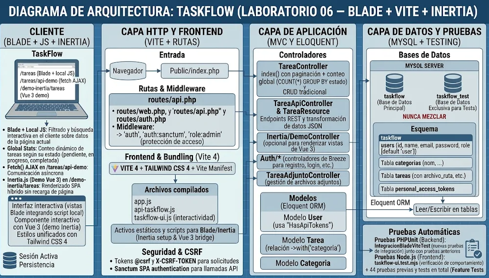

# Laboratorio 06 — Integración full-stack con Blade, Vite e introducción a Inertia
<!--  -->

**Curso:** Desarrollo de aplicaciones para ambientes Web Avanzado  
**Capítulo:** 6. Fullstack con Blade y Vite  
**Práctica oficial:** 6.5 — Integración full-stack con Blade y Vite  
**Duración oficial de la práctica:** **150 minutos** (2 horas y 30 minutos)  
**Proyecto conductor:** **TaskFlow**, el mismo proyecto de los laboratorios 1, 2, 3, 4 y 5  
**Tecnologías:** Laravel 13.x · PHP 8.3+ · MySQL 8.4 LTS · Blade · JavaScript moderno · Vite · Tailwind CSS 4 · Laravel Sanctum (existente)  
**Entornos admitidos:** Bash (Ubuntu, Linux o WSL) y PowerShell (Windows 11).

> **Regla principal:** no cree otro proyecto Laravel, no cambie la base de datos a SQLite, no reinstale Breeze ni Sanctum, no reemplace `resources/js/app.js`, `vite.config.js` o `routes/web.php` completos y no ejecute `migrate:fresh`. Este laboratorio **agrega funcionalidad** al TaskFlow ya construido.
>
> **Alcance:** la actividad obligatoria mejora una pantalla Blade utilizando Vite y JavaScript, integra datos Eloquent y ejecuta pruebas. **Inertia (Vue/React) se compara como arquitectura alternativa durante la práctica**, sin sustituir el frontend Blade. El **anexo A**, completamente opcional y fuera de los 150 minutos, explica cómo montar una pequeña demostración Inertia/Vue en una ruta independiente del mismo proyecto.
>
> **No hay proyecto descargable:** el alumno realizará los cambios siguiendo los comandos, las rutas de archivo, el código y las comprobaciones descritos en este documento.

---

## 1. Objetivo, resultados esperados y distribución del tiempo

**Objetivo:** integrar de forma coherente Laravel, Eloquent, Blade, Vite y JavaScript en TaskFlow, mejorando el listado de tareas con filtros instantáneos en el navegador y mostrando estadísticas calculadas en el backend. Conservar el CRUD web, la API REST, los archivos privados, la autenticación y los roles existentes.

## Diagrama



Al finalizar, el alumno podrá:

- [ ] Reconocer el propósito de `@vite`, `vite.config.js`, `resources/js/app.js` y `resources/css/app.css`.
- [ ] Incorporar un módulo JavaScript sin reemplazar el código agregado en el laboratorio 5.
- [ ] Filtrar **solo las tareas de la página cargada** por título, categoría y estado, sin recargar el navegador.
- [ ] Diferenciar el filtro local en JavaScript de la paginación y el ordenamiento realizados en MySQL.
- [ ] Obtener conteos generales por estado mediante Eloquent y mostrarlos en Blade.
- [ ] Explicar cuándo una pantalla Blade con JavaScript, una API REST o una página Inertia son apropiadas.
- [ ] Confirmar que un invitado no puede ver el listado y que un usuario autenticado sí puede.
- [ ] Ejecutar pruebas Feature sobre `taskflow_test` y comprobar por separado la compilación `npm run build`.
- [ ] Guardar el avance sin exponer credenciales ni borrar registros existentes.

| Bloque | Actividades | Tiempo |
|---|---|---:|
| A | Preparación; revisión de `@vite` e importaciones existentes | 25 min |
| B | Filtro interactivo del listado mediante Blade y JavaScript | 45 min |
| C | Datos calculados en Laravel/Eloquent y presentación en Blade | 30 min |
| D | Comparación Blade, Inertia y API: ejercicio conceptual | 20 min |
| E | Pruebas, compilación Vite, evidencias y Git | 30 min |
| **Total** | | **150 min** |

**Qué se conserva:** base de datos `taskflow`, tablas `users`, `categorias`, `tareas` y `personal_access_tokens`; rol `user/admin`; formularios y adjuntos; rutas `tareas.*`, `tareas.adjunto.*`, `tareas.api-demo`, `admin.index`, `api.tareas.*`; validaciones y pruebas previas.

**Nota de seguridad:** las tareas siguen siendo **compartidas por todos los usuarios autenticados**. La aplicación no tiene un modelo de propiedad de tareas por usuario; este laboratorio no incorpora ese alcance. Los filtros JavaScript **no son un mecanismo de autorización**.

---

## 2. Bloque A — Preparar el entorno y revisar Vite (25 min)

### Paso 0.1 — Abrir el TaskFlow del laboratorio 5

Use **una** de estas terminales.

**Bash (Ubuntu/Linux/WSL):**

```bash
cd ~/labs/taskflow
pwd
```

**PowerShell (Windows 11):**

```powershell
Set-Location "$HOME\labs\taskflow"
Get-Location
```

> Si en su máquina utilizó otra ubicación para el proyecto, entre en esa carpeta. **No ejecute `composer create-project`**: se debe continuar con el proyecto existente.

En la raíz, ejecute los comandos siguientes. Son iguales en ambas terminales:

```bash
php artisan --version
php artisan about
php artisan db:show
php artisan migrate:status
php artisan route:list --path=tareas
php artisan route:list --path=api
composer show laravel/breeze
composer show laravel/sanctum
node --version
npm --version
git status --short
```

**Resultado esperado:** Laravel 13, MySQL **`taskflow`**, login funcionando, CRUD web, API REST y la pantalla `/tareas/api-demo`. Si falla alguno, corrija el laboratorio correspondiente **antes de iniciar**. No cree nuevas tablas para ocultar un problema de continuidad.

Compruebe que existen estos archivos:

```text
app/Http/Controllers/TareaController.php
app/Http/Controllers/Api/TareaApiController.php
app/Models/Tarea.php
app/Models/Categoria.php
app/Models/User.php
resources/views/layouts/app.blade.php
resources/views/tareas/index.blade.php
resources/views/tareas/api-demo.blade.php
resources/js/app.js
resources/js/api-taskflow.js
resources/css/app.css
vite.config.js
routes/web.php
routes/api.php
.env
.env.testing
```

### Paso 0.2 — Guardar el avance y crear la rama del laboratorio 6

```bash
git status --short
git branch --show-current
git log -1 --oneline
git check-ignore .env
git check-ignore .env.testing
```

Si hay cambios pendientes, revíselos y confirme los cambios válidos del laboratorio 5 antes de crear otra rama. No pierda trabajo usando `git reset --hard` ni `git clean -fd`.

```bash
git switch -c lab-06-blade-vite
```

Si ya creó esa rama, utilice `git switch lab-06-blade-vite` y **no** ejecute nuevamente `-c`.

**Verificación:**

```bash
git branch --show-current
```

**Resultado esperado:** `lab-06-blade-vite`.

### Paso 0.3 — Inspeccionar la integración existente con Vite

Abra **`resources/views/layouts/app.blade.php`** y compruebe que mantiene en `<head>`:

```blade
<meta name="csrf-token" content="{{ csrf_token() }}">
@vite(['resources/css/app.css', 'resources/js/app.js'])
```

**Este es un fragmento de referencia, NO un nuevo layout.** Si `@vite` ya existe, no lo duplique. Conserve navegación, mensajes, formularios, sesión y diseño previos.

Abra **`resources/js/app.js`** y confirme que aún importa el módulo creado en el laboratorio 5:

```javascript
import './api-taskflow.js';
```

También puede contener otras importaciones de Breeze, Bootstrap, Alpine o del proyecto. **No las elimine**.

Abra **`resources/css/app.css`** y confirme que conserva la directiva de Tailwind CSS 4:

```css
@import "tailwindcss";
```

Abra **`vite.config.js`** y localice los plugins de Laravel y Tailwind. **No sustituya este archivo** por un ejemplo genérico de Vite: ya contiene la integración funcionando.

Comprobar dependencias y compilación:

```bash
npm ls vite laravel-vite-plugin tailwindcss @tailwindcss/vite
npm run build
```

**Resultado esperado:** compilación finalizada sin errores y archivo `public/build/manifest.json` generado. Los recursos JavaScript y CSS del laboratorio 5 deben seguir cargando.

> No fije Vite 6 ni versiones alfa de Tailwind. Utilice las versiones compatibles declaradas en el `package.json` y el `package-lock.json` del proyecto Laravel 13 que ya funciona.

### Paso 0.4 — Confirmar las dos bases antes de utilizar pruebas

```bash
php artisan config:clear
php artisan db:show
php artisan db:show --env=testing
```

| Entorno | Base obligatoria |
|---|---|
| Desarrollo `.env` | `taskflow` |
| Pruebas `.env.testing` | `taskflow_test` |

**DETÉNGASE** si la base de pruebas apunta a `taskflow`. Los Feature Tests utilizarán `RefreshDatabase`, que puede modificar tablas. Revise también `phpunit.xml` para comprobar que **no** sobrescribe las credenciales de `.env.testing` con la base de desarrollo. Conserve una `APP_KEY` válida para testing.

---

## 3. Bloque B — Filtro instantáneo con Blade y JavaScript (45 min)

**Caso de uso:** el listado `/tareas` ya puede paginar y ordenar desde MySQL. Ahora añadiremos un filtro **en el navegador** para las tarjetas de la página actual. El usuario podrá buscar por texto y por estado sin perder el formulario de ordenamiento existente.

### Paso 1.1 — Añadir controles al listado Blade sin reemplazarlo

Abra **`resources/views/tareas/index.blade.php`**. El archivo, construido en el laboratorio 2, contiene un formulario `GET` con `sort`, `direction` y `per_page`, seguido de un `<div class="grid gap-4 md:grid-cols-2">` que contiene tarjetas `<x-tarjeta-tarea>`.

**Inserte el bloque siguiente inmediatamente después del `</form>` del formulario de ordenamiento y antes de la cuadrícula de tarjetas.** No cambie el formulario `GET` ni las acciones del CRUD.

```blade
{{-- LAB 06: filtros solo de los registros visibles en esta página. --}}
<section data-taskflow-filtros
         aria-label="Filtrar tareas de esta página"
         class="mb-6 rounded-xl border border-slate-200 bg-white p-4 shadow-sm">
    <h2 class="mb-3 text-lg font-semibold text-blue-900">
        Filtrar tareas de esta página
    </h2>

    <div class="grid gap-3 md:grid-cols-3">
        <div>
            <label for="buscar-tarea-local" class="mb-1 block text-sm font-medium">
                Buscar título o categoría
            </label>
            <input id="buscar-tarea-local"
                   type="search"
                   autocomplete="off"
                   placeholder="Ej. documentación"
                   class="w-full rounded-lg border border-slate-300 p-2">
        </div>

        <div>
            <label for="estado-tarea-local" class="mb-1 block text-sm font-medium">
                Estado
            </label>
            <select id="estado-tarea-local"
                    class="w-full rounded-lg border border-slate-300 p-2">
                <option value="">Todos</option>
                <option value="Pendiente">Pendiente</option>
                <option value="En progreso">En progreso</option>
                <option value="Completada">Completada</option>
            </select>
        </div>

        <div class="flex items-end">
            <button id="limpiar-filtros-local" type="button"
                    class="w-full rounded-lg border border-slate-400 p-2">
                Limpiar filtros
            </button>
        </div>
    </div>

    <p id="resultado-filtros-local"
       class="mt-3 text-sm text-slate-700"
       role="status" aria-live="polite">
        Cargando filtro…
    </p>

    <p class="mt-1 text-xs text-slate-500">
        Este filtro solo examina las tareas cargadas en la página actual.
        Para cambiar de página u ordenar registros, use los controles superiores.
    </p>
</section>
```

**Por qué se mantiene el formulario anterior:** ordenar y paginar son operaciones del servidor que pueden trabajar sobre todas las tareas; nuestro nuevo filtro de JavaScript únicamente muestra u oculta tarjetas ya presentes en el HTML.

### Paso 1.2 — Identificar la cuadrícula de tareas

En el **mismo archivo**, busque el contenedor existente que rodea el `@forelse`:

```blade
<div class="grid gap-4 md:grid-cols-2">
```

**Sustituya solo la etiqueta de apertura** por:

```blade
<div id="lista-tareas-cliente" class="grid gap-4 md:grid-cols-2">
```

Conserve el `@forelse`, la rama `@empty`, el cierre del contenedor y `{{ $tareas->links() }}`.

### Paso 1.3 — Marcar cada tarjeta con datos seguros para JavaScript

Localice dentro de `@forelse ($tareas as $tarea)` el componente `<x-tarjeta-tarea>`. **Envuélvalo** en un `<div>` con atributos `data-*`. El bloque debe quedar con esta estructura:

```blade
@forelse ($tareas as $tarea)
    <div data-tarea-item
         data-titulo="{{ $tarea->titulo }}"
         data-estado="{{ $tarea->estado }}"
         data-categoria="{{ $tarea->categoria?->nombre ?? '' }}">

        {{-- CONSERVE AQUÍ, SIN CAMBIOS, SU COMPONENTE ORIGINAL: --}}
        <x-tarjeta-tarea
            :titulo="$tarea->titulo"
            :estado="$tarea->estado"
            :descripcion="$tarea->descripcion ?? ''">
            <x-slot:acciones>
                <p class="mb-2 text-xs text-slate-600">
                    Categoría: {{ $tarea->categoria?->nombre ?? 'Sin categoría' }}
                </p>
                <div class="flex gap-4 text-sm">
                    <a href="{{ route('tareas.show', $tarea) }}"
                       class="text-blue-700 underline">Ver detalle</a>
                    <a href="{{ route('tareas.edit', $tarea) }}"
                       class="text-blue-700 underline">Editar</a>
                </div>
            </x-slot:acciones>
        </x-tarjeta-tarea>
    </div>
@empty
    <p class="text-slate-600">No hay tareas registradas.</p>
@endforelse
```

> **Importante:** el bloque anterior muestra la estructura completa para facilitar la comparación. Si en su vista actual existen enlaces, mensajes o clases adicionales, **consérvelos** dentro del componente. Los valores de `data-*` utilizan `{{ }}` de Blade, por lo que se escapan como atributos HTML. No los construya con `{!! !!}`.

**Inmediatamente después del cierre** de `</div>` de `id="lista-tareas-cliente"`, y **antes** del bloque de paginación, añada:

```blade
<p id="sin-resultados-cliente" hidden
   class="mt-4 rounded-lg border border-amber-200 bg-amber-50 p-4 text-amber-900">
    Ninguna tarea de esta página coincide con los filtros.
</p>
```

No elimine `{{ $tareas->links() }}`. El componente de paginación debe seguir funcionando.

### Paso 1.4 — Crear `resources/js/taskflow-ui.js`

Cree el archivo **`resources/js/taskflow-ui.js`**. Introduzca todo el código siguiente:

```javascript
// Archivo: resources/js/taskflow-ui.js
// Filtra SOLO las tarjetas visibles en la página Blade actual.
// No consulta MySQL ni reemplaza la paginación del backend.

export function normalizarTexto(valor) {
    return String(valor ?? '')
        .normalize('NFD')
        .replace(/[\u0300-\u036f]/g, '')
        .toLocaleLowerCase('es')
        .trim();
}

export function coincideFiltros(tarea, busqueda, estado) {
    const textoBuscado = normalizarTexto(busqueda);
    const titulo = normalizarTexto(tarea.titulo);
    const categoria = normalizarTexto(tarea.categoria);
    const estadoActual = String(tarea.estado ?? '');

    const coincideTexto = textoBuscado === ''
        || titulo.includes(textoBuscado)
        || categoria.includes(textoBuscado);

    const coincideEstado = estado === '' || estadoActual === estado;

    return coincideTexto && coincideEstado;
}

function inicializarFiltroTaskFlow() {
    const panel = document.querySelector('[data-taskflow-filtros]');
    if (!panel || panel.dataset.iniciado === '1') {
        return; // No ejecutar en login, api-demo ni otras páginas.
    }
    panel.dataset.iniciado = '1';

    const buscar = panel.querySelector('#buscar-tarea-local');
    const estado = panel.querySelector('#estado-tarea-local');
    const limpiar = panel.querySelector('#limpiar-filtros-local');
    const contador = panel.querySelector('#resultado-filtros-local');
    const vacio = document.getElementById('sin-resultados-cliente');
    const tarjetas = Array.from(
        document.querySelectorAll('#lista-tareas-cliente [data-tarea-item]')
    );

    if (!buscar || !estado || !limpiar || !contador || !vacio) {
        console.error('TaskFlow: faltan elementos del filtro en Blade.');
        return;
    }

    function aplicarFiltros() {
        let visibles = 0;

        for (const tarjeta of tarjetas) {
            const datos = {
                titulo: tarjeta.dataset.titulo ?? '',
                categoria: tarjeta.dataset.categoria ?? '',
                estado: tarjeta.dataset.estado ?? '',
            };

            const mostrar = coincideFiltros(datos, buscar.value, estado.value);
            tarjeta.hidden = !mostrar;

            if (mostrar) {
                visibles += 1;
            }
        }

        contador.textContent = `${visibles} de ${tarjetas.length} `
            + 'tareas de esta página visibles.';

        // No mostrar un segundo mensaje vacío si el servidor ya devolvió 0 tareas.
        vacio.hidden = tarjetas.length === 0 || visibles > 0;
    }

    buscar.addEventListener('input', aplicarFiltros);
    estado.addEventListener('change', aplicarFiltros);
    limpiar.addEventListener('click', () => {
        buscar.value = '';
        estado.value = '';
        aplicarFiltros();
        buscar.focus();
    });

    aplicarFiltros();
}

// El módulo se importa en app.js y también en pantallas sin filtros.
// Por ello se activa únicamente donde existe el panel del laboratorio 6.
if (typeof document !== 'undefined') {
    if (document.readyState === 'loading') {
        document.addEventListener('DOMContentLoaded', inicializarFiltroTaskFlow, {
            once: true,
        });
    } else {
        inicializarFiltroTaskFlow();
    }
}
```

**Explicación:** `normalizarTexto` elimina diferencias entre mayúsculas y tildes para la búsqueda. `coincideFiltros` combina búsqueda y estado. La función principal asigna `hidden` a las tarjetas que no coinciden y actualiza el contador de forma accesible (`aria-live`). No utiliza `innerHTML`, no envía credenciales y no modifica registros en MySQL.

### Paso 1.5 — Importar el módulo desde el punto de entrada existente

Abra **`resources/js/app.js`**. **Conserve todo su contenido** y añada **una sola vez**:

```javascript
import './taskflow-ui.js';
```

Debe seguir existiendo la importación del laboratorio 5:

```javascript
import './api-taskflow.js';
```

**No renombre** `api-taskflow.js` a `taskflow-api.js`: el nombre correcto es el utilizado por el laboratorio 5. Ambos módulos pueden coexistir porque detectan los elementos de la página antes de ejecutar su interfaz.

Verifique:

```bash
node --check resources/js/taskflow-ui.js
node --check resources/js/api-taskflow.js
npm run build
```

**Resultado esperado:** Node.js no informa errores de sintaxis y Vite compila el CSS y ambos módulos JavaScript.

### Paso 1.6 — Comprobar el filtro en el navegador

Abra dos terminales desde el directorio del proyecto.

**Terminal A (Laravel):**

```bash
php artisan serve --host=127.0.0.1 --port=8000
```

**Terminal B (Vite):**

```bash
npm run dev
```

Abra `http://127.0.0.1:8000/login`, autentíquese y visite:

```text
http://127.0.0.1:8000/tareas
```

Pruebe lo siguiente:

1. Escriba una palabra presente en el título de una tarea visible: solo deben permanecer las tarjetas coincidentes.
2. Pruebe la misma palabra con mayúsculas o sin tildes: debe obtener resultados equivalentes.
3. Seleccione `Pendiente`, `En progreso` o `Completada`: el resultado se debe restringir por estado.
4. Combine búsqueda y estado: deben cumplirse **las dos** condiciones.
5. Introduzca una palabra inexistente: debe aparecer el mensaje «Ninguna tarea de esta página coincide…».
6. Pulse **Limpiar filtros**: reaparecen todas las tarjetas cargadas.
7. Observe **Network / Red** en las herramientas del navegador: teclear en el filtro **no debe generar nuevas peticiones** HTTP a `/api/tareas` ni a MySQL.
8. Use la paginación o el ordenamiento **superior** de TaskFlow: el navegador debe solicitar una nueva página al servidor y volver a aplicar el filtro local a esas nuevas tarjetas.
9. Visite `/tareas/api-demo`: la pantalla del laboratorio 5 debe seguir funcionando, sin controles del laboratorio 6.

**Limitación deliberada:** si existen 200 tareas pero la página contiene 10, el filtro local solo examina esas 10. **No lo anuncie como búsqueda global.** Una búsqueda global requeriría enviar criterios al backend y paginar los resultados filtrados, lo cual es otro ejercicio.

---

## 4. Bloque C — Datos de Eloquent y Blade (30 min)

Ahora mostraremos un **resumen general de tareas por estado**, calculado por Laravel sobre **toda** la tabla `tareas`, y no solamente sobre la página visible.

### Paso 2.1 — Agregar una consulta de conteos a `TareaController@index`

Abra **`app/Http/Controllers/TareaController.php`**. Localice el método `index(Request $request): View` construido en los laboratorios 2 y 4.

**No reemplace el controlador:** contiene validación mediante Form Requests y limpieza de adjuntos privados. Busque esta línea existente:

```php
$tareas = $query->paginate($perPage)->withQueryString();
```

**Justo después**, añada:

```php
// LAB 06: conteos generales de MySQL, independientes de la página actual.
$conteosPorEstado = Tarea::query()
    ->select('estado')
    ->selectRaw('COUNT(*) AS total')
    ->groupBy('estado')
    ->pluck('total', 'estado');
```

Finalmente, **reemplace únicamente** el `return view(...)` del método `index()` por:

```php
return view('tareas.index', compact(
    'tareas',
    'sort',
    'direction',
    'perPage',
    'conteosPorEstado'
));
```

**Resultado esperado:** la vista recibe una nueva variable `conteosPorEstado` con pares estado → cantidad (por ejemplo, `Pendiente => 7`). Las acciones `show`, `create`, `store`, `edit`, `update` y `destroy` **no cambian**.

**Comprobar sintaxis:**

```bash
php -l app/Http/Controllers/TareaController.php
```

### Paso 2.2 — Mostrar los conteos en el listado Blade

En `resources/views/tareas/index.blade.php`, justo después del encabezado principal «Mis tareas» y antes de los formularios de filtros y ordenamiento, agregue el siguiente bloque:

```blade
{{-- LAB 06: datos globales calculados en Laravel/Eloquent. --}}
<section aria-labelledby="titulo-resumen-tareas"
         class="mb-6 rounded-xl border border-slate-200 bg-white p-4">
    <h2 id="titulo-resumen-tareas" class="mb-3 text-lg font-semibold text-blue-900">
        Resumen general de TaskFlow
    </h2>

    <div class="grid gap-3 sm:grid-cols-3">
        @foreach (['Pendiente', 'En progreso', 'Completada'] as $estado)
            <div class="rounded-lg bg-slate-50 p-3">
                <p class="text-sm text-slate-600">{{ $estado }}</p>
                <p class="text-2xl font-bold text-slate-900">
                    {{ (int) $conteosPorEstado->get($estado, 0) }}
                </p>
            </div>
        @endforeach
    </div>

    <p class="mt-3 text-xs text-slate-500">
        Estas cifras abarcan todos los registros en MySQL.
        El filtro interactivo inferior solo examina la página actual.
    </p>
</section>
```

**¿Por qué es una integración full-stack?** Laravel consulta MySQL mediante Eloquent, pasa los resultados a Blade y Blade genera HTML. JavaScript mejora la interacción pero no sustituye el modelo ni decide los permisos de acceso.

### Paso 2.3 — Comprobar el contraste entre backend y navegador

1. Abra `/tareas` e identifique el resumen general de los tres estados.
2. En el formulario de ordenamiento, seleccione **10 por página**; agregue más tareas de prueba si necesita apreciar la diferencia.
3. Cambie el filtro local a `Completada`: desaparecerán las tarjetas de otros estados **solo de esta página**.
4. Observe que los conteos generales no cambian al escribir en el filtro: provienen de MySQL y se calcularon durante la petición HTTP anterior.
5. Cree una tarea mediante el CRUD Blade y vuelva al listado. El conteo del estado seleccionado debe aumentar; el filtrado JavaScript no modifica esa cantidad por sí solo.
6. En `/tareas/api-demo`, compruebe que sigue disponible el flujo AJAX del laboratorio 5 sobre las mismas tareas.

**Validaciones de código:**

```bash
php -l app/Http/Controllers/TareaController.php
php artisan view:clear
php artisan view:cache
php artisan route:list --name=tareas.index
npm run build
```

**Resultado esperado:** no existen errores de sintaxis, las vistas compilan y la ruta `tareas.index` sigue registrada.

> La consulta `COUNT(*)` agrupada por estado calcula cantidades agregadas, no trae todas las tareas a PHP para contarlas. El listado continúa paginado y mantiene `with('categoria')` para evitar consultas N+1 de categorías.

---

## 5. Bloque D — Contrastar Blade, Inertia (Vue/React) y API (20 min)

**En este bloque no instalaremos un starter kit nuevo.** Se trata de entender una decisión arquitectónica con TaskFlow, en línea con el tema 6.2 del temario. La **demostración técnica opcional** se describe en el anexo A y **no es un requisito** de la práctica de 150 minutos.

### Paso 3.1 — Comparar los tres flujos que ya conoce

| Pregunta | Blade + JavaScript (Lab 6) | API REST + `fetch()` (Lab 5) | Inertia + Vue/React (alternativa) |
|---|---|---|---|
| ¿Qué devuelve Laravel? | HTML renderizado por Blade | JSON | Página Inertia y *props* |
| ¿Qué representa la interfaz? | Plantillas Blade + JS puntual | JS manipula el DOM de una vista Blade | Componente Vue o React |
| ¿Usa rutas de Laravel? | Sí, `web.php` | Sí, `api.php` y ruta web anfitriona | Sí, `web.php` |
| ¿Puede usar MySQL/Eloquent? | Sí | Sí | Sí |
| ¿La autenticación se mantiene en el backend? | Sí | Sí, `auth:sanctum` | Sí, middleware web `auth` |
| ¿Necesita una API REST para cada pantalla? | No | Sí, para los datos que consume | No |
| ¿Puede convivir con TaskFlow? | Ya existe | Ya existe | Sí, en una ruta independiente |

### Paso 3.2 — Leer un ejemplo de Inertia sin ejecutarlo

**Ejemplo ilustrativo de Laravel (NO pegar en `routes/web.php` durante la práctica obligatoria):**

```php
// Demostración conceptual: mismo modelo Eloquent, otra respuesta.
use App\Models\Tarea;
use Inertia\Inertia;

return Inertia::render('Tareas/Index', [
    'tareas' => Tarea::query()
        ->latest('id')
        ->limit(10)
        ->get(['id', 'titulo', 'estado']),
]);
```

**Ejemplo ilustrativo de Vue (NO crear un archivo durante la práctica obligatoria):**

```vue
<script setup>
const props = defineProps({
    tareas: { type: Array, required: true },
});
</script>

<template>
    <h1>TaskFlow con Inertia y Vue</h1>
    <ul>
        <li v-for="tarea in props.tareas" :key="tarea.id">
            {{ tarea.titulo }} — {{ tarea.estado }}
        </li>
    </ul>
</template>
```

**Pregunta de análisis:** ¿por qué `Inertia::render()` no es equivalente a `return response()->json(...)`? **Respuesta esperada:** Inertia utiliza su protocolo de páginas y un componente cliente, no expone por sí mismo un endpoint REST genérico.

### Paso 3.3 — Responder tres preguntas de reflexión

Escriba las respuestas en `evidencias/lab06-notas.md` **solo si desea conservarlas en Git** (no es obligatorio crear esta carpeta):

1. ¿Por qué una búsqueda local no sustituye la paginación de MySQL?
2. ¿Qué cambiaría si el frontend principal fuese una página Inertia/Vue en lugar de Blade?
3. ¿Qué responsabilidades deben permanecer en Laravel aunque se agregue mucho JavaScript al navegador?

**Respuestas esperadas:** MySQL pagina y ordena sobre el conjunto completo; Inertia cambia el mecanismo de presentación y navegación sin exigir una API por pantalla; autenticación, autorización, validación y acceso a datos continúan en el servidor.

---

## 6. Bloque E — Pruebas, compilación y entrega (30 min)

### Paso 4.1 — Asegurar el aislamiento de la base de pruebas

**Vuelva a ejecutar lo siguiente antes de cualquier prueba automatizada:**

```bash
php artisan config:clear
php artisan db:show
php artisan db:show --env=testing
```

Confirme visualmente:

```text
Desarrollo: taskflow
Pruebas:    taskflow_test
```

**No continúe** si ambas conexiones apuntan a la misma base. Compruebe `.env.testing`, `phpunit.xml`, los nombres de usuario y permisos de la base y la existencia de las migraciones. **No use** `migrate:fresh`, `db:wipe` ni `RefreshDatabase` sobre la base de desarrollo.

### Paso 4.2 — Crear un Feature Test del listado Blade

Ejecute:

```bash
php artisan make:test IntegracionBladeViteTest
```

Reemplace **solo** el nuevo archivo `tests/Feature/IntegracionBladeViteTest.php` por este código completo:

```php
<?php
// Archivo: tests/Feature/IntegracionBladeViteTest.php

namespace Tests\Feature;

use App\Models\Tarea;
use App\Models\User;
use Illuminate\Foundation\Testing\RefreshDatabase;
use Tests\TestCase;

class IntegracionBladeViteTest extends TestCase
{
    use RefreshDatabase;

    protected function setUp(): void
    {
        parent::setUp();
        $this->withoutVite();
    }

    public function test_invitado_no_puede_ver_listado_blade(): void
    {
        $this->get(route('tareas.index'))
            ->assertRedirect(route('login'));
    }

    public function test_usuario_autenticado_ve_los_controles_de_filtro(): void
    {
        Tarea::create([
            'titulo' => 'Preparar exposición',
            'descripcion' => 'Comprobar Blade y Vite.',
            'estado' => 'Pendiente',
            'categoria_id' => null,
        ]);

        $this->actingAs(User::factory()->create())
            ->get(route('tareas.index'))
            ->assertOk()
            ->assertViewIs('tareas.index')
            ->assertViewHas('conteosPorEstado')
            ->assertSee('data-taskflow-filtros', false)
            ->assertSee('data-tarea-item', false)
            ->assertSee('Preparar exposición');
    }

    public function test_conteos_globales_no_dependen_de_la_paginacion(): void
    {
        for ($i = 1; $i <= 12; $i++) {
            Tarea::create([
                'titulo' => 'Tarea de prueba '.$i,
                'descripcion' => null,
                'estado' => 'Pendiente',
                'categoria_id' => null,
            ]);
        }

        $this->actingAs(User::factory()->create())
            ->get(route('tareas.index', ['per_page' => 10]))
            ->assertOk()
            ->assertViewHas('tareas', function ($pagina): bool {
                return $pagina->count() === 10 && $pagina->total() === 12;
            })
            ->assertViewHas('conteosPorEstado', function ($conteos): bool {
                return (int) $conteos->get('Pendiente', 0) === 12;
            });
    }

    public function test_pagina_api_del_laboratorio_5_sigue_disponible(): void
    {
        $this->actingAs(User::factory()->create())
            ->get(route('tareas.api-demo'))
            ->assertOk()
            ->assertSee('form-api-tarea', false);
    }
}
```

**Qué comprueban los tests:** protección por sesión, vista Blade, atributos del filtro, acceso a Eloquent, conteos globales, paginación y conservación de la demostración AJAX del laboratorio 5.

**Qué NO comprueban:** ejecución real del JavaScript en el navegador, compatibilidad de CSS o generación de `manifest.json`. Se validarán con Node.js, Vite y el navegador en pasos separados.

### Paso 4.3 — Probar la lógica JavaScript con Node.js, sin levantar Laravel

Cree la carpeta `tests/js` si no existe.

**Bash:**

```bash
mkdir -p tests/js
```

**PowerShell:**

```powershell
New-Item -ItemType Directory -Force -Path tests/js | Out-Null
```

Cree **`tests/js/taskflow-ui.test.mjs`** con el contenido siguiente:

```javascript
// Archivo: tests/js/taskflow-ui.test.mjs
import test from 'node:test';
import assert from 'node:assert/strict';
import { normalizarTexto, coincideFiltros } from '../../resources/js/taskflow-ui.js';

test('la búsqueda ignora tildes y mayúsculas', () => {
    assert.equal(normalizarTexto('  EXPOSICIÓN  '), 'exposicion');
});

test('coincide por título', () => {
    const tarea = {
        titulo: 'Preparar exposición',
        categoria: 'Formación',
        estado: 'Pendiente',
    };
    assert.equal(coincideFiltros(tarea, 'EXPOSICION', ''), true);
});

test('coincide por categoría', () => {
    const tarea = {
        titulo: 'Actualizar interfaz',
        categoria: 'Diseño',
        estado: 'En progreso',
    };
    assert.equal(coincideFiltros(tarea, 'diseno', ''), true);
});

test('respeta el filtro por estado', () => {
    const tarea = {
        titulo: 'Revisar API',
        categoria: 'Backend',
        estado: 'Completada',
    };
    assert.equal(coincideFiltros(tarea, 'API', 'Pendiente'), false);
    assert.equal(coincideFiltros(tarea, 'API', 'Completada'), true);
});

test('acepta filtros vacíos', () => {
    assert.equal(coincideFiltros({ titulo: '', categoria: '', estado: '' }, '', ''), true);
});
```

Ejecute:

```bash
node --check resources/js/taskflow-ui.js
node --test tests/js/taskflow-ui.test.mjs
```

**Resultado esperado:** cinco tests de JavaScript correctos. Si Node informa que el proyecto no usa módulos ESM, revise `package.json`: el proyecto Laravel moderno usa importaciones ESModules; no convierta `taskflow-ui.js` a CommonJS ni reemplace el proyecto. Esta prueba requiere un Node.js compatible con la versión de Vite instalada.

### Paso 4.4 — Ejecutar los Feature Tests solo en `taskflow_test`

**Primero**, verifique **otra vez** la conexión de testing:

```bash
php artisan config:clear
php artisan db:show --env=testing
```

Solo si el resultado identifica inequívocamente **`taskflow_test`**, ejecute:

```bash
php -l tests/Feature/IntegracionBladeViteTest.php
php artisan test --filter=IntegracionBladeViteTest
```

**Resultado esperado:** cuatro pruebas nuevas aprobadas. Si fallan, corrija el código o configuración; no elimine pruebas anteriores para obtener resultados positivos.

Cuando el resultado sea correcto, vuelva a ejecutar la suite completa **solo si ya había comprobado** que toda la suite utiliza la misma base aislada:

```bash
php artisan test
```

Las pruebas de laboratorios anteriores (Breeze, CRUD, adjuntos y API) deben seguir funcionando. Algunas suites antiguas pueden requerir revisión por versiones; registre esas incidencias sin modificar la base de desarrollo.

### Paso 4.5 — Comprobar la compilación y el frontend por separado

```bash
npm run build
```

Compruebe que existe el manifiesto:

**Bash:**

```bash
ls -l public/build/manifest.json
```

**PowerShell:**

```powershell
Get-Item public/build/manifest.json
```

En el navegador, valide que `/tareas` se ve correctamente, que filtrar no genera recargas y que `/tareas/api-demo` aún funciona. Abra **F12 → Console** y compruebe que no hay errores de módulos.

> `withoutVite()` se usa **solo en las pruebas PHP** para que el renderizado de Blade no dependa del servidor Vite. **No sustituye** la verificación real de `npm run build` ni prueba que el JavaScript interactúe con el DOM.

### Paso 4.6 — Confirmar que MySQL y el proyecto siguen intactos

```bash
php artisan db:show
php artisan migrate:status
php artisan route:list --path=tareas
php artisan route:list --path=api
```

Compruebe desde el navegador que siguen funcionando el alta, la edición, el detalle, las categorías, las descargas privadas y los roles del proyecto. La actividad de este laboratorio **no añade migraciones**: el estado de las tablas debe permanecer inalterado.

### Paso 4.7 — Registrar evidencias y guardar el avance

Conserve evidencias de:

1. `git branch --show-current` mostrando `lab-06-blade-vite`.
2. `php artisan db:show` con `taskflow` y `--env=testing` con `taskflow_test`.
3. `php artisan route:list --path=tareas` y rutas anteriores intactas.
4. Pantalla `/tareas` con resumen general por estado.
5. Filtro local por título, categoría y estado; mensaje de cero coincidencias.
6. Paginación del servidor conservada y diferencia entre datos globales y página actual.
7. Pantalla `/tareas/api-demo` todavía funcional.
8. `node --test tests/js/taskflow-ui.test.mjs`: **5 pruebas correctas**.
9. `php artisan test --filter=IntegracionBladeViteTest`: **4 pruebas correctas**.
10. `npm run build` finalizado y `public/build/manifest.json` disponible.

**No incluya** capturas con cookies, claves de API, contraseñas ni el contenido de `.env`.

Para guardar el avance:

```bash
git status --short
git diff --stat
git check-ignore .env
git check-ignore .env.testing
```

Inspeccione la lista de archivos y después ejecute:

```bash
git add app/Http/Controllers/TareaController.php \
        resources/views/tareas/index.blade.php \
        resources/js/app.js \
        resources/js/taskflow-ui.js \
        tests/Feature/IntegracionBladeViteTest.php \
        tests/js/taskflow-ui.test.mjs

git diff --cached --stat
git commit -m "lab06: Blade Vite filtros locales y pruebas TaskFlow"
git log -1 --oneline
```

**PowerShell:** `git add` puede ejecutarse en una sola línea, con las mismas rutas de archivo. **No copie el comando multilínea con `\` de Bash en PowerShell.** Ejemplo:

```powershell
git add app/Http/Controllers/TareaController.php resources/views/tareas/index.blade.php resources/js/app.js resources/js/taskflow-ui.js tests/Feature/IntegracionBladeViteTest.php tests/js/taskflow-ui.test.mjs
git diff --cached --stat
git commit -m "lab06: Blade Vite filtros locales y pruebas TaskFlow"
```

`package-lock.json` o `package.json` no deberían haber cambiado durante la parte obligatoria. Si aparecen modificaciones inesperadas, revíselas antes del commit.

---

## 7. Errores frecuentes y cómo resolverlos

### Error A — El navegador no muestra los filtros nuevos

1. Confirme que agregó el bloque `data-taskflow-filtros` en **`resources/views/tareas/index.blade.php`**.
2. Confirme `import './taskflow-ui.js';` en **`resources/js/app.js`**.
3. Verifique que `layouts/app.blade.php` tiene `@vite(...)`.
4. Ejecute `npm run dev` o `npm run build`, según su modo de desarrollo.
5. Ejecute `php artisan view:clear` y recargue el navegador.

### Error B — Los filtros aparecen, pero nada cambia al escribir

Abra **F12 → Console**. Verifique que existen los identificadores `buscar-tarea-local`, `estado-tarea-local`, `resultado-filtros-local` y `lista-tareas-cliente`. Asegúrese de que cada tarjeta esté dentro de un elemento con `data-tarea-item`, y de que los selectores del JS coincidan exactamente.

### Error C — Se muestra «0 de 0 tareas» aunque la base tiene registros

El listado podría estar vacío porque la ruta está paginada o el usuario está en otra página. Revise el HTML real y compruebe que los `data-tarea-item` se agregaron **dentro** del `@forelse`, antes del `<x-tarjeta-tarea>`. Compruebe con `php artisan db:show` que el backend usa `taskflow`.

### Error D — El filtro local no encuentra tareas de otras páginas

Es el comportamiento esperado: filtra **únicamente la página cargada**. La paginación del servidor sigue gestionando el conjunto total. No cargue toda MySQL en JavaScript para «corregir» este comportamiento.

### Error E — `Undefined variable $conteosPorEstado`

El método `TareaController@index` debe ejecutar la consulta y pasar `conteosPorEstado` a `view('tareas.index', ...)`. Verifique `php -l` y compruebe que añadió la variable en `compact(...)` sin modificar los otros parámetros.

### Error F — `Unknown column` o `SQLSTATE` al consultar conteos

Asegúrese de utilizar exactamente el campo `estado`, presente desde el laboratorio 2, y la tabla `tareas` a través del modelo `Tarea`. **No** cree otra tabla ni use `tasks` para arreglar el error.

### Error G — `Vite manifest not found`

Si Vite no está activo, ejecute `npm run build`. Si desarrolla con recarga rápida, mantenga `npm run dev` funcionando. Verifique que `vite.config.js` siga incluyendo las entradas `resources/js/app.js` y `resources/css/app.css`.

### Error H — El módulo JavaScript rompe la pantalla `/tareas/api-demo`

El módulo del laboratorio 6 debe salir inmediatamente si no existe `[data-taskflow-filtros]`; `api-taskflow.js` a su vez se ejecuta solo en su página. No mezcle sus identificadores DOM ni elimine importaciones anteriores.

### Error I — `ERR_MODULE_NOT_FOUND` o problema con las pruebas Node

Verifique `node --version`, la ruta relativa `../../resources/js/taskflow-ui.js` y que utiliza un Node.js moderno. No cambie las pruebas a `require()` ni use CommonJS si el proyecto ya está organizado para módulos ES.

### Error J — Falla `php artisan test` tras agregar `RefreshDatabase`

Antes de intentar repetir la prueba, verifique que **`php artisan db:show --env=testing` usa `taskflow_test`**. Si apunta a `taskflow`, no ejecute tests. Revise `.env.testing` y `phpunit.xml`. Nunca solucione el error ejecutando `migrate:fresh` contra la base de desarrollo.

### Error K — Los botones de edición o adjuntos desaparecieron

Al envolver `<x-tarjeta-tarea>` en el `<div data-tarea-item>`, conserve el `x-slot:acciones` con sus enlaces originales. No reemplace el componente por una tarjeta nueva que pierda acciones de otros laboratorios.

### Error L — Los conteos globales parecen diferentes al filtro

**No es un fallo:** la suma agrupada procede de toda la tabla, mientras que las tarjetas filtradas pertenecen solo a la página actual. Si un dato no coincide después de agregar una tarea, recargue `/tareas` para solicitar nuevos conteos al servidor.

---

## 8. Lista de comprobación final

- [ ] Continúa el **mismo** Laravel 13 y la base MySQL `taskflow` de los laboratorios anteriores.
- [ ] Existe la rama `lab-06-blade-vite` y se conservaron las modificaciones anteriores.
- [ ] `@vite` sigue cargando los recursos CSS/JS de TaskFlow.
- [ ] `app.js` importa `api-taskflow.js` **y** `taskflow-ui.js`.
- [ ] El listado Blade conserva CRUD, componentes, mensajes, paginación y ordenamiento.
- [ ] El filtro local permite buscar por título y categoría (sin distinguir tildes ni mayúsculas).
- [ ] El selector de estado filtra `Pendiente`, `En progreso` y `Completada`.
- [ ] El mensaje «Ninguna tarea…» aparece si no hay coincidencias en la página actual.
- [ ] Eloquent calcula los conteos globales por estado sin descargar todas las filas.
- [ ] La página AJAX del laboratorio 5, los roles y los adjuntos privados siguen funcionando.
- [ ] El alumno puede explicar diferencias entre Blade + Vite, API + `fetch()` e Inertia.
- [ ] `node --test` aprueba las 5 pruebas de JavaScript.
- [ ] El Feature Test aprueba las 4 pruebas en **`taskflow_test`**.
- [ ] `npm run build` termina correctamente y genera el manifiesto.
- [ ] Los secretos no se agregaron al repositorio.

---

## 9. Continuidad hacia el laboratorio 7

El laboratorio 7 introducirá **servicios de inteligencia artificial invocados desde Laravel** para sugerir descripciones y resumir información de TaskFlow. No se reemplazarán las rutas, la autenticación, MySQL ni el frontend actual. La clave del proveedor se mantendrá **solo en el servidor** y las sugerencias no se guardarán sin intervención del usuario.

**Estado que debe conservar:**

```text
TaskFlow — Laravel 13 y MySQL taskflow
├── Autenticación web Breeze (roles user/admin)
├── CRUD web /tareas con componentes Blade y adjuntos privados
├── Form Requests y validación/CSRF/XSS
├── API /api/tareas con Laravel Sanctum
├── Frontend AJAX /tareas/api-demo + api-taskflow.js
├── Filtro Blade local /tareas + taskflow-ui.js (LAB 06)
├── Resumen global por estado desde Eloquent
├── Vite + Tailwind CSS 4 (mismo pipeline)
└── Pruebas PHP + JS; MySQL taskflow_test para las pruebas de base
```

---

## Anexo A — Demostración **opcional** de Inertia con Vue 3 (fuera de los 150 minutos)

**Objetivo opcional:** comparar una página Inertia ejecutable con la pantalla Blade, sin instalar un nuevo starter kit ni borrar Breeze. **No es requisito para aprobar el laboratorio 6.** Recomendado únicamente después de tener terminada y confirmada la parte obligatoria.

**Tiempo adicional estimado de clase:** variable; no incluido en los 150 minutos.

**Precauciones:** esta variante agrega dependencias PHP y JS y modifica `vite.config.js`. Realícela **solo si puede recuperar su punto anterior con Git**. No cambie MySQL, no edite `users` ni `tareas` y no reemplace la pantalla Blade `/tareas`.

### A.1 — Crear un punto de recuperación antes de experimentar

```bash
git status --short
git log -1 --oneline
git switch -c lab-06-opcional-inertia
```

Si ya existe esa rama, utilice `git switch lab-06-opcional-inertia`. No continúe con cambios sin confirmar del trabajo principal.

### A.2 — Instalar el adaptador Inertia 2 y Vue

En **la raíz del mismo TaskFlow**, ejecute:

```bash
composer require "inertiajs/inertia-laravel:^2.0.21"
npm install vue@^3 @inertiajs/vue3@^2
npm install --save-dev @vitejs/plugin-vue@^6
```

Compruebe las versiones resueltas:

```bash
composer show inertiajs/inertia-laravel
npm ls vue @inertiajs/vue3 @vitejs/plugin-vue vite
```

> La rama 2 del adaptador Inertia para Laravel es compatible con Laravel 13 desde versiones que incluyen ese soporte. No fuerce instalaciones incompatibles con `--ignore-platform-reqs` ni instale paquetes alfa. Si el administrador indica un conflicto, documente el error y suspenda **solo este anexo**.

### A.3 — Generar middleware Inertia para la ruta de demostración

```bash
php artisan inertia:middleware
```

Abra `app/Http/Middleware/HandleInertiaRequests.php` y busque la propiedad que configura la vista raíz (habitualmente `$rootView`). Ajuste su valor para esta demostración:

```php
// Dentro de App\Http\Middleware\HandleInertiaRequests:
protected $rootView = 'inertia-demo';
```

**No agregue el middleware a todo el grupo `web`** de `bootstrap/app.php` en esta práctica opcional. Lo aplicaremos **solo** a una nueva ruta; así no interfiere con las páginas Blade existentes. Si la estructura del middleware generado difiere según su versión instalada, consulte la documentación correspondiente antes de editarlo.

### A.4 — Crear una raíz Blade independiente de la app clásica

Cree **`resources/views/inertia-demo.blade.php`**:

```blade
<!DOCTYPE html>
<html lang="es">
<head>
    <meta charset="UTF-8">
    <meta name="viewport" content="width=device-width, initial-scale=1.0">
    <title>TaskFlow · Demo Inertia</title>
    @vite('resources/js/inertia-demo.js')
    @inertiaHead
</head>
<body class="bg-slate-50 text-slate-900">
    @inertia
</body>
</html>
```

No modifique `resources/views/layouts/app.blade.php` ni las vistas `tareas.*`.

### A.5 — Configurar una entrada JavaScript para Inertia

Cree **`resources/js/inertia-demo.js`**:

```javascript
import '../css/app.css';
import { createApp, h } from 'vue';
import { createInertiaApp } from '@inertiajs/vue3';
import { resolvePageComponent } from 'laravel-vite-plugin/inertia-helpers';

createInertiaApp({
    resolve: (name) => resolvePageComponent(
        `./Pages/${name}.vue`,
        import.meta.glob('./Pages/**/*.vue'),
    ),
    setup({ el, App, props, plugin }) {
        createApp({ render: () => h(App, props) })
            .use(plugin)
            .mount(el);
    },
});
```

En **`vite.config.js`**, conserve los plugins ya instalados (`laravel`, `tailwindcss`) y **agregue** la importación de Vue:

```javascript
import vue from '@vitejs/plugin-vue';
```

En `plugins: [...]`, agregue `vue()` sin eliminar los demás. En el arreglo `input` del plugin `laravel`, **añada** `'resources/js/inertia-demo.js'` junto con las entradas `resources/css/app.css` y `resources/js/app.js`. Las tres entradas deben seguir presentes.

**Este es un cambio puntual, no una instrucción para sustituir `vite.config.js`.**

### A.6 — Crear el componente Vue de solo lectura

Cree la carpeta:

**Bash:**

```bash
mkdir -p resources/js/Pages/Tareas
```

**PowerShell:**

```powershell
New-Item -ItemType Directory -Force -Path resources/js/Pages/Tareas | Out-Null
```

Cree **`resources/js/Pages/Tareas/Index.vue`**:

```vue
<script setup>
import { computed } from 'vue';

const props = defineProps({
    tareas: { type: Array, required: true },
});

const completadas = computed(() =>
    props.tareas.filter((tarea) => tarea.estado === 'Completada').length
);
</script>

<template>
    <main class="mx-auto max-w-3xl p-6">
        <h1 class="mb-4 text-2xl font-bold">TaskFlow · Inertia + Vue</h1>
        <p class="mb-4">Tareas completadas en esta muestra: {{ completadas }}</p>
        <ul class="space-y-2">
            <li v-for="tarea in props.tareas" :key="tarea.id"
                class="rounded-lg bg-white p-3 shadow-sm">
                {{ tarea.titulo }} — {{ tarea.estado }}
            </li>
        </ul>
        <p v-if="props.tareas.length === 0">No hay tareas.</p>
        <a href="/tareas" class="mt-6 inline-block text-blue-800 underline">
            Volver a Blade
        </a>
    </main>
</template>
```

Vue interpola texto por defecto; no utilice `v-html` con títulos provenientes de usuarios.

### A.7 — Agregar una ruta web de demostración autenticada

Abra **`routes/web.php`** y agregue las importaciones necesarias **si no existen ya**:

```php
use App\Models\Tarea;
use App\Http\Middleware\HandleInertiaRequests;
use Inertia\Inertia;
```

Agregue una ruta nueva **independiente** de `/tareas/{tarea}`, preferentemente antes de la ruta resource:

```php
// SOLO DEMOSTRACIÓN INERTIA; no reemplaza el CRUD web.
Route::middleware(['auth', HandleInertiaRequests::class])
    ->get('/demo-inertia/tareas', function () {
        return Inertia::render('Tareas/Index', [
            'tareas' => Tarea::query()
                ->latest('id')
                ->limit(10)
                ->get(['id', 'titulo', 'estado']),
        ]);
    })->name('demo-inertia.tareas');
```

La ruta no crea ni modifica tareas y utiliza la misma base MySQL. **No use el token Bearer de Bruno/Postman** para esta pantalla: la protege el middleware de sesión `auth`.

### A.8 — Probar y comparar

```bash
php -l routes/web.php
php artisan route:list --path=demo-inertia
node --check resources/js/inertia-demo.js
npm run build
```

Inicie Laravel y Vite y autentíquese. Abra:

```text
http://127.0.0.1:8000/demo-inertia/tareas
```

**Resultado esperado:** Vue renderiza como máximo 10 tareas recibidas como *props* desde Laravel. Compare con `/tareas`, que utiliza Blade y filtros JavaScript. **La ruta opcional no implementa un CRUD adicional ni sustituye Sanctum.**

Si no funciona, compruebe la versión exacta de los paquetes, el middleware `HandleInertiaRequests`, la root view `inertia-demo`, la entrada de Vite, la disponibilidad de `Tareas/Index.vue` y la consola del navegador. No modifique otras rutas para «arreglar» la demostración.

---

## 10. Referencias y alcance de la validación

**Material de referencia del curso:**

- Temario oficial del curso: capítulo 6, temas 6.1–6.5 y práctica de **150 minutos**.
- Presentación corregida: capítulo 6, **diapositivas 375–413**, especialmente la práctica 6.5 en la diapositiva 411.
- `LAB01_TaskFlow_Guia_Alumno.md` a `LAB05_TaskFlow_Guia_Alumno.md`; esta guía utiliza **sus nombres de archivo, tablas y rutas**, en especial `api-taskflow.js` del laboratorio 5.

**Documentación oficial consultable:**

- [Laravel 13 — Vite](https://laravel.com/docs/13.x/vite).
- [Laravel 13 — Frontend](https://laravel.com/docs/13.x/frontend).
- [Laravel 13 — Blade](https://laravel.com/docs/13.x/blade).
- [Laravel 13 — Pruebas HTTP](https://laravel.com/docs/13.x/http-tests).
- [Laravel 13 — Pruebas de base de datos](https://laravel.com/docs/13.x/database-testing).
- [Laravel 13 — Testing](https://laravel.com/docs/13.x/testing).
- [Inertia — Guía de instalación](https://inertiajs.com/docs/v2/installation/server-side-setup).
- [Vue 3 — Introducción](https://vuejs.org/guide/introduction.html).

**Estado de verificación:** el documento indica los comandos y pruebas que ejecutará el alumno. El **funcionamiento completo en el entorno Laravel/MySQL del curso continúa pendiente de ejecución real**; una comprobación de sintaxis o de Markdown no equivale a una integración exitosa. El anexo de Inertia es opcional y también requiere prueba en el entorno del alumno.

<!--  -->
